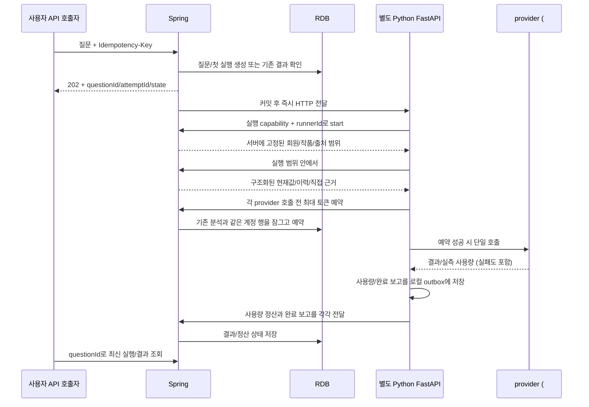
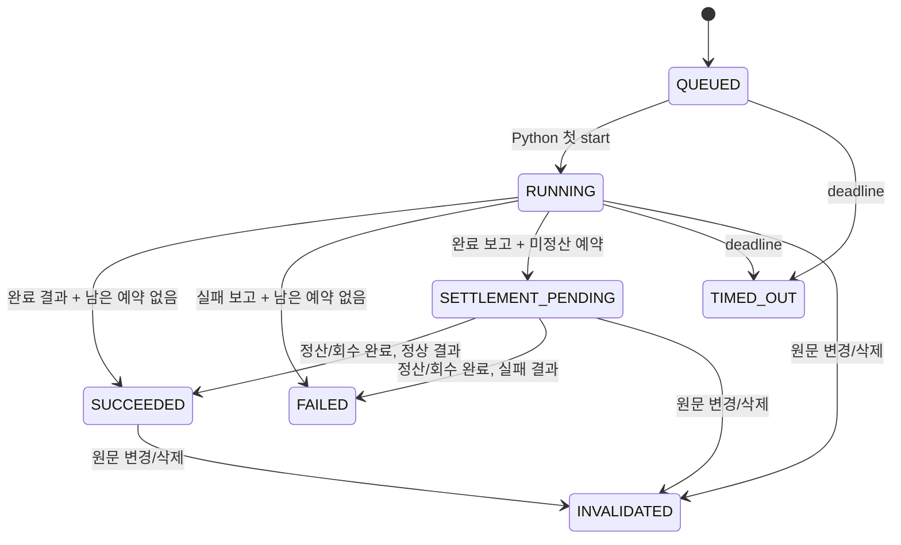

# 채팅 실행 계약 v1 — #237

## 범위와 현재 상태

Spring은 질문·인증 범위·실행 상태·저장 답변·토큰 계정을 소유하고, Python은 별도 FastAPI 프로세스로 단일 실행을 처리한다. 기존 분석/해소 Worker의 claim loop나 AnalysisJob lease는 사용하지 않는다. 같은 AI 저장소/이미지에 실행 진입점을 추가했으며 기존 Worker replica 수를 변경하지 않는다.

실제 자연어 해석·도구 선택·답변 연결은 **#238**의 [RDB 질의응답 계약](chat-qa-v1.md)에 정의한다. `CHAT_QA_ENABLED=false`인 기본 구성에서는 아래 비활성 handler를 유지한다. 운영 기본 handler는 `HANDLER_UNAVAILABLE`로 종료하며 provider를 호출하지 않는다. `CHAT_ENABLED=false`가 기본이다. 실제 유료 모델 없는 고정 handler는 `tests/support/chat_stub_server.py`에만 있다. `CHAT_TEST_ONLY=true` 없이 실행할 수 없고 localhost에만 바인딩한다. 아직 운영에 배포하지 않았다.

## 책임과 흐름

일상 실행은 즉시 HTTP 전달이다. Spring의 5초 복구 스케줄은 아직 시작되지 않은 동일 시도 재전달·시간 초과 처리·고아 예약 회수용이다. Python은 시작 소유권을 한 번 획득해야 provider를 호출하므로 다른 프로세스가 같은 시도를 전달받아도 재실행하지 않는다. 사용자 결과 조회 API는 폴링 가능하며 SSE/스트리밍과 대화 UI는 이 범위에 없다.

## 식별자와 인증

| 값 | 범위/역할 |
|---|---|
| Idempotency-Key | 회원 + 작품 안에서 동일 질문 접수 구분. ASCII 영숫자 `._:-`, 1–100자 |
| questionId | 논리적 질문. 명시적 재시도에서도 유지 |
| attemptId | 실행 시도 UUID. 재시도마다 새 값, generation 증가 |
| runnerId | Python 실행 task가 생성. Spring의 첫 start에서 소유권 고정 |
| callId | 실제 provider 호출마다 새 UUID. 재전송할 때 동일 값 |
| capability | 별도 `CHAT_CAPABILITY_SECRET`으로 attemptId/작품을 HMAC 서명. 로그·모델 인자에 넣지 않음 |

회원·작품은 JWT와 서버 조회로 결정한다. 내부 요청은 기존 `X-Internal-Api-Key`와 `X-Chat-Capability`, `X-Chat-Runner`를 함께 검증한다. 모델 인자는 설정 도구의 검색 조건뿐이다. Python이 보내는 임의 memberId/workId로 실행 범위를 바꿀 수 없다. 이전 #236 경로는 기존 내부 호출 호환을 위해 남아 있지만 채팅은 실행 전용 `/tools` 경로를 사용한다.

행 잠금 순서는 새 접수/재시도에서 회원 → 작품, 실행 변경에서 작품 → 사용량 → 계정이다. provider/S3/외부 HTTP를 기다리는 동안 이 실행 변경 트랜잭션을 유지하지 않는다. 도구 호출은 짧은 시작 검증 → 기존 조회 서비스 → 짧은 결과 검증으로 나눈다.

## API

모든 Spring 응답은 기존 CommonResponse로 감싼다. OpenAPI의 `Chat*V1` schema와 양 저장소의 `docs/contracts/chat-execution-v1.json` fixture가 계약이다.

| 경로 | 요청/의미 |
|---|---|
| POST `/api/v1/works/{workId}/chat-questions` | `{question, episodeFrom?, episodeTo?}`, Idempotency-Key. 202 |
| GET `/api/v1/works/{workId}/chat-questions/{questionId}` | 소유자의 최신 시도/결과. 200 |
| POST `…/{questionId}/retry` | `{previousAttemptId}`. FAILED/TIMED_OUT만 새 시도. 202 |
| POST `/api/internal/v1/chat-runs/{id}/start` | 최초 runner 획득. 재전송은 같은 runner에만 허용 |
| GET `…/{id}/context` | 실행 중 문맥 재검증 |
| POST `…/{id}/tools` | #236 SettingToolQuery |
| POST `…/{id}/calls` | `{callId,purpose,model,reservedTokens}` |
| POST `…/{id}/calls/{callId}` | `{kind,inputTokens?,cachedInputTokens?,outputTokens?,outcome?}` |
| POST `…/{id}/finish` | `{result?,failure?}` 중 정확히 하나 |
| POST `/api/internal/v1/chat-runs/operations/{id}` | 운영 전용 `{workId,actor,policy,tokenBudget}`, 같은 id는 같은 입력만 허용 |
| Python POST `/internal/v1/chat-executions` | Spring Dispatch만 수신. 202 또는 포화 429 |
| Python GET `/healthz` | ready/draining, 비밀값·실행 정보 없음 |
| Python GET `/metrics` | 내부 API key 필요 |

오류: 입력 400, 인증 401, 실행 범위 403, 접근 가능한 대상 없음 404, 입력/상태 충돌 409, 계정 잔액 부족은 기존 AI_TOKEN_QUOTA_EXHAUSTED 409, 실행 한도 429, 기능 비활성 503, 본문 상한 413. 외부 provider 오류 원문을 전달하지 않는다. 실행 제한은 HTTP 429 + `CHAT_LIMIT_EXCEEDED` 코드로 `EXECUTION_LIMIT_EXCEEDED`를 보고한다. 계정 잔액 부족은 `AI_TOKEN_QUOTA_EXHAUSTED` 코드일 때만 `QUOTA_EXHAUSTED`로 보고하며 알 수 없는 429를 잔액 부족으로 추정하지 않는다. 실패 enum은 `PROVIDER_FAILURE`, `NETWORK_FAILURE`, `QUOTA_EXHAUSTED`, `EXECUTION_LIMIT_EXCEEDED`, `HANDLER_UNAVAILABLE`, `INTERRUPTED`다. 시간 초과·삭제는 실행 상태로 별도 구분한다.

## 상태와 재시도

모든 상태는 작품/원문 파기 때 INVALIDATED가 될 수 있다. 명시적 retry는 기존 실행을 덮어쓰지 않고 새 QUEUED 행을 만든다. 같은 previousAttemptId 재전송은 이미 만들어진 현재 시도를 돌려준다. 같은 접수 key에 질문이나 회차 필터가 바뀌면 409다. 질문 문자열은 임의 정규화하지 않는다.

정상 완료는 ANSWER/CLARIFICATION/INSUFFICIENT_EVIDENCE다. 답변 내용과 정산 상태는 별개이므로 `SETTLEMENT_PENDING`에도 저장된 결과가 있다. `usageUnknown`은 정산을 확인하지 못한 호출이 있음을 뜻하며 0토큰 확정이 아니다. 오래된 세대·잘못된 runner·deadline 이후 결과는 새 결과를 덮어쓸 수 없다.

## 비용과 실패 복구

기존 `ai_token_accounts`와 `ai_token_usages`를 재사용한다. usage 행은 analysis_job_id 또는 chat_run_id 중 정확히 하나를 가진다. 분석 합산은 기존 analysis_job_id 조건을 유지한다. 신규 목적을 기존 분석 예약 API에 제출하는 것은 거절한다.

- `Execution.call()`은 호출 전 최대량을 예약한다. 허용 목적은 CHAT_INTERPRETATION/CHAT_ANSWER/CHAT_QUERY_EMBEDDING이다. provider adapter는 SDK 자동 재시도를 끄고 **실제 호출마다** 이 경계를 사용해야 한다. 기존 TextGenerationClient/EmbeddingApi를 연결하는 `ChatTextClient`/`ChatEmbeddingClient`가 예약 추정과 성공·truncation·실패의 usage 추출을 재사용한다. #238은 실제 client 구성과 질문 흐름을 연결한다.
- 계정 잠금은 분석 예약과 공유한다. 잔액이 부족하면 provider를 호출하지 않는다. 재시도의 이전 사용량은 유지된다.
- `SETTLE`: 실측 input/output과 cached input을 받는다. 차감량은 input+output이며 cached input은 input의 부분집합이다. 내용 없는 실패·truncation도 측정값이 있으면 FAILURE로 정산한다.
- `RELEASE`: provider를 호출하기 전 포기한 경우에만 사용한다. 동일 해제는 멱등이고 이후 정산으로 바꾸지 않는다.
- `UNKNOWN`: 사용량 미확인 보고다. 즉시 0으로 확정하거나 예약을 풀지 않는다. deadline 뒤 기본 10분까지 보고를 기다린다. 이후 예약을 회수하되 UNKNOWN 행과 null 사용량을 보존한다. 그 뒤 24시간까지 확인된 늦은 정산을 받을 수 있다. 늦은 정산은 회수한 예약을 다시 빼지 않고 실제 사용량만 더한다.
- 같은 callId의 owner/purpose/model/reservation 또는 완료 정산값이 달라지면 충돌한다. SETTLED/RELEASED 재전송은 잔액을 다시 바꾸지 않는다.
- 운영 backfill run은 actor/policy/작품/예약 예산을 기록하고 OPERATIONAL_BACKFILL만 허용한다. work의 member_id는 귀속 정보이며 사용자 계정에는 예약·차감을 하지 않는다. 완료된 예약도 run의 누적 예약 예산에 포함하므로 회수/재전송으로 예산을 재사용하지 않는다. 실제 백필 실행·embedding은 #239이며 이 run은 채팅 dispatcher가 자동 전달하지 않는다.

Python outbox는 SQLite 파일과 전용 볼륨을 사용한다. provider 호출 자체를 재생하지 않고 결과·사용량 보고만 재전송한다. 답변과 사용량은 각각 최대 8건을 선택하고, 두 종류가 함께 대기하면 각 2개씩 독립 전송 슬롯을 사용한다(한 종류만 있으면 최대 4개). 종류별로 마지막 시도 순서를 SQLite에 남겨 일시 실패가 같은 종류의 후속 보고도 막지 않게 순환한다. 기존 볼륨에는 시작 시 `last_attempt` 컬럼을 추가하고 미전송 기록을 보존한다. 만료 기록은 매 전달 주기마다 전체 대기열에서 먼저 제거한다. 시작 시 백그라운드 복구를 시작하지만 전체 backlog 처리를 기다린 뒤 요청을 받는 구조는 아니다. 결과는 실행 deadline까지만, 사용량은 deadline+24시간까지만 로컬에 보관한다. 삭제/권한 취소가 확인된 보고는 즉시 지우고 SQLite secure_delete를 사용한다. 네트워크가 끊기면 삭제 사실을 즉시 알 수 없으므로 TTL이 로컬 보관의 최대 시간이다. 원문 전체·질문은 outbox에 저장하지 않는다. 결과 본문과 capability가 있는 민감 볼륨이므로 사설 호스트 권한으로 관리한다.

프로세스가 provider 실행 중 종료되면 자동 재호출하지 않는다. Spring이 deadline에 TIMED_OUT으로 바꾸고 예약을 회수한다. 디스크 오류로 실측 보고 자체를 저장하지 못하면 보고 복구가 불가능할 수 있으므로 UNKNOWN이 남는다. 이를 성공 정산으로 위장하지 않는다. Python의 report_storage_failure와 Spring의 usageUnknown을 운영에서 확인한다.

## 근거와 삭제

#236의 source Reference를 최종 결과에 유지한다. 현재 값 탐색에서 받은 참조만으로 인용을 승인하지 않고, 해당 실행이 직접 근거 도구에서 AVAILABLE을 확인한 참조만 최종 sources에 저장할 수 있다. 의미적으로 답변을 지지하는지 판단하는 것은 #238/#240 영역이다.

출처 범위는 history/evidence 조회에 서버가 적용한다. 모델이 더 넓은 범위를 요구하면 거절하며 생략하면 실행 범위를 채운다. 현재 값/대상 탐색은 현재 상태를 조회한다. 특정 회차의 전체 세계 상태를 복원한 것으로 답변하면 안 된다.

원문 삭제·교체·직접 수정 이벤트와 같은 트랜잭션에서 **해당 작품의 모든 채팅 결과/질문 본문/근거 receipt**를 무효화한다. 개별 참조 정밀 추적보다 보수적인 첫 구현이다. 완료 이후 source가 바뀌어도 답변 본문이 남지 않는다. 작품 PURGING 진입 시 예약을 회수하고, 최종 파기에서 질문·실행·usage 행을 지운다. 탈퇴는 기존 작품 파기 경로를 따른다. 후속 #241이 별도 대화 테이블로 답변을 복사하면 동일 무효화/파기 계약을 연결해야 한다.

## 상한과 설정

| 설정 | 기본값 | 목적 |
|---|---:|---|
| CHAT_ENABLED | false | 새 사용자 접수와 전송 활성화 |
| CHAT_PYTHON_URL | 없음 | 별도 FastAPI 사설 주소 |
| CHAT_CAPABILITY_SECRET | 없음 | 내부 API key와 다른 32자 이상 secret |
| CHAT_MAX_BODY_BYTES (Spring) | 131072 | 본문 상한, 512–131072바이트 |
| CHAT_DISPATCH_THREADS / CHAT_DISPATCH_QUEUE_CAPACITY | 2 / 32 | 즉시 HTTP 전송 동시성·대기열 |
| CHAT_MAX_QUESTION_CHARACTERS | 4000 | 질문 상한 (최대 4000) |
| CHAT_MAX_ACTIVE_PER_MEMBER | 3 | 사용자별 대기/실행/정산 대기 합계 |
| CHAT_MAX_CALLS | 8 | 실행별 provider 호출 수 |
| CHAT_MAX_TOOL_CALLS | 20 | 실행별 조회 수 |
| CHAT_ATTEMPT_TOKEN_BUDGET | 208000 | 실행별 누적 예약 상한; 실제 차감은 provider 측정량 정산 |
| CHAT_EXECUTION_TIMEOUT | 120s | 대기 시간을 포함한 시도 deadline |
| CHAT_USAGE_GRACE | 10m | 미정산 예약 보류 시간 |
| CHAT_RECOVERY_DELAY_MS | 5000 | Spring 복구 간격 |
| SPRING_INTERNAL_API_BASE_URL / SPRING_INTERNAL_API_KEY | 필수 | Python의 기존 Worker와 같은 Spring 내부 연결 설정 |
| CHAT_CAPACITY | 4 | Python 프로세스 동시 실행 수 |
| CHAT_OUTBOX_PATH | /tmp/catchhole-chat/outbox.sqlite3 | 개발 기본 경로; 운영은 전용 볼륨 필수 |
| CHAT_SHUTDOWN_GRACE | 15 | Python 정상 종료 대기 초 |

Spring HTTP 전송 기본값은 2 thread + 32 queue이며 DB에 접수된 실행이 재전달 가능하다. Python은 로컬 대기열 없이 포화 시 429를 반환한다. DB 접수량은 사용자별 3개 제한이며 전역 사용자 접수 rate limiter는 추가하지 않았다. HTTP 본문은 Spring 채팅 경로 128KiB, Python dispatch 4KiB다. 결과 본문 16000자, 인용 참조 50개, 한계 설명 20개다.

## 배포·롤백

1. Spring V75 migration과 API부터 배포한다. CHAT_ENABLED는 false로 유지한다.
2. AI #236 선행 PR을 먼저 병합하고 이 HTTP runtime 이미지/독립 Compose를 준비한다.
3. #238 실제 handler와 제공된 provider adapter를 연결하고 평가한 뒤 운영 활성화한다. 지금 이미지는 기본 handler가 비활성 실패를 반환하므로 사용자에게 열지 않는다.
4. `deploy/compose.chatbot.prod.yml`을 명시적으로 실행한다. 기존 Worker Compose에 자동 합치지 않는다. 사설 IP:8082를 Spring 보안그룹에서만 허용하고, metrics도 내부 key로 수집한다. 기본 localhost bind를 인터넷 공개 주소로 바꾸지 않는다.
5. 같은 EC2에 배치할 수 있으나 CPU 0.5/메모리 512MiB/동시성 4는 출발값이다. 기존 5+2 Worker의 처리량·메모리와 함께 부하를 확인한 뒤 조정한다. 새 EC2 생성·운영 SG 변경·실배포는 수행하지 않았다.
6. 롤백은 먼저 CHAT_ENABLED=false로 새 접수를 막고 진행 중 실행/보고를 drain한다. 복구 스케줄은 feature flag와 독립이므로 예약 정리가 계속된다. capability secret과 outbox 볼륨은 유지한다. 미정산 실행이 있는 동안 V75 이전 Spring 이미지로 되돌리면 복구가 멈추므로 현재 Spring을 유지하고 Python 이미지만 되돌린다. DB를 down migration하거나 outbox 볼륨을 삭제하지 않는다.

지표: Python chat_execution_seconds/chat_active/chat_executions_total/chat_pending_reports, Spring chat.dispatch/chat.recovery/chat.execution.count/chat.usage.count. Spring DB 집계는 15초 캐시이며 chat.snapshot.last.success.seconds가 오래되면 집계값을 최신 상태로 해석하지 않는다. HTTP 상태/지연은 기존 Actuator를 사용한다. label은 고정 결과 분류만 사용하며 회원·작품·실행 ID, 질문·원문·답변·secret을 넣지 않는다.

## 검증과 후속 연결

- Java: 공개/내부 인증, 동시 같은 키, 입력 충돌, 중복 완료/정산, 다른 runner/attempt, quota, UNKNOWN→늦은 정산, 이전 세대 차단, source/작품 파기, 운영 비과금, 분석+채팅 동시 계정 예약.
- Python: 중복 전달, 재시작 후 outbox 복구, quota 전 호출 차단, 알려진/누락된 사용량 실패, shutdown/cancellation, timeout, source 삭제 후 로컬 제거, 안전한 검증 오류, 정산 장애와 답변 보고 분리.
- Java/Python versioned fixture + PostgreSQL 전체 Flyway/JPA validate. `ChatHttpEndToEndTest`는 GH237_AI_CHECKOUT에 AI checkout 절대 경로를 주어 실제 두 HTTP 프로세스를 테스트한다. 유료 API 호출은 없다.
- 기존 analysis/comparison 전체 테스트는 함께 실행한다. 빌드한 이미지에서 uid 10001/전용 outbox 볼륨/HTTP health·metrics 인증/빈 작업 응답을 받는 기존 Worker의 동시 프로세스 실행·정상 종료를 확인했다. 운영 Worker와 챗봇의 동시 부하 수치는 측정하지 않았으므로 이 결과를 처리량 보장으로 해석하지 않는다.

다음 #238은 `Execution`이 제공하는 context/tools()/call() 경계 안에 자연어 해석 → 허용 도구 선택 → 제한된 재조회 → 답변/추가 질문/근거 부족 판단을 구현한다. 그 다음 #239 embedding readiness와 운영 백필, #240 RDB+직접 근거+semantic retrieval, #241 대화/UI/문맥·파기 연계, #242 평가·비용·베타가 남는다.

### 2026-10-12 로컬 검증 기록

- Java 전체 `./gradlew test bootJar`: 1,621 통과, 91 skip. Docker/외부 통합 조건이 없는 기본 실행이다.
- 별도 Docker 환경에서 채팅 계약 29개 전부 통과: H2 13, PostgreSQL 전체 Flyway+JPA validate 14, 공통 fixture 1, 실제 Spring↔FastAPI HTTP 왕복 1.
- Python 전체 pytest: 2,169 통과, 14 skip. 신규 실행 테스트 21개 포함. 기존 FastAPI TestClient deprecation warning 1건.
- 변경 Python 파일 Ruff 검사, Compose config 검사, AI Docker 이미지 빌드 통과.
- 네트워크를 차단한 테스트 컨테이너에서 FastAPI health/metrics 인증, non-root outbox 파일 소유권, 기존 Worker 동시 기동 중 health 16회, 두 프로세스 정상 종료 확인. 테스트 컨테이너와 테스트 볼륨 정리 완료.
- 실제 provider 호출, 운영 배포, 기존 5+2 Worker 처리량 측정은 하지 않았다.

### 2026-10-12 PR 리뷰 보완 검증

- outbox 종류별 전송 슬롯·영속 재시도 순서·기존 SQLite 파일 업그레이드·대기열 전체 만료 제거를 추가했다. 16/32건의 정산 장애, 응답 대기, 재시작 이후 같은 종류 후속 보고의 전달을 회귀 검증했다.
- 실행 한도 실패를 `EXECUTION_LIMIT_EXCEEDED`로 분리했다. 실제 Spring의 잔액 부족 409와 실행 제한 429 코드, 내부 finish 저장·공개 재조회, Python의 로컬 호출 제한과 HTTP 오류 분류를 검증했다.
- Java 전체 `test bootJar --rerun-tasks`를 Docker 및 `GH237_AI_CHECKOUT`이 있는 환경에서 실행: 1,690 통과, 24 skip. 기존 migration 테스트 2개와 채팅 계약 31개(H2 14, PostgreSQL 15, 공통 fixture 1, 실제 HTTP 왕복 1)가 모두 실행·통과했다.
- Python 전체 pytest: 2,180 통과, 14 skip. 실행 테스트 32개와 변경 파일 Ruff 통과. 기존 FastAPI TestClient deprecation warning 1건.
