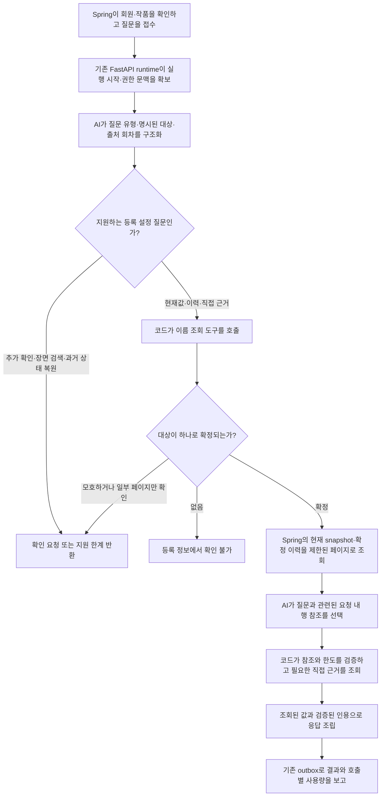

# RDB 기반 단일 질의응답 v1 — GH238

관련 이슈: [#238](https://github.com/catchhole-soma/catchhole-backend-java/issues/238).
선행 계약: [조회 도구](setting-tools-v1.md), [실행·인증·계량](chat-execution-v1.md).
이 문서는 Java/Python 저장소에 같은 내용으로 보관한다.

## OPT-31 후속 대화·조회 계약

[#247 OPT-31](https://github.com/catchhole-soma/catchhole-backend-java/issues/247) 진단 뒤 추가한 보완이다. 현재 QA 계획은 `chat-qa-plan-v7`, 결합 계획/원문 답변은 v8/v9이며 FIELD select v1·구형 행 select v3·등록 설명/현재 조건/이력 조건 v2는 유지한다. 후속 실제 모델 검증은 [최종 코드·결과별 기록](chat-query-quality-v1.md#opt-31-후속-구현-검증--2026-10-15)에 구분한다. 아래 이전 검증 수치를 이번 변경의 결과로 재사용하지 않는다.

- `GREETING`·`THANKS`·`HELP`는 작품 사실 질문이 없는 인사·감사·이 챗봇의 사용법을 planner가 구분한 경우다. 조회 필드를 비운 계획만 허용하고 고정 존댓말을 기존 `ANSWER`/빈 sources로 반환한다. 해석 호출은 계량하고 추가 조회나 답변 모델을 호출하지 않는다. 인사 문자열을 코드로 선별하지 않으며 사실 질문이 섞이면 일반 조회를 계획한다.
- 대화 생략 정보는 내부 모델에 유지한다. 공개 `CONVERSATION_LIMIT`는 `CLARIFICATION`에서만 보여 주고 정상 답변·등록 정보 부족 결과에 무관한 경고로 붙이지 않는다. 실제 부분 조회·원문/저장소 오류와 값 절단 안내는 유지한다.
- 세계관은 전체 이름과 지정 분류의 완전한 빈 조회에 한해서만 공백으로 분리된 분류 표시어를 이름 끝에서 한 번 제거해 같은 분류로 재조회한다. 기존 전체 이름 후보, 모호성·불완전한 페이지·오류를 우회하거나 임의 별칭을 생성하지 않는다.
- 등록 대상·관련 FIELD·관련 값/행의 부족은 조회 지점에서 typed gap으로 남긴다. RDB 전용 handler는 확인하지 못한 범위를 답하며 작품 전체 부재를 단정하지 않는다. hybrid가 활성화되면 `sourceFallback=true`와 정상 `INSUFFICIENT_EVIDENCE`, 명시한 대상, 완전한 조회 및 남은 실행 예산을 함께 확인해 기존 원문 흐름을 재사용할 수 있다. 정상 현재값/명시적 부정 답변, collection/characterFilter·COUNT/DISTINCT, 명확화·부분/절단·자료 변경/원문 오류·실행 실패는 자동 보완 대상이 아니다. 상세 조건과 원문 인용 재검증은 [결합 조회](chat-hybrid-retrieval-v1.md#opt-31-후속-대화원문-보완)를 따른다.
- 검증 재시도는 schema 필드 경로와 고정 규칙으로 요청 부분·정보 필요·사건 문맥을 교정하도록 안내한다. 형식·계약·JSON 오류와 provider 출력 절단을 구분하고 실제 질문·모델 출력·거절값·임의 예외 본문을 피드백이나 로그에 복사하지 않는다. 최초 포함 두 번과 기존 예약·정산 경계를 유지하며 검증 완화나 무한 재시도를 하지 않는다.

hybrid 계획 v8은 최초 습득 항목을 HISTORY와 원문 PROCESS로 확인하고 현재 보유 목록의 CURRENT와 구분하도록 지시한다. 최초 등록·사용 기록을 실제 최초 획득이라고 단정하지 않는다. 일반 원문 경로는 직접 근거 조회에서 `3 * max_rounds + 2`와 collection 검사 수만큼 도구 여유를 남긴다. 기본 검색 두 라운드의 8회분은 검색·최종 검사 여유이며 기존 전체 상한을 늘리는 설정은 아니다. 후속 실제 검증에서는 두 검색 라운드까지 진행했지만 실제 최초를 입증하지 못해 미확인으로 남았다.

원문 결합의 초기 답변 v8 뒤 현재 v9은 일반 claim의 `relatedFacets`로 관련 맥락과 요구 충족을 분리한다. related만 확인한 요구는 missingFacets에 남고 PARTIAL로 표시하며 실제 지원 구절과 최종 인용 검사를 계속 적용한다. 원문 답변의 schema/계약 복구 소진(`ResponseValidationFailure`)은 미검증 문장을 버리고 남은 검색·기존 검증된 부분 답변으로 이어 갈 수 있다. 전송·provider·출력 절단 복구·권한 실패를 정상 미확인으로 바꾸지 않으며 RDB 전용/계획 호출부의 기존 실패 경계는 유지한다. 후속 실제 검증은 `77dc74e1df125dfec34fe609481d5881fbe45b57`의 Luna/medium 6건으로, SUCCEEDED 6건·ANSWER 4건/INSUFFICIENT_EVIDENCE 2건이다. 관련 원문 맥락의 ANSWER는 PARTIAL이며 정답률이 아니다. 중간 `d1c8f6865e255a7a785c4020e3b0bfcede7b8a13`의 4건 중 성공 3건·실패 1건은 별도 보존한다. 최종 `265fc683d0f6d026c5ce860c9bb90afe06d24d83`는 모델 호출 없는 안내 표현 보완만 추가했고 Python 2,853 passed/54 skipped/기존 warning 1(11.99초), Ruff를 통과했다. 실제 호출량·확인 범위·남은 최초 입증 한계는 [공통 검증 기록](chat-query-quality-v1.md#opt-31-후속-구현-검증--2026-10-15)을 따른다.

실제 후속 6건에서는 관련 맥락 경로를 확인했으나 자연 발생한 모델 응답 검증 실패는 없었다. typed 검증 실패의 NONE 복구·기존 PARTIAL 보존은 합성 회귀로 검증했다. 최종 265fc68의 표시 변경은 전체 자동 테스트와 로컬 기동으로 확인했고 실제 모델 6건은 동일한 프롬프트·검색·검증 경로의 77dc74e에서 실행했다.

## 2026-10-15 조회 보완

현재 구현은 [조회 완전성·답변 표시 보완](chat-query-quality-v1.md)을 함께 따른다. 유형/실제 항목 필터를 먼저 적용하며, 새 focus 계획에는 아래 초기 2페이지/10행 선택 상한을 적용하지 않는다. 후속 대화는 [GH241 계약](chat-sessions-v1.md), 장면·이유·과정은 [GH240 결합 조회](chat-hybrid-retrieval-v1.md)를 따른다.

이름을 지정한 세계관 대상도 `QuestionSubject.worldCategory`로 종류를 함께 전달한다. RDB와 원문 결합 경로는 `qa_lookup.py`의 `resolve_subject()`를 공유하며, 종류를 지정한 경우 `FIND_WORLD_SETTINGS(query, worldCategory)`로 먼저 후보를 좁힌다. CHARACTER의 worldCategory는 null만 허용한다. 분류는 대상 자체의 종류이고 임의 저장 경로나 권한 범위가 아니다. 같은 이름도 명시한 분류가 다르면 별개 대상으로 다루고, 같은 분류에서 후보가 여럿이거나 조회가 불완전하면 여전히 추가 확인을 요청한다. 응답 분류가 요청 필터와 다르면 계약 오류이며, 결과가 없다고 분류를 제거해 다른 대상을 대신 조회하지 않는다.

직전 명확화에 이름·종류를 보충한 답변은 원래 요청과 함께 해석하고 DB를 다시 조회하도록 계획 프롬프트에 지시한다. 최신 정정·새 주제가 우선이며 과거 답변의 값은 사실 근거로 사용하지 않는다. 보충 질문을 올바르게 연결하는 모델의 의미 품질은 실제 질문으로 별도 검증해야 한다. 조건 목록은 확인된 MATCH를 먼저 보여주고 UNKNOWN은 개수로 요약한다. 일부 자료가 부족해 일치 대상을 확인하지 못한 경우와 전체 등록 모집단을 확인한 뒤 일치 대상이 없는 경우를 구분한다.

말투 변경 이전 조회·검색 보완의 검증은 AI `257dfe6cb56cf759047f5e62c0d079ff0d4a64e7`·Java `1166892aa300a8c27c46b40f227df6e69ec3ebcd` 기준이다. Python 전체 2,780 passed/54 skipped/기존 경고 1개(11.50초), 별도 검색 PostgreSQL 26 passed, Java ChatExecution 관련 21 passed와 bootJar 성공을 확인했다. 로컬 실제 Luna·medium은 개발 중 8건·중간 코드 2건·최종 코드 3건에서 실행 오류가 없었지만, 일부 원문 요구는 당시 최종 코드에서도 미답변으로 남았다. 실행 성공을 의미적 정답으로 집계하지 않는다. 코드별 실제 실행과 원문 대조 범위·남은 최초 사건 해석 한계는 [공통 품질 검증 기록](chat-query-quality-v1.md)에 구분한다.

후속 말투 보완은 `qa_prompts.py`의 `ANSWER_STYLE_INSTRUCTIONS`를 등록 설명과 현재/이력 조건 판정에 공통 적용한다. 새 설명과 목록의 `explanation`은 존댓말(`~습니다`·`~요`)로 작성하며, 사용자·이전 대화의 반말이나 원문 서술체를 따라 쓰지 않는다. 실제 고유명사·저장값·정확한 인용은 보존한다. `chat-registered-answer-v2`, `chat-current-condition-v2`, `chat-history-condition-v2`를 각각 prompt cache key로 사용한다. 말투 보완 당시 QA plan v6·FIELD select v1·구형 행 select v3는 유지했으며, 이후 OPT-31의 현재 QA 계획은 v7이다. 명확화는 기존 고정 존댓말이며 응답 전체를 정규식으로 변환하거나 추가 모델을 호출하지 않는다. 이력/FACTS에 그대로 표시하는 저장 문장은 원래 말투를 유지할 수 있다. 위 13건은 이 변경의 실제 말투 검증 기록이 아니다.

## 초기 GH238의 구현 배경

GH236은 8개 읽기 전용 조회 도구, GH237은 질문 접수·실행·정산·복구 기반이다.
GH238은 그 위에 질문 분류 → 대상 찾기 → 등록 설정/이력 조회 → 관련 행 선택 → 직접 근거 조회 → 응답을 연결한다.
Java의 현재값 계산·조회 API·실행 DTO·DB schema는 바꾸지 않는다. Java 변경은 실제 HTTP 통합 테스트와 문서다.

Python의 `CHAT_QA_ENABLED=true`일 때 새 `ChatQaHandler`를 사용한다. 기본값은 false다.
Spring의 `CHAT_ENABLED`와 독립적인 활성화 설정이며, 설정 파일 추가를 운영 배포나 활성화 완료로 해석하지 않는다.



## 질문 유형과 조회 도구는 다르다

AI는 SQL이나 자유로운 도구 호출을 작성하지 않는다. 현재 `QuestionPlan`은 아래 12개 intent와 focus/characterFilter를 반환한다.
유형이 정해진 조회는 분류 1회 뒤 관련 행을 모두 조립한다. 동적 경로는 실제 FIELD의 의미 선택 호출이 추가될 수 있다. 구형 기록 계획의 관련 행 선택만 기존 `CHAT_ANSWER` 호출을 유지한다.
미지원·모호성·대상 없음이면 분류 또는 탐색 후 종료한다.

| intent | 의미 | 이후 처리 |
| --- | --- | --- |
| GREETING / THANKS / HELP | 인사 / 감사 / 이 챗봇의 사용법만 요청 | 조회 없이 고정 존댓말 ANSWER; 사실 질문이 함께 있으면 일반 조회 |
| CHARACTER_LIST | 한 현재값 조건에 맞는 인물 목록 | 작품 FIELD → 정확 조건 FIND_CHARACTERS |
| CURRENT | 현재 등록값 | FIND → CURRENT → 필요 시 EVIDENCE |
| HISTORY | 확정된 변경 이력 | FIND → HISTORY → 필요 시 EVIDENCE |
| CURRENT_AND_HISTORY | 현재값과 이력 모두 | FIND → CURRENT + HISTORY → 필요 시 EVIDENCE |
| DIRECT_EVIDENCE | 현재 등록 설정의 원문 인용 | FIND → CURRENT → EVIDENCE; 인용이 하나도 없으면 INSUFFICIENT_EVIDENCE |
| NEEDS_SEARCH | 장면·이유·줄거리 | 조회 없이 INSUFFICIENT_EVIDENCE, `SEMANTIC_SEARCH_REQUIRED` 연결 지점 |
| PAST_STATE | 특정 회차 당시 상태 복원 | 조회 없이 INSUFFICIENT_EVIDENCE |
| CLARIFICATION | 대상 누락·대명사·범위 불명확 | 조회 없이 CLARIFICATION |
| UNSUPPORTED | 쓰기·권한 밖 요청 등 | 조회 없이 INSUFFICIENT_EVIDENCE |

FIND/CURRENT/HISTORY/EVIDENCE는 각각 CHARACTER 또는 WORLD 도구로 연결된다.
`FIND_WORLD_SETTINGS`만 탐색 이름이 다르며, 나머지는 `WORLD_CURRENT/HISTORY/EVIDENCE`다.
최대 3개 명시된 대상을 지원한다. 다른 대상이 섞인 복잡한 의도, 대명사, 별칭 해소는 확정하지 않는다.

### 대상과 설정 경로를 선택하는 방법

1. 모델에는 회원·작품·실행 ID, 인증값, SQL, URL, 대상 UUID 입력 필드가 없다.
2. 현재 질문 또는 명확히 연결된 최근 대화에 등장한 이름으로 FIND를 호출한다. 세계관 대상의 명시적 worldCategory는 같은 조회에 전달하며 이름 조회는 서버의 부분 일치다.
3. 후보가 여러 개면 첫 번째나 정확히 일치하는 하나를 임의 선택하지 않는다. 일부 페이지만 읽었다면 후보가 하나여도 확정하지 않는다.
4. `focus.factType`으로 유형 전체를 먼저 필터한다. 특정 속성은 값 없는 FIELD 목록을 확인한 뒤 실제 F 참조를 선택해 저장 key/scope로 복원한다. 모델이 key/scope를 생성하지 않는다.
5. 필터한 현재값/이력을 전역 도구 예산 안에서 끝까지 읽는다. 동적 경로의 모호성·목록 불완전성은 추가 확인으로 끝낸다.
6. 새 focus 경로는 관련 행 전체를 조립한다. focus가 없던 구형 기록 계획만 `AnswerSelection`의 R 참조 선택과 기존 행/페이지 상한을 사용한다.

이름은 현재 질문 또는 서버가 선별한 최근 대화에서 관측된 문자열이어야 한다. 동일 이름의 복수 인물은 계속 추가 확인 대상이다. 정확한 전체 흐름과 한도는 [보완 계약](chat-query-quality-v1.md)을 따른다.

## 초기 GH238 요청 예시 (이력 보존)

아래는 focus 도입 전 계약 예시다. 새 계획/조회 순서와 현재 답변 형식은 [보완 계약](chat-query-quality-v1.md#분류와-조회-예시)을 따른다.

아래 값은 검증용 합성 작품의 예다. 실제 사용자 작품이나 실측 모델 예측이 아니다.

### 1. “아리아의 현재 능력과 직접 근거를 알려줘”

분류:

```json
{"intent":"CURRENT","subjects":[{"domain":"CHARACTER","name":"아리아"}],"includeEvidence":true,"episodeFrom":null,"episodeTo":null}
```

모든 조회는 기존 `POST /api/internal/v1/chat-runs/{attemptId}/tools`로 나간다.
내부 key·capability·runner는 실행이 보유하고, 회원·작품은 Spring 실행 기록에서 결정한다.

```json
{"tool":"FIND_CHARACTERS","query":"아리아","page":0,"size":20}
{"tool":"CHARACTER_CURRENT","targetId":"<FIND가 반환한 인물 UUID>","page":0,"size":20}
{"tool":"CHARACTER_EVIDENCE","targetId":"<선택한 현재 항목에 연결된 Fact UUID>","page":0,"size":20}
```

첫 조회의 실제 JPQL 조건은 `c.work.id = :workId and c.status = 'ACTIVE'`이며,
이름이 있으면 `lower(c.name) like :query escape '!'`가 추가된다. 문자열은 바인딩 변수이고 `%/_/!`는 문자로 이스케이프된다.
CURRENT는 `CharacterSnapshotAccessor`로 현재 snapshot을 읽고 `CharacterSnapshotSource`의 연결을 조회한다. 최신 Fact를 현재값으로 바꾸지 않는다.

현재 항목이 `R1=SKILL/화염 마법/화염구`, `R2=STAT/마력/30`이면 선택 응답은 `{"outcome":"ANSWER","rowRefs":["R1"]}`다.
코드가 R1의 source 참조를 실제 Fact UUID로 해석해 EVIDENCE를 호출한다.
Spring이 원문·hash·인용을 확인하고 AVAILABLE을 반환한 경우에만 다음처럼 조립한다.

```text
조회한 등록 정보입니다.
- 아리아 · 화염 마법 (현재 등록값): 화염구
  [1] 출처 2화: "아리아는 화염구를 사용할 수 있다."
```

`sources[0]`에는 실제로 인용한 CHARACTER_EVIDENCE 참조만 담긴다. 일반 CURRENT 질문은 원문을 요청하지 않아도 등록값으로 답할 수 있다.

### 2. “아리아의 1~3화에 기록된 마력 변경 이력을 알려줘”

`HISTORY` + `episodeFrom=1/episodeTo=3` → FIND_CHARACTERS → CHARACTER_HISTORY다.
Fact 조회는 작품·활성 인물·확정 후보 조건에 targetId와 **출처 번호 범위**를 바인딩한다.
범위 계산은 `coalesce(aj.sourceEpisodeNo, fj.sourceEpisodeNo, e.episodeNo, ce.episodeNo)`다.
출처 순서 → 생성 시각 → ID 순서를 유지하며 답변도 서버 순서를 따른다.

예시 기록은 1화 10, 2화 30, 3화에 늦게 등록된 과거 기록 5다. 마지막 값이 5라는 이유로 현재 마력을 5라고 하지 않는다.
현재 마력 질문은 별도로 CURRENT를 읽어 30을 반환한다. 이력 답변은 처리 종류·현재 기여 여부·과거 기록 전용 여부를 표시한다.

### 3. “화염술의 상위 주문이 소모하는 마력과 근거는?”

`CURRENT`, domain=WORLD, name=화염술 → FIND_WORLD_SETTINGS → WORLD_CURRENT.
WORLD_CURRENT는 세계관의 실제 properties/version에서 `일반 마법 / 소모 마력 = 10`, `고급 마법 / 소모 마력 = 30`을 서로 다른 행으로 반환한다.
AI가 고급 마법 행을 선택하면 그 행의 source만 WORLD_EVIDENCE로 조회한다.
**‘상위 주문’ 문자열을 SQL scope 조건으로 보내지 않는다.** 경로를 의미상 연결하는 부분은 모델 품질 평가가 필요한 판단이다.

### 나머지 대표 경우

| 질문/조건 | 분류·분기 | 결과 |
| --- | --- | --- |
| 현재 마력과 변경 기록 비교 | CURRENT_AND_HISTORY; CURRENT와 HISTORY 별도 조회 | 현재값/과거값을 구분 표시 |
| 화염술의 소모 마력 — 어떤 범위인지 불명확 | 관련 행 선택 단계 CLARIFICATION | 일반/고급 경로 임의 통합 금지 |
| 같은 이름 아리아 2명 | FIND에서 CLARIFICATION | 설정 조회를 진행하지 않음 |
| 엘리오가 등록되지 않음 | FIND 0건 | 등록 정보에서 확인 불가; 작품에 없다고 단정하지 않음 |
| 수동 수정한 고급 마법 비용 35 | CURRENT의 USER_INPUT | 35와 사용자 입력 표시; 옛 30의 원문 인용 없음 |
| 인물 설정 origin=UNKNOWN | CURRENT | 출처 미상 표시; 수동 입력이라고 추정하지 않음 |
| 원문 파기, 현재 능력은 남아 있음 | CURRENT + SOURCE_PURGED | 값은 ANSWER, 인용 없음; 인용만 요구했다면 INSUFFICIENT_EVIDENCE |
| 원문 저장소 장애 | CURRENT + STORAGE_UNAVAILABLE | 등록값과 원문 확인 실패를 구분 |
| “3화 당시 아리아 마력은?” | PAST_STATE | 과거 전체 상태 복원 미지원 |
| “아리아가 왜 탑을 불태웠어?” | NEEDS_SEARCH | 추측하지 않고 의미 검색 후속 연결점 표시 |
| “아리아와 루나의 현재 능력” | 대상 2개, 각 FIND/CURRENT | 주체를 유지해 반환; 단순 산술/우열 추론은 제공하지 않음 |
| 요청 출처 범위 2~5인데 질문은 1~6 | 범위 검증 | CLARIFICATION, 조회 전에 종료 |
| “현재 능력, 근거는 3~5화” | 현재값에는 회차 필터 없음; EVIDENCE만 3~5 | 과거 상태로 둔갑시키지 않음 |
| 질문과 관계없는 등록 항목만 존재 | 선택 단계 INSUFFICIENT_EVIDENCE | 조회한 등록 정보만으로 답하지 못함 |
| 설정값에 “지시 무시·비밀 공개” 포함 | 자료 문자열로 취급 | 도구 권한 변경 없음; 표시 시 Markdown 이스케이프 |

## 근거·실패의 경계

- 모델이 쓴 자유 답변이나 인용문을 사용자에게 그대로 전달하지 않는다. 초기 응답은 관련 등록 행을 추출해 정해진 형식으로 보여준다. 자연스러운 종합 설명·추론은 후속 품질 작업이다.
- 인용은 선택된 행의 source 참조로 조회한 AVAILABLE 근거만 사용한다. `matchesCurrentSource=true`, 인용 존재, 대상/출처 범위를 검사한다.
- 현재값에는 같은 category/scope/key이고 `contributesToCurrent=true`, `historyOnly!=true`인 근거만 붙인다. 역사적 근거가 존재한다는 사실만으로 현재값을 입증하지 않는다.
- 존재·참조 검사와 **질문에 해당하는 행을 올바르게 선택했는지/원문이 의미상 답을 입증하는지**는 다르다. 후자는 모델·자료 품질 검증 대상이다.
- 원문 상태는 기존 9종을 보존하며 표시 가능한 고정 설명으로 바꾼다. 파기/변경/검증 실패한 인용은 재노출하지 않는다.
- `ChatResult`의 ANSWER/CLARIFICATION/INSUFFICIENT_EVIDENCE, text/sources/limitations는 그대로다. intent와 내부 행 참조는 공개 DTO에 추가하지 않는다.
- 도구 HTTP/계약 오류는 NETWORK_FAILURE, 도구·실행 횟수 제한은 EXECUTION_LIMIT_EXCEEDED, 계정 잔액 부족은 QUOTA_EXHAUSTED다. provider/구조 검증 실패는 PROVIDER_FAILURE다. 어느 것도 ‘설정 없음’으로 바꾸지 않는다.
- schema·알 수 없는 참조 재시도는 각각 `Execution.call()`을 다시 통과한다. 자동 HTTP 재시도는 추가하지 않는다. 이미 성공한 호출의 사용량도 기존 outbox가 보고한다.
- 실행 deadline, 삭제 시 무효화, 결과 출처 receipt 검증, 저장·정산 복구는 GH237을 사용한다.

## 설정과 운영 연결

Python 환경변수는 `.env`를 자동으로 읽지 않는다. 챗봇 전용 Compose가 명시적으로 전달한다.
`deploy/chatbot.env.example`에서 시작하며 실제 secret을 커밋하지 않는다.

| 환경변수 | 기본값 | 역할 |
| --- | --- | --- |
| CHAT_QA_ENABLED | false | QA handler 활성화 |
| LLM_API_KEY | 빈 값 | QA 활성화 시 필수; 기존 provider client 사용 |
| CHAT_QA_MODEL / CHAT_QA_REASONING_EFFORT | gpt-6-luna / medium | 챗봇 전용 기본값; 기존 분석 Worker 모델과 독립, 로컬 사례 검증과 정식 품질 평가는 구분 |
| CHAT_QA_MAX_ATTEMPTS | 2 | 단계별 최초 호출과 schema/참조/출력 잘림 복구를 합친 시도 수 |
| CHAT_QA_MAX_OUTPUT_TOKENS | 2000 | CHAT_INTERPRETATION 출력 기본 상한 |
| CHAT_QA_ANSWER_MAX_OUTPUT_TOKENS | 6000 | CHAT_ANSWER 출력 기본 상한 |
| CHAT_QA_TRUNCATION_RETRY_MAX_OUTPUT_TOKENS | 7000 | 출력 절단·schema/근거 복구 때 해당 단계 기본값의 두 배로 재시도할 최대 상한 |
| CHAT_QA_FINALIZATION_RESERVE_SECONDS | 10 | 서버 deadline 안에서 최종 검증·전달에 남길 시간; 모델 대기는 이보다 먼저 취소 |
| CHAT_QA_MAX_INPUT_TOKENS | 32000 | 프롬프트+자료+schema 입력 추정 상한 |
| CHAT_QA_MAX_CONTEXT_CHARACTERS | 32000 | 프롬프트와 자료 문자 상한 |
| CHAT_QA_PAGE_SIZE / CHAT_QA_MAX_PAGES | 20 / 2 | 페이지 크기 / 이름 탐색·구형 계획의 페이지 상한. 새 focus 조회는 전역 예산까지 순회 |
| CHAT_QA_MAX_ITEMS | 80 | 구형 계획의 조회 수집/행 선택 문맥 상한 |
| CHAT_QA_MAX_TOOL_CALLS | 16 | 실행별 조회 상한; Spring 한도와 작은 값 적용 |
| CHAT_QA_MAX_SELECTED_ROWS | 10 | 구형 계획의 LLM 행 선택 상한; 새 focus 결과에 미적용 |
| CHAT_QA_MAX_EVIDENCE_CALLS | 8 | 고유 직접 근거 조회 상한 |
| CHAT_QA_MAX_ANSWER_CHARACTERS | 12000 | 최종 본문 길이 상한 |

페이지·문맥·답변·근거 한도에 도달하면 해당 누락을 알린다. RDB 응답은 limitations를 유지하고, 원문 결합 성공 답변은 검색 범위와 미확인 항목을 본문에 설명한다. 페이지를 다 보지 않았는데 대상을 하나로 확정하지 않는다.
새 focus 경로는 남은 도구 예산을 확인하여 일부 결과를 안내한다. 원문 결합은 최종 재검증에 필요한 예산을 남긴다. 최종 본문에서 행 자체가 생략되면 해당 행의 source도 반환하지 않는다. 원문 전문은 근거 창에서 확인한다.
LLM 요청은 기존 `OpenAIResponsesClient`의 Responses API structured output과 `store=false`를 사용한다.
[공식 structured output schema 제약](https://developers.openai.com/api/docs/guides/structured-outputs#supported-schemas)에 맞춰 모든 모델 출력 필드를 required, 객체를 additionalProperties=false로 제공하고 로컬에서 재검증한다.

### Luna 입력 추정과 실행 예산 (2026-10-15)

현재 tiktoken은 `gpt-6-luna`의 tokenizer를 식별하지 못하므로 기존 UTF-8 byte 보수 상한(+512)을 유지한다. 이를 실제 모델 토큰 수나 tokenizer 이름으로 해석하지 않는다. 8,000 입력 상한에서는 짧은 hybrid 계획의 프롬프트·schema도 초과하므로 입력 추정 상한과 문자 상한을 32,000으로 맞췄다. 현재 기본 해석 출력 2,000·답변 출력 6,000은 별도이며 모델 자체의 context window를 모두 쓰는 설정이 아니다. 출력 잘림 복구는 해석 4,000·답변 7,000까지 허용하되 기본 총 2회 시도 안에서만 수행한다. 실제 사용량은 실패·잘림도 provider 응답으로 정산한다.

Spring의 `CHAT_ATTEMPT_TOKEN_BUDGET=240000`과 함께 적용한다. 보수적으로 텍스트 최대 6회 × (입력 추정 32,000 + 복구 출력 상한 7,000) + 검색 임베딩 1회(최대 1,000 Unicode 문자 × 4 bytes + 256) = 238,256의 **누적 예약**을 수용한다. 실제 모든 호출이 복구 상한을 사용하는 것은 아니다. 모델 호출 횟수·도구 횟수·회원 잔액 검증은 유지한다. 예약 예산 증가는 실제 차감량 증가를 뜻하지 않지만, 보수적 예약 때문에 호출 시작에 필요한 회원 잔액은 실제 사용량보다 클 수 있다.

운영 env가 기존 숫자를 명시하면 코드/Compose 기본값보다 우선한다. 챗봇 모델과 위 QA 값, `CHAT_RETRIEVAL_EVIDENCE_TOKENS=6000`, API 서버의 실행 예산을 함께 확인한다. 정확한 사전 토큰 계산은 [OpenAI input token count API](https://developers.openai.com/api/docs/guides/token-counting)를 통한 후속 최적화 대상이며 이번 변경은 추가 네트워크 호출을 만들지 않는다.

## 재현과 검증의 의미

Python checkout:

```sh
.venv/bin/python -m app.chatbot.replay --fixture tests/fixtures/chat-qa-v1.json
.venv/bin/python -m app.chatbot.replay --fixture tests/fixtures/chat-qa-v1.json --case world_scope
.venv/bin/pytest -q tests/test_chat_qa.py tests/test_chat_execution.py tests/test_setting_tools_client.py
```

재현기는 제품 handler와 실제 Python HTTP client·runtime·outbox를 사용한다. Spring 응답은 MockTransport, 모델 출력은 고정 JSON이다.
실제 API key·DB·외부 네트워크를 사용하지 않고 `.env`도 읽지 않는다. 출력의 usage는 정산 연결을 검사하는 **합성 수치**다.
`--case`는 질문, 실제 전송된 typed query, 결과·근거·제한을 출력한다. 운영 사용자 질문을 이 fixture에 복사하지 않는다.

Java checkout, 설치된 Python 환경과 Docker를 준비한 뒤:

```sh
GH237_AI_CHECKOUT=/absolute/path/to/catchhole-backend-ai \
GH238_AI_CHECKOUT=/absolute/path/to/catchhole-backend-ai \
./gradlew test --tests 'org.monitoring.catchholebackend.domain.chat.*'
```

새 `ChatQaHttpEndToEndTest`는 실제 Spring DB 조회·FastAPI·새 handler·인증·원장·결과 저장을 왕복한다.
모델 응답과 S3 원문 공급만 합성 대역이며, 현재 snapshot/직접 원문 인용 및 세계관 scope/수동 입력을 확인한다.
환경변수가 없으면 이 실제 HTTP 검증은 skip되므로 일반 CI 성공과 구분한다.

검증은 세 종류로 구분한다. 아래 세 번째 항목은 초기 GH238의 검증 범위이며, 이후 로컬 실제 모델 실행은 위 최신 기록을 따른다.

1. 자동 단위/계약/HTTP 테스트: 분기·한도·권한·정산 연결 검증.
2. 이 대화의 Codex 검토: 합성 질문 24개의 의도·항목 선택·기대 근거를 문맥에서 대조. 고정 응답 fixture에 그 판단을 기록.
3. **초기 GH238 당시 실제 배포 모델의 분류/선택 품질·지연·비용: 미측정.** 당시 API key 사용 없이 진행해 달라는 요청에 따라 유료 provider와 judge를 호출하지 않았다. 이 역사 기록을 이후 실제 모델 실행이 없었다는 의미로 재사용하지 않는다.

스크립트 재현 통과율을 배포 모델 정확도라고 보고하지 않는다. 원문 의미 검색(#239/#240), 대화 저장·UI(#241), 확대 평가·운영 부하 확인(#242)은 후속 범위다.

### 2026-10-13 검증 기록

- Python 전체: 2,252 passed / 14 skipped. 기존 FastAPI TestClient deprecation 경고 1건.
- 관련 Python 실행·조회·QA 테스트: 129 passed, 이 중 새 QA 테스트 72개.
- Java 전체 `test bootJar`: 1,692 passed / 24 skipped. GH237 HTTP 1개와 GH238 HTTP 2개 모두 실제 실행해 통과.
- 합성 질문 CLI: 24개 전부 재현. 각 질문의 도구 순서·응답 종류·인용 수·기대 포함/제외 문구 확인.
- Compose: 14개 QA 환경변수의 기본값·기존 환경파일 호환·override 전달, 합성 key 전달 확인. 실제 서비스 기동·배포는 이 검사에 포함하지 않음.
- Ruff 및 `git diff --check` 통과. 실제 배포 모델·유료 judge 평가는 미측정.
