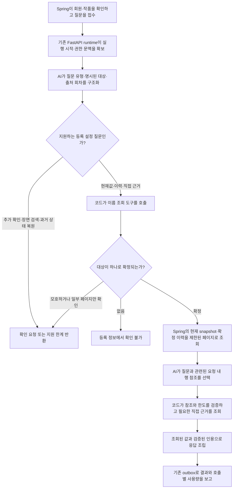

# RDB 기반 단일 질의응답 v1 — GH238

관련 이슈: [#238](https://github.com/catchhole-soma/catchhole-backend-java/issues/238).
선행 계약: [조회 도구](setting-tools-v1.md), [실행·인증·계량](chat-execution-v1.md).
이 문서는 Java/Python 저장소에 같은 내용으로 보관한다.

## 달라진 동작

GH236은 8개 읽기 전용 조회 도구, GH237은 질문 접수·실행·정산·복구 기반이다.
GH238은 그 위에 질문 분류 → 대상 찾기 → 등록 설정/이력 조회 → 관련 행 선택 → 직접 근거 조회 → 응답을 연결한다.
Java의 현재값 계산·조회 API·실행 DTO·DB schema는 바꾸지 않는다. Java 변경은 실제 HTTP 통합 테스트와 문서다.

Python의 `CHAT_QA_ENABLED=true`일 때 새 `ChatQaHandler`를 사용한다. 기본값은 false다.
Spring의 `CHAT_ENABLED`와 독립적인 활성화 설정이며, 설정 파일 추가를 운영 배포나 활성화 완료로 해석하지 않는다.



## 질문 유형과 조회 도구는 다르다

AI는 SQL이나 자유로운 도구 호출을 작성하지 않는다. `QuestionPlan`의 8개 intent를 반환한다.
일반적인 성공 질문은 분류 1회(`CHAT_INTERPRETATION`)와 관련 행 선택 1회(`CHAT_ANSWER`)다.
미지원·모호성·대상 없음이면 분류 후 코드에서 종료한다. 도구 선택을 위한 별도 모델 호출은 없다.

| intent | 의미 | 이후 처리 |
| --- | --- | --- |
| CURRENT | 현재 등록값 | FIND → CURRENT → 필요 시 EVIDENCE |
| HISTORY | 확정된 변경 이력 | FIND → HISTORY → 필요 시 EVIDENCE |
| CURRENT_AND_HISTORY | 현재값과 이력 모두 | FIND → CURRENT + HISTORY → 필요 시 EVIDENCE |
| DIRECT_EVIDENCE | 현재 등록 설정의 원문 인용 | FIND → CURRENT → EVIDENCE; 인용이 하나도 없으면 INSUFFICIENT_EVIDENCE |
| NEEDS_SEARCH | 장면·이유·줄거리 | 조회 없이 INSUFFICIENT_EVIDENCE, `SEMANTIC_SEARCH_REQUIRED` 연결 지점 |
| PAST_STATE | 특정 회차 당시 상태 복원 | 조회 없이 INSUFFICIENT_EVIDENCE |
| CLARIFICATION | 대상 누락·대명사·범위 불명확 | 조회 없이 CLARIFICATION |
| UNSUPPORTED | 쓰기·권한 밖 요청 등 | 조회 없이 INSUFFICIENT_EVIDENCE |

FIND/CURRENT/HISTORY/EVIDENCE는 각각 CHARACTER 또는 WORLD 도구로 연결된다.
`FIND_WORLD_SETTINGS`만 탐색 이름이 다르며, 나머지는 `WORLD_CURRENT/HISTORY/EVIDENCE`다.
최대 3개 명시된 대상을 지원한다. 다른 대상이 섞인 복잡한 의도, 대명사, 별칭 해소는 확정하지 않는다.

### 대상과 설정 경로를 선택하는 방법

1. 모델에는 회원·작품·실행 ID, 인증값, SQL, URL, 대상 UUID 입력 필드가 없다.
2. 질문에 문자 그대로 등장한 이름으로만 FIND를 호출한다. 이름 조회는 서버의 부분 일치다.
3. 후보가 여러 개면 첫 번째나 정확히 일치하는 하나를 임의 선택하지 않는다. 일부 페이지만 읽었다면 후보가 하나여도 확정하지 않는다.
4. 서버가 반환한 대상 UUID로 CURRENT/HISTORY를 조회한다. 모델이 저장 key를 추측해 빈 결과를 만드는 일을 피하기 위해 **초기 버전은 key/scope 필터를 보내지 않고 항목을 제한된 페이지로 읽는다**.
5. 모델에는 DB ID 대신 `R1`, `R2` 같은 요청 내 행 참조와 실제 category/key/표시명/scope/value를 제공한다. 자연어 ‘상위 주문’을 조회된 ‘고급 마법’ 경로와 연결하는 판단은 이 단계다.
6. `AnswerSelection`은 결과 상태와 `rowRefs`만 반환한다. 없는 참조·중복·임의 문장·인용 필드는 거절한다. 값·인용·회원·작품을 생성할 수 없다.

설정이 매우 많으면 bounded page 조회 비용과 일부 항목 누락이 생긴다. 현재 범위는 페이지/문맥 한도를 표시하며, 향후 관측한 정확한 key를 사용하는 재조회나 의미 검색으로 확장할 수 있다.
동일한 이름의 복수 인물은 추가 확인으로 끝낸다. 이 이슈는 다음 메시지에서 UUID 선택을 이어가는 다중 턴 UI를 제공하지 않는다.

## 실제 요청 예시

아래 값은 검증용 합성 작품의 예다. 실제 사용자 작품이나 실측 모델 예측이 아니다.

### 1. “아리아의 현재 능력과 직접 근거를 알려줘”

분류:

```json
{"intent":"CURRENT","subjects":[{"domain":"CHARACTER","name":"아리아"}],"includeEvidence":true,"episodeFrom":null,"episodeTo":null}
```

모든 조회는 기존 `POST /api/internal/v1/chat-runs/{attemptId}/tools`로 나간다.
내부 key·capability·runner는 실행이 보유하고, 회원·작품은 Spring 실행 기록에서 결정한다.

```json
{"tool":"FIND_CHARACTERS","query":"아리아","page":0,"size":20}
{"tool":"CHARACTER_CURRENT","targetId":"<FIND가 반환한 인물 UUID>","page":0,"size":20}
{"tool":"CHARACTER_EVIDENCE","targetId":"<선택한 현재 항목에 연결된 Fact UUID>","page":0,"size":20}
```

첫 조회의 실제 JPQL 조건은 `c.work.id = :workId and c.status = 'ACTIVE'`이며,
이름이 있으면 `lower(c.name) like :query escape '!'`가 추가된다. 문자열은 바인딩 변수이고 `%/_/!`는 문자로 이스케이프된다.
CURRENT는 `CharacterSnapshotAccessor`로 현재 snapshot을 읽고 `CharacterSnapshotSource`의 연결을 조회한다. 최신 Fact를 현재값으로 바꾸지 않는다.

현재 항목이 `R1=SKILL/화염 마법/화염구`, `R2=STAT/마력/30`이면 선택 응답은 `{"outcome":"ANSWER","rowRefs":["R1"]}`다.
코드가 R1의 source 참조를 실제 Fact UUID로 해석해 EVIDENCE를 호출한다.
Spring이 원문·hash·인용을 확인하고 AVAILABLE을 반환한 경우에만 다음처럼 조립한다.

```text
조회한 등록 정보입니다.
- 아리아 · 화염 마법 (현재 등록값): 화염구
  [1] 출처 2화: "아리아는 화염구를 사용할 수 있다."
```

`sources[0]`에는 실제로 인용한 CHARACTER_EVIDENCE 참조만 담긴다. 일반 CURRENT 질문은 원문을 요청하지 않아도 등록값으로 답할 수 있다.

### 2. “아리아의 1~3화에 기록된 마력 변경 이력을 알려줘”

`HISTORY` + `episodeFrom=1/episodeTo=3` → FIND_CHARACTERS → CHARACTER_HISTORY다.
Fact 조회는 작품·활성 인물·확정 후보 조건에 targetId와 **출처 번호 범위**를 바인딩한다.
범위 계산은 `coalesce(aj.sourceEpisodeNo, fj.sourceEpisodeNo, e.episodeNo, ce.episodeNo)`다.
출처 순서 → 생성 시각 → ID 순서를 유지하며 답변도 서버 순서를 따른다.

예시 기록은 1화 10, 2화 30, 3화에 늦게 등록된 과거 기록 5다. 마지막 값이 5라는 이유로 현재 마력을 5라고 하지 않는다.
현재 마력 질문은 별도로 CURRENT를 읽어 30을 반환한다. 이력 답변은 처리 종류·현재 기여 여부·과거 기록 전용 여부를 표시한다.

### 3. “화염술의 상위 주문이 소모하는 마력과 근거는?”

`CURRENT`, domain=WORLD, name=화염술 → FIND_WORLD_SETTINGS → WORLD_CURRENT.
WORLD_CURRENT는 세계관의 실제 properties/version에서 `일반 마법 / 소모 마력 = 10`, `고급 마법 / 소모 마력 = 30`을 서로 다른 행으로 반환한다.
AI가 고급 마법 행을 선택하면 그 행의 source만 WORLD_EVIDENCE로 조회한다.
**‘상위 주문’ 문자열을 SQL scope 조건으로 보내지 않는다.** 경로를 의미상 연결하는 부분은 모델 품질 평가가 필요한 판단이다.

### 나머지 대표 경우

| 질문/조건 | 분류·분기 | 결과 |
| --- | --- | --- |
| 현재 마력과 변경 기록 비교 | CURRENT_AND_HISTORY; CURRENT와 HISTORY 별도 조회 | 현재값/과거값을 구분 표시 |
| 화염술의 소모 마력 — 어떤 범위인지 불명확 | 관련 행 선택 단계 CLARIFICATION | 일반/고급 경로 임의 통합 금지 |
| 같은 이름 아리아 2명 | FIND에서 CLARIFICATION | 설정 조회를 진행하지 않음 |
| 엘리오가 등록되지 않음 | FIND 0건 | 등록 정보에서 확인 불가; 작품에 없다고 단정하지 않음 |
| 수동 수정한 고급 마법 비용 35 | CURRENT의 USER_INPUT | 35와 사용자 입력 표시; 옛 30의 원문 인용 없음 |
| 인물 설정 origin=UNKNOWN | CURRENT | 출처 미상 표시; 수동 입력이라고 추정하지 않음 |
| 원문 파기, 현재 능력은 남아 있음 | CURRENT + SOURCE_PURGED | 값은 ANSWER, 인용 없음; 인용만 요구했다면 INSUFFICIENT_EVIDENCE |
| 원문 저장소 장애 | CURRENT + STORAGE_UNAVAILABLE | 등록값과 원문 확인 실패를 구분 |
| “3화 당시 아리아 마력은?” | PAST_STATE | 과거 전체 상태 복원 미지원 |
| “아리아가 왜 탑을 불태웠어?” | NEEDS_SEARCH | 추측하지 않고 의미 검색 후속 연결점 표시 |
| “아리아와 루나의 현재 능력” | 대상 2개, 각 FIND/CURRENT | 주체를 유지해 반환; 단순 산술/우열 추론은 제공하지 않음 |
| 요청 출처 범위 2~5인데 질문은 1~6 | 범위 검증 | CLARIFICATION, 조회 전에 종료 |
| “현재 능력, 근거는 3~5화” | 현재값에는 회차 필터 없음; EVIDENCE만 3~5 | 과거 상태로 둔갑시키지 않음 |
| 질문과 관계없는 등록 항목만 존재 | 선택 단계 INSUFFICIENT_EVIDENCE | 조회한 등록 정보만으로 답하지 못함 |
| 설정값에 “지시 무시·비밀 공개” 포함 | 자료 문자열로 취급 | 도구 권한 변경 없음; 표시 시 Markdown 이스케이프 |

## 근거·실패의 경계

- 모델이 쓴 자유 답변이나 인용문을 사용자에게 그대로 전달하지 않는다. 초기 응답은 관련 등록 행을 추출해 정해진 형식으로 보여준다. 자연스러운 종합 설명·추론은 후속 품질 작업이다.
- 인용은 선택된 행의 source 참조로 조회한 AVAILABLE 근거만 사용한다. `matchesCurrentSource=true`, 인용 존재, 대상/출처 범위를 검사한다.
- 현재값에는 같은 category/scope/key이고 `contributesToCurrent=true`, `historyOnly!=true`인 근거만 붙인다. 역사적 근거가 존재한다는 사실만으로 현재값을 입증하지 않는다.
- 존재·참조 검사와 **질문에 해당하는 행을 올바르게 선택했는지/원문이 의미상 답을 입증하는지**는 다르다. 후자는 모델·자료 품질 검증 대상이다.
- 원문 상태는 기존 9종을 보존하며 표시 가능한 고정 설명으로 바꾼다. 파기/변경/검증 실패한 인용은 재노출하지 않는다.
- `ChatResult`의 ANSWER/CLARIFICATION/INSUFFICIENT_EVIDENCE, text/sources/limitations는 그대로다. intent와 내부 행 참조는 공개 DTO에 추가하지 않는다.
- 도구 HTTP/계약 오류는 NETWORK_FAILURE, 도구·실행 횟수 제한은 EXECUTION_LIMIT_EXCEEDED, 계정 잔액 부족은 QUOTA_EXHAUSTED다. provider/구조 검증 실패는 PROVIDER_FAILURE다. 어느 것도 ‘설정 없음’으로 바꾸지 않는다.
- schema·알 수 없는 참조 재시도는 각각 `Execution.call()`을 다시 통과한다. 자동 HTTP 재시도는 추가하지 않는다. 이미 성공한 호출의 사용량도 기존 outbox가 보고한다.
- 실행 deadline, 삭제 시 무효화, 결과 출처 receipt 검증, 저장·정산 복구는 GH237을 사용한다.

## 설정과 운영 연결

Python 환경변수는 `.env`를 자동으로 읽지 않는다. 챗봇 전용 Compose가 명시적으로 전달한다.
`deploy/chatbot.env.example`에서 시작하며 실제 secret을 커밋하지 않는다.

| 환경변수 | 기본값 | 역할 |
| --- | --- | --- |
| CHAT_QA_ENABLED | false | QA handler 활성화 |
| LLM_API_KEY | 빈 값 | QA 활성화 시 필수; 기존 provider client 사용 |
| CHAT_QA_MODEL / CHAT_QA_REASONING_EFFORT | gpt-5.6-terra / medium | 기존 모델 명칭을 재사용한 초기 설정; 품질 실측 아님 |
| CHAT_QA_MAX_ATTEMPTS | 2 | 단계별 schema/참조 검증 시도 수 |
| CHAT_QA_MAX_OUTPUT_TOKENS | 1500 | provider 호출별 출력 상한 |
| CHAT_QA_MAX_INPUT_TOKENS | 8000 | 프롬프트+자료+schema 입력 추정 상한 |
| CHAT_QA_MAX_CONTEXT_CHARACTERS | 24000 | 프롬프트와 자료 문자 상한 |
| CHAT_QA_PAGE_SIZE / CHAT_QA_MAX_PAGES | 20 / 2 | 조회별 페이지 크기/횟수 |
| CHAT_QA_MAX_ITEMS | 80 | 조회 수집/모델 문맥 행 상한 |
| CHAT_QA_MAX_TOOL_CALLS | 16 | 실행별 조회 상한; Spring 한도와 작은 값 적용 |
| CHAT_QA_MAX_SELECTED_ROWS | 10 | 답변에 선택할 행 상한 |
| CHAT_QA_MAX_EVIDENCE_CALLS | 8 | 고유 직접 근거 조회 상한 |
| CHAT_QA_MAX_ANSWER_CHARACTERS | 12000 | 최종 본문 길이 상한 |

페이지·문맥·답변·근거 한도에 도달하면 해당 누락을 limitations로 표시한다. 페이지를 다 보지 않았는데 대상을 하나로 확정하지 않는다.
실행 전체 도구 호출 상한 초과는 실행 실패로 종료한다. 출력 길이 때문에 인용이 표시되지 않으면 해당 source도 반환하지 않는다.
LLM 요청은 기존 `OpenAIResponsesClient`의 Responses API structured output과 `store=false`를 사용한다.
[공식 structured output schema 제약](https://developers.openai.com/api/docs/guides/structured-outputs#supported-schemas)에 맞춰 모든 모델 출력 필드를 required, 객체를 additionalProperties=false로 제공하고 로컬에서 재검증한다.

## 재현과 검증의 의미

Python checkout:

```sh
.venv/bin/python -m app.chatbot.replay --fixture tests/fixtures/chat-qa-v1.json
.venv/bin/python -m app.chatbot.replay --fixture tests/fixtures/chat-qa-v1.json --case world_scope
.venv/bin/pytest -q tests/test_chat_qa.py tests/test_chat_execution.py tests/test_setting_tools_client.py
```

재현기는 제품 handler와 실제 Python HTTP client·runtime·outbox를 사용한다. Spring 응답은 MockTransport, 모델 출력은 고정 JSON이다.
실제 API key·DB·외부 네트워크를 사용하지 않고 `.env`도 읽지 않는다. 출력의 usage는 정산 연결을 검사하는 **합성 수치**다.
`--case`는 질문, 실제 전송된 typed query, 결과·근거·제한을 출력한다. 운영 사용자 질문을 이 fixture에 복사하지 않는다.

Java checkout, 설치된 Python 환경과 Docker를 준비한 뒤:

```sh
GH237_AI_CHECKOUT=/absolute/path/to/catchhole-backend-ai \
GH238_AI_CHECKOUT=/absolute/path/to/catchhole-backend-ai \
./gradlew test --tests 'org.monitoring.catchholebackend.domain.chat.*'
```

새 `ChatQaHttpEndToEndTest`는 실제 Spring DB 조회·FastAPI·새 handler·인증·원장·결과 저장을 왕복한다.
모델 응답과 S3 원문 공급만 합성 대역이며, 현재 snapshot/직접 원문 인용 및 세계관 scope/수동 입력을 확인한다.
환경변수가 없으면 이 실제 HTTP 검증은 skip되므로 일반 CI 성공과 구분한다.

검증은 세 종류로 보고한다.

1. 자동 단위/계약/HTTP 테스트: 분기·한도·권한·정산 연결 검증.
2. 이 대화의 Codex 검토: 합성 질문 24개의 의도·항목 선택·기대 근거를 문맥에서 대조. 고정 응답 fixture에 그 판단을 기록.
3. **실제 배포 모델의 분류/선택 품질·지연·비용: 미측정.** API key 사용 없이 진행해 달라는 사용자 요청에 따라 유료 provider와 judge를 호출하지 않음.

스크립트 재현 통과율을 배포 모델 정확도라고 보고하지 않는다. 원문 의미 검색(#239/#240), 대화 저장·UI(#241), 확대 평가·운영 부하 확인(#242)은 후속 범위다.

### 2026-10-13 검증 기록

- Python 전체: 2,252 passed / 14 skipped. 기존 FastAPI TestClient deprecation 경고 1건.
- 관련 Python 실행·조회·QA 테스트: 129 passed, 이 중 새 QA 테스트 72개.
- Java 전체 `test bootJar`: 1,692 passed / 24 skipped. GH237 HTTP 1개와 GH238 HTTP 2개 모두 실제 실행해 통과.
- 합성 질문 CLI: 24개 전부 재현. 각 질문의 도구 순서·응답 종류·인용 수·기대 포함/제외 문구 확인.
- Compose: 14개 QA 환경변수의 기본값·기존 환경파일 호환·override 전달, 합성 key 전달 확인. 실제 서비스 기동·배포는 이 검사에 포함하지 않음.
- Ruff 및 `git diff --check` 통과. 실제 배포 모델·유료 judge 평가는 미측정.
