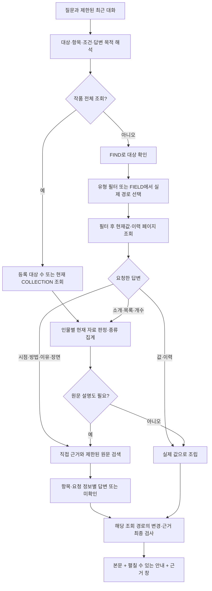

# 챗봇 조회·집계와 원문 답변 품질 보완 — 2026-10-14

관련: [GH241](https://github.com/catchhole-soma/catchhole-backend-java/issues/241), [누적 한계 GH247](https://github.com/catchhole-soma/catchhole-backend-java/issues/247). Java/Python에 같은 내용으로 보관한다. 이 문서의 현재 동작은 이번 수정 코드 기준이며, 아래 과거 검증 수치는 새 구현의 통과 기록으로 재사용하지 않는다.

## 책임과 전체 흐름

질문에 필요한 항목을 찾기 전에 전체 설정의 앞부분을 자르면 뒤쪽 값과 이력을 놓친다. 한 인물의 설정 행 수, 조건을 만족하는 인물 수, 실제 보유 능력 수도 서로 다르다. 원문에 사용 장면이 있다는 사실만으로 획득 시점·과정까지 확인됐다고 답해서도 안 된다.

Spring은 작품 권한, 실제 현재 snapshot/확정 이력, 저장 경로, 모집단과 변경 검사를 소유한다. Python은 질문에서 대상·항목·조건·답변 목적을 해석한 뒤 제한된 조회 도구를 호출한다. `qa_lookup.py`는 대상/필드 탐색, `qa_collection.py`는 작품 전체 조회와 최종 token 확인, `qa_synthesis.py`는 등록 자료의 의미 판정·소개·집계, `hybrid.py`/`hybrid_items.py`는 원문 검색과 요청 정보별 답변을 맡는다. LLM은 SQL·회원/작품 ID·저장 key/scope를 생성하지 않는다.

## 계획과 실제 조회

다음 표는 합성 질문의 의도별 경로이며 실제 배포 모델의 예측 결과가 아니다.

| 질문 목적 | 계획 | 실제 처리 |
| --- | --- | --- |
| 한 인물의 현재 레벨 | CURRENT, focus=LEVEL/null, FACTS | 이름 FIND → CHARACTER_CURRENT(factType=LEVEL) → 실제 값 표시 |
| 특정 스탯 변화 | HISTORY, focus=STAT/질문의 항목 표현 | FIND → CHARACTER_FIELDS → 관측한 F 참조 선택 → 실제 key로 HISTORY 페이지 조회 |
| 특정 세계관 속성 | WORLD, focus=null/질문의 항목 표현 | WORLD_FIELDS의 category/scope/key를 구분해 선택 → WORLD_CURRENT/HISTORY |
| 등록 인물 수 | CURRENT, collection=CHARACTER, 조건 없음, COUNT | FIND_CHARACTERS(size=1)의 서버 totalElements 사용 |
| 세계관에 등록된 종족 목록 | collection=WORLD, worldCategory=RACE | 해당 분류의 등록 주체 목록 조회; 인물의 종족 속성과 구분 |
| 현재 전투 불능인 인물 | collection=CHARACTER, factType=STATUS, predicate=질문의 조건 구절 | CHARACTER_CURRENT_COLLECTION → 인물별 상태를 함께 읽어 MATCH/NO_MATCH/UNKNOWN |
| 레벨 10 이상인 인물 | collection=CHARACTER, factType=LEVEL, predicate=질문의 조건 구절 | 현재 LEVEL 자료를 의미 판정; 서버 valueEquals로 대소 조건을 바꾸지 않음 |
| 한 인물의 소개 | SUMMARY | 이번 등록 자료를 R 참조로 뒷받침하는 자연어 설명 |
| 보유 능력 목록·개수 | LIST/COUNT | 논리 설정 항목별 판정 → 코드가 확인 목록/개수와 보류 항목 표시 |
| 각 능력을 언제 어떻게 얻었는지 | CURRENT + PROCESS, perItem=true, requestedFacets=TIME/HOW | 현재 논리 항목별 검색 → 시점·경위 각각 답변 또는 미확인 |

새 strict 모델 schema는 `focus`, `collection`, `answerShape`, `requestedFacets`, `eventScope`, `includeRegisteredValues` 등 해당 계획의 필드를 명시하게 한다. 현재 prompt 버전은 QA plan v4, FIELD select v1, 구형 행 select v3, hybrid plan/answer v4다. 등록 설명과 현재 조건 판정은 각각 `chat-registered-answer-v1`, `chat-current-condition-v1`을 사용한다. 이력 사건의 판정은 `chat-history-condition-v1`으로 구분한다.

- `focus`의 FactType은 정해진 유형이고 attribute는 현재 질문 또는 제한된 대화에 실제 나온 항목 표현이다. 동적 경로는 값 없는 FIELD 목록을 끝까지 확인한 뒤 관측된 F 참조로 고른다. 불완전한 FIELD 목록을 유일한 경로라고 확정하지 않는다.
- 인물 FIELD는 대상이 있으면 현재와 허용 이력의 경로, 대상이 없으면 작품 활성 인물의 현재 경로다. 세계관의 작품 FIELD는 category/scope/key별 현재 경로다. 동일 표시명이라도 다른 scope나 의미를 임의로 합치지 않는다.
- `collection`은 개별 이름 없이 작품 전체 현재 자료를 조회한다. 인물 FactType과 세계관 worldCategory는 다른 분류다. 복수 유형이 필요한 조건은 FactType을 고정하지 않고 관련 현재 자료를 함께 읽어야 한다.
- 과거 대화는 지칭 해석만 돕는다. 현재 질문의 사실 근거는 다시 읽은 RDB와 검증된 원문이며 이전 답변을 사실로 재사용하지 않는다.
- 회차 범위는 출처의 허용 범위다. 현재 snapshot을 그 회차 당시 상태로 바꾸지 않는다. 이번 서버 범위 또는 현재 질문에 명시된 숫자 회차만 사용하며 예전 대화의 범위를 자동 계승하지 않는다.

## 모집단·페이지·변경 검사

등록 인물 수는 활성 등록 인물, 세계관 목록/개수는 선택한 분류의 등록 주체가 모집단이다. 소설에 실제로 등장하는 모든 존재나 설정 행 수를 뜻하지 않는다. 원문 전체에서 존재 여부를 검색한 결과와도 구분한다.

`CHARACTER_CURRENT_COLLECTION`/`WORLD_CURRENT_COLLECTION` 응답의 `collection`은 `subjectCount`(등록 대상 수), `subjectsWithValues`(선택 필터의 현재 행이 있는 대상 수), `recordCount`(설정 행 수)를 구분한다. 조건 목록은 인물/세계관 주체 단위로 묶고 MATCH 대상만 센다. 이름을 지정한 능력 목록·개수는 이번에 읽은 관련 논리 설정 항목을 묶어 판정하므로 같은 항목의 여러 행을 그대로 더하지 않는다. 자료가 없는 대상, UNKNOWN, 예산 때문에 미검토인 대상은 확인한 수에 넣지 않고 따로 안내한다. 세계관의 실제 FIELD를 선택하면 그 category도 조회에 고정한다. 여러 분류를 선택한 경우 분류별 모집단을 중복 없이 더하고 선택한 분류의 범위임을 표시한다.

20은 기본 페이지 크기다. 새 focus/collection은 필터 후 `hasNext=false`까지 전역 도구 예산 안에서 순회하며 옛 2페이지/10행 제한을 적용하지 않는다. 페이지 조회가 끝났는지, 의미 판정을 모두 했는지, 답변에 모두 표시했는지는 별도 상태다. 부족한 경우 부분 조회·문맥·답변 길이 안내를 유지한다.

COLLECTION의 두 번째 페이지부터 최초 `readToken`을 전달하고 답변 생성 후 같은 필터의 page 0을 재검사한다. token은 작품·도구·필터·대상 집합/이름/version·표시 schema의 변경 확인용이며 권한이나 과거 snapshot 저장소가 아니다. 생성 중 변경이 확인되면 결과를 확정하지 않고 최신 상태로 다시 질문하도록 안내한다. 조건 없는 전체 대상 목록도 COLLECTION으로 조회 전후를 감싸고 중복 대상/완료 목록 수를 확인한다. 단일 COUNT는 한 FIND 응답의 서버 totalElements를 사용한다. FIND API 자체에 snapshot token이 추가된 것은 아니다.

정렬된 COLLECTION을 도중에 멈추면 마지막 인물의 뒤쪽 설정이 남아 있을 수 있다. 이 인물과 잘린 값이 있는 인물은 UNKNOWN으로 보류한다. 여러 경로 중 일부 조회가 중단되면 다른 경로가 판정을 바꿀 수 있어 읽은 대상 전체를 보수적으로 보류한다. 각 필터의 첫 조회와 최종 token 검사에 쓸 도구 예산을 남긴다. 선택한 경로가 너무 많아 최소 조회·검사조차 불가능하면 설정 없음으로 오답을 만들지 않고 범위 구체화를 요청한다. 대량 작품의 전수 현재값/경로 scan은 대상·설정 수에 비례하는 DB/메모리 비용을 가지며 운영 규모 처리량은 아직 측정하지 않았다.

## 등록 자료의 판정·설명·종류

새 조건 조회는 scalar 정확 일치 외에도 서술형 상태, 부정, 숫자 비교, 복수 조건을 관련 현재 자료에 대해 LLM이 판정하는 경로를 제공한다. Java가 의미 SQL을 생성하거나 사망·회복·보유 상태를 추정하지 않는다. 조건 판정은 현재 자료 전체를 인물 단위로 묶고, 같은 batch의 모든 itemRef가 정확히 한 번 등장하는지와 인용 R 참조의 소속을 검사한다. MATCH/NO_MATCH에는 실제 해당 항목의 참조가 필요하다. 판정용 입력은 한 인물/항목을 중간에 자르지 않고 batch로 나누며 문맥/호출 한도를 넘는 대상은 미검토로 남긴다.

LIST와 COUNT는 선택적 소개와 다르게 모든 읽은 논리 항목을 판정 대상으로 삼는다. 희망·예정·학습 중인 능력을 보유로 세거나 과거 사망/제거를 현재 상태로 읽지 않도록 지시한다. 목록·숫자는 모델이 임의로 집계한 문장을 그대로 쓰지 않고 검증된 판정에서 코드가 만든다. 이 구조 검증은 판정 내용의 의미적 정확성을 증명하지 않는다. HISTORY의 LIST/COUNT는 같은 저장 key라도 실제 사건 ID별로 구분하고 과거 사건용 판정을 사용한다. CURRENT_AND_HISTORY의 LIST는 현재값과 이력을 나누어 표시하고 COUNT는 무엇의 개수인지 구체화를 요청한다. 잘린 값은 이름을 지정한 조회에서도 자동으로 판단 보류한다.

SUMMARY 등 등록 자료 설명은 이번 R 참조를 가진 자연어 주장으로 작성한다. 일부만 읽거나 입력에서 일부 행을 제외했다면 모델에 partial을 전달하고 답변에도 확인한 범위임을 붙인다. 소개는 관련 특징을 요약할 수 있으므로 전체 항목 열거와 동일한 coverage 계약이 아니다. 원문을 요청한 조건 목록에서는 MATCH 판단에 사용한 행의 직접 근거를 예산 안에서 확인하며, 확인 실패와 근거 상한을 안내한다. 실제 표시한 설명에 연결된 sources만 결과에 남긴다. 이름을 지정한 CURRENT 소개·목록·개수도 모델 생성 뒤 대상의 현재 version·이름·존재를 다시 확인하며, 변경되면 구값 설명을 보류한다. 이 검사는 미래 변경을 잠그거나 과거 snapshot을 저장하는 기능은 아니다.

DISTINCT는 domain/category/scope/key가 같은 경로별로 독립 집계한다. 조건이 있으면 MATCH 판단이 실제 인용한 행에서만 종류를 세고, 요청한 직접 근거도 그 행에만 연결한다. 인물은 structured JSON의 scalar 또는 value/name을 사용하고 표시 설명문을 대체 값으로 쓰지 않는다. 세계관 속성은 서버의 실제 문자열 value를 사용한다. 없거나 복합형이거나 잘린 값은 집계에서 제외하고 scalar 확인 불가를 안내하며, 확인할 값이 없으면 0종류라고 단정하지 않는다. 같은 의미의 다른 표기를 자동으로 정규화·통합하는 기능은 없다. 긴 목록은 항목 경계에서 줄이고 답변 길이 안내를 남긴다.

기존 저장 계획의 `CHARACTER_LIST`/`characterFilter`는 호환 경로로 남는다. 이 경로만 Spring의 단일 현재 scalar 정확 일치(valueEquals)를 사용한다. strip/NFC/소문자 비교와 기존 snapshot 해석을 유지하며, 부정·대소·복수 조건을 이 연산으로 임의 변환하지 않는다. 새 모델 계획은 collection을 사용한다. focus/새 답변 필드가 없던 기록도 허용하되, 필드 생략에 따른 구형 행 선택·표시 계약을 유지하며 저장 답변을 소급 재작성하지 않는다.

## 원문 답변의 공통 요청 정보와 검색

값·변경 이력에 연결된 인용을 함께 보여달라는 요청은 기존 등록 조회와 직접 근거를 사용한다.
HISTORY + sourceNeed NONE + includeEvidence true + FACTS이며, '전부'나 '어떻게 바뀌었는지'만으로
원인·과정 추론으로 바꾸지 않는다. 이유·사건 경위를 명시적으로 요청하면 원문 해석 경로를 사용한다.
직접 근거 요청에서 확인하지 못한 행도 값을 유지하고 `원문 미확인`을 표시한다. 원문을 요청하지
않은 답변에는 이 표시를 붙이지 않는다. 실제 인용문은 기존 Spring source 참조 계약으로 연결한다.

원문 필요와 RDB 조회는 독립적이다. `requestedFacets`는 TIME(시점), HOW(경위·방법), WHY(이유), SCENE(장면) 중 실제 요청한 정보다. 일반 답변도 claim의 answeredFacets와 최상위 missingFacets가 요청 정보를 빠짐없이 나누도록 검사한다. 사용 장면만 확보했는데 획득 시점·경위 요청을 COMPLETE로 표시할 수 있다는 뜻은 아니다. 의미적 지지는 별도 평가 대상이다.

일반 답변의 미확인 정보 종류와 미답변 기록은 독립적이다. 일부 행에서 모든 facet 종류가
등장해도 unansweredRowRefs가 남으면 COMPLETE가 될 수 없다. 부분 답변 병합·조건 후처리도
미답변 행을 보존한다. 모델이 일반 답변에서 행을 아예 누락하고 미답변으로도 선언하지 않는
경우까지 모든 선택 행의 coverage를 강제하는 계약은 아직 없으며, '전체 원문 설명'의 별도 평가 대상이다.

모델 응답 검증 실패에는 목적·schema·시도·JSON/schema/후속 계약 구분과 고정 코드 위치만
진단 로그에 남긴다. 원시 응답·질문·인용·ID·예외 메시지를 기록하지 않고 재시도·계량 한도를 유지한다.

시점·과정 질문은 `eventScope=ACTUAL/PLANNED/null`로 실제 사건과 계획을 구분하고, 원문 답변의 `eventStatus=OCCURRED/PLANNED/UNCERTAIN/null`을 함께 받는다. 실제 사건 질문에 계획·불확실 상태만 있으면 서버가 완료로 집계하지 않고 확인한 계획과 미확인인 실제 시점·과정을 구분한다. 필요한 상태를 누락한 설명은 사실 답변으로 게시하지 않는다. 모델이 사건 상태 자체를 오독하는 경우까지 이 계약이 의미적으로 검증하는 것은 아니다.

`perItem=true`는 현재값·이력을 domain/subject/category/scope/key가 같은 논리 항목으로 묶는다. CURRENT_AND_HISTORY에서는 현재 항목이 응답 대상이고 이력만 있는 항목을 새 현재 보유 항목으로 늘리지 않는다. 모든 논리 항목의 itemAnswers에 요청 facet별 답변 또는 미확인이 있어야 한다. 새 항목별 답변은 claim/행 단위 fallback과 섞지 않으며, 일부 facet만 확인한 부분 답변은 다음 검색에서도 보존한다. 새 근거가 기존 답변과 충돌하면 관련 항목을 보류하고 충돌을 지운 것처럼 처리하지 않는다.

현재 조건이 UNKNOWN인 대상은 검색 후보에 남을 수 있지만 원문 설명 모델이 이를 현재 조건 충족자로 승격할 수 없다. 코드가 그 대상의 답변을 보류하고, 관련 facet을 미확인으로 유지한다. 과거 사건이 검색됐다는 이유로 현재 사망·현재 보유 등이 확정되지는 않는다. 원문을 이용해 UNKNOWN 현재 조건을 새로 증명하는 별도 계약은 아직 없다.

직접 근거 뒤 부족한 정보를 검색한다. 각 항목은 실제 표시명과 scope로 키워드를 구성하고, 연결 출처는 검색 힌트로만 사용한다. 키워드는 일치 점수를 먼저 정렬하고 동점에서 연결 회차를 우선한다. 항목별 검색 결과를 함께 모아 여러 항목을 뒷받침할 수 있는 공통 청크를 우선 선택하고 인접 문맥을 한 번에 조회한다. 앞 항목의 이웃 청크가 문맥을 먼저 채워 뒤 항목의 실제 획득 장면을 밀어내지 않도록 근거 공간을 함께 배분한다. 다음 검색은 미확인 항목을 우선하며 벡터에는 이미 읽은 청크를 제외할 수 있다. 필터·정렬은 허용 코퍼스 전체에 적용한 뒤 LIMIT한다.

기본 상한은 키워드/벡터 각각 Top K 12, 인접 반경 1·최대 6, 근거 항목 8, 검색 후보 구성 시 회차당 청크 3·검색 근거 문맥 3,000토큰, 검색 2라운드, 질문 임베딩 1회, 텍스트 모델 6회(각 schema 재시도 포함)다. 서버와 QA의 전체 도구 한도 중 작은 값도 적용한다. 조건 판정은 최종 설명 모델 1회와 COLLECTION/직접 근거/검색 receipt·원문 재검증에 필요한 호출을 남긴다. 답변 모델 예산이 없으면 추가 검색을 중단하며, 유효한 부분 답변은 최종 검사를 통과한 뒤 반환한다. 각 항목·facet을 입력 예산 안에 표현할 수 없거나 항목 수가 상한을 넘으면 범위를 좁혀 달라고 요청한다.

이전 부분 답변의 E 참조를 함께 유지하고 최종 결과에서 사용한 근거의 합집합을 다시 검사한다. Python fingerprint, Spring의 실제 원문 hash/offset/인용 receipt, 직접 근거의 현재 응답과 COLLECTION token이 각 경계를 소유한다. 검증 실패한 설명을 그대로 게시하지 않는다. 현재 등록값은 명시적으로 함께 요청한 `includeRegisteredValues=true`일 때 본문에 덧붙이며, 이 필드가 없던 과거 기록만 예전 표시를 유지한다. 새 계획에 없는 요청 facet은 구형 기록의 sourceNeed를 기준으로 해석하는 호환 경로가 남는다.

## 화면과 남은 한계

본문은 plain text다. 설명·목록·미확인 안내를 질문 목적에 맞게 표시하고 내부 R/F/E 참조·처리 enum을 형식 문구로 노출하지 않는다. 실제 이름·값에 같은 문자열이 있다는 이유로 regex로 삭제하지 않는다. 긴 인용은 근거 창에 두며 번호는 sources 다음 retrievalSources의 원본 순서다. 일부 근거 실패로 번호를 당기거나 다른 유효한 근거를 버리지 않는다. 마지막 질문 재검증/실행 일치 검사가 실패하면 인용 전체를 표시하지 않는다.

서로 다른 서버 안내는 모두 보존한다. 동일한 문장만 중복 제거하고 하나면 바로 표시한다. 여러 개면 `답변에서 확인할 점 N가지`와 접근성 있는 펼침 버튼으로 제공하며 접어도 내용을 삭제하지 않는다. 설정집 미지원처럼 현재 질문과 무관한 상시 경고와 실제 부분 조회·원문 변경 안내를 구분한다.

현재 의미 판정, 소개 문장, 경로 선택과 인용의 의미적 지지는 실제 배포 모델로 평가해야 한다. 참조 존재·정확한 원문 인용·항목 coverage 통과가 진실성 점수는 아니다. #242의 품질/비용/지연 평가와 #247의 분석 추출 오류, 모호한 경로, 대량 scan 비용, 긴 대화 지칭, 원문 검증 I/O 한계를 유지한다. 설정집, 특정 회차 당시의 전체 상태, 과거 원문 버전, 작품 전체 모순 판정은 지원하지 않는다. 새 모델·운영 배포·기능 활성화·임베딩 백필은 이번 변경 범위에 포함하지 않는다.

## 이번 변경 검증 상태

**후속 이력·원문 보완:** AI `ce55d2620abd1f7be529841e08cded4f17c2699c`에서 정상 부분 답변 거절·행별 병합·직접 근거 미확인 표시와 안전한 진단을 보완했다. Python 전체 2,641 통과/51 skip/기존 경고1이며 신규40개를 포함한다. 외부 API 호출 없는 합성 회귀이고 최신 계획 프롬프트의 실제 분류·의미 품질은 미측정이다. 로컬 챗봇을 재시작했으며 코드·검증 질문안·미선언 행 누락의 남은 한계는 AI `docs/evaluations/chat-history-evidence-v1.md`와 v0010 상세에 기록했다. 이하 Java/Front/실제 모델 수치는 선행 실행으로 보존한다.

**최종 검증 완료 / 로컬 커밋·미push.** AI `a7e3b9a4059f74b1d0850eeb500411347f9c1cdc`, Java `738336ef01b4bcdc0fc3b21117f921d38d546cc0`, Front `160cc5511f8c22639441f8af45dc86b04c58e10f`. Python 전체 2,601 통과/51 skip/기존 경고1, 별도 검색 PostgreSQL23 통과, Java 관련111 통과/bootJar 성공, Front19·타입/lint/build/Knip 통과다. Java 전체는 1,841 통과/26 skip/기존 Redis 시계 차이 검사1 실패로 남았다. 실제 Terra·medium과 로컬 복사 DB/기존 색인으로 재시험 포함 질문10건을 확인했다. 실행 성공을 의미 정답률로 표시하지 않는다. 개발 중 원문 문맥 누락과 계획/실제 혼동을 확인해 보완한 뒤 재검증했고, 정식 품질·비용·지연 평가는 #242에 남긴다. 실행 단계별 코드 차이·비공개 snapshot 식별·명령은 AI 저장소 `docs/ai-logic-versions/details/v0010.md`에 기록했다. 아래 역사 기록을 이번 실행의 결과로 합산하지 않는다. 새 회귀 대상은 작품 모집단/빈 값/조건 의미 판정, COLLECTION 중간·최종 변경, 부분 인물·복수 경로의 예산 중단, LIST 항목 누락, DISTINCT 값/절단, 근거 요청, 논리 항목·공통 facet coverage, UNKNOWN의 원문 승격 차단, 검색·최종 확인 예산이다. 공개 fixture는 합성이며 고정 모델 응답은 연결·구조 검증용이다. 개인 원문·개별 예측을 이 문서에 복사하지 않는다.

## 역사 기록 — 2026-10-14 e9a 구현 검증

이하 표와 복원 SHA는 앞선 구현의 실행 기록으로 보존한다. 이번 collection/synthesis/facet 보완의 최종 검증 결과와 구분한다.

2026-10-14, API key/provider/embedding/judge 호출 없이 검증했다. 공개 회귀는 합성 데이터만 사용한다. 실제 로컬 복사 DB 연결 검증은 수동 계획으로 실행했으며 개인 질문·원문·예측을 이 문서에 복사하지 않는다.

| 검증 | 결과 |
| --- | --- |
| Java 전체 test + bootJar | 1,795 passed / 27 skipped |
| Java 실행별 API 경로 H2 / PG | 18 passed / 19 passed (전체 실행에 포함) |
| Java 설정 도구 H2 + scalar / 별도 격리 PG | 39 passed / 27 passed |
| Python 전체 | 2,520 passed / 50 skipped, 기존 Starlette 경고 1개 |
| 새 focused / hybrid 회귀 | 35 passed / 16 passed (전체 실행에 포함) |
| Front 챗봇 E2E | 16 passed, PC/모바일 확인 |
| Front 타입·lint·빌드 | 통과, 기존 lint 경고 2개와 bundle 크기 경고 유지 |
| 실제 Spring/Python/복사 DB 연결 | 현재값·필터 이력·스킬 목록·조건 인물 목록 6경로 통과, 모델 계획은 수동 지정 |
| 실제 모델의 분류·필드 의미 선택·답변 의미 품질 | 미측정, #242에서 평가 |

회귀는 관련 항목 앞의 무관한 설정 300개, 관련 이력 47개/3페이지, 여러 scope, 모호성/위조 참조, 조건 인물 23명, scalar 표시/실제 값 불일치, 사용·획득 구분과 항목 누락, 검색 후 최종 재검증 예산을 포함한다. 개별/부분집합 테스트 수를 전체 수에 합산하지 않는다. 구현 SHA와 상세 조건은 AI의 [v0010 상세](https://github.com/catchhole-soma/catchhole-backend-ai/blob/feat/gh-241-chat-context/docs/ai-logic-versions/details/v0010.md)에 기록한다.

#247의 의미적 인용 지지, 분석/추출 정확도, 모호한 경로, 대량 데이터 비용, 긴 대화 대상 기억 등은 계속 열어 둔다. 이번 개선은 운영 배포·기능 활성화·추가 임베딩 백필을 포함하지 않는다.

실행별 인증 어댑터는 factType/valueEquals를 보존한다. 대상 FIELD에 출처 회차가 하나라도 명시되면 실행 범위보다 넓힐 수 없고 생략한 반대쪽 경계는 실행 범위로 채운다. 회차 없는 FIELD는 현재 조회를 위한 catalog 의미를 유지하며 회차 필터를 자동 주입하지 않는다.

최종 제품 복원 SHA: AI `e9a11e0ff380fac8232f9a6a9789b702e242cd90`, Java `f5a99490edb2eaa7fabe60b3f3195e5c7ed19738`, Front `66bd6407f30cadbcf568799e1c29fad929fdf489`. Java 최종 전체는 1분 56초, 총 1,822개 중 1,795 통과/27 skip이며 신규 실행 경로 회귀 4개를 H2와 PostgreSQL에서 각각 실행했다. 뒤 문서 커밋은 제품 코드를 변경하지 않는다.
