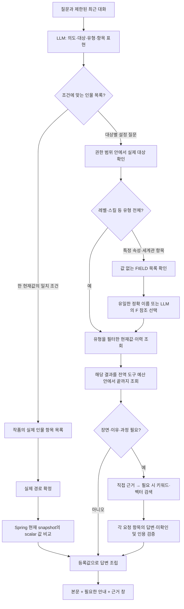

# 챗봇 조회 완전성과 답변 표시 보완 — 2026-10-14

관련: [GH241](https://github.com/catchhole-soma/catchhole-backend-java/issues/241), [누적 한계 GH247](https://github.com/catchhole-soma/catchhole-backend-java/issues/247). Java/Python에 같은 내용으로 보관한다. 기존 QA/결합 조회 문서에서 설명한 초기 전체 항목 20개 × 2페이지, 최종 10행 선택은 새 focus 계획의 현재 동작이 아니다.

## 바꾼 이유와 책임

앞부분의 전체 설정을 먼저 가져온 뒤 LLM이 관련 행을 고르면, 뒤에 저장된 레벨·특정 스탯과 이력을 놓칠 수 있었다. 조건에 맞는 인물 목록도 이름 조회만으로는 표현할 수 없었다. 등록 능력의 사용 장면을 찾았다는 이유만으로 획득 과정까지 확인했다고 답하거나 일부 능력을 누락하는 문제도 있었다.

질문 문자열이나 인물 이름별 예외를 추가하지 않고 **의도·항목 표현 해석 → 실제 경로 확인 → 필터 후 페이지 조회**로 공통 순서를 바꿨다. Spring은 현재 snapshot/확정 이력·권한·실제 항목 경로를 소유한다. Python `FocusedLookup`을 RDB 답변과 원문 결합 답변이 함께 사용한다. 프론트는 실제 본문을 치환하지 않고 설명·근거를 표시한다.

## 분류와 조회 예시

아래는 합성 입력의 **기대 계획**이다. 실제 배포 모델의 예측 결과가 아니다. 실행의 회원·작품·대상 UUID·저장 key/scope를 LLM이 작성하지 않는다.

| 질문 | 계획의 핵심 | 실제 조회 |
| --- | --- | --- |
| 아리아의 현재 레벨은? | CURRENT, CHARACTER, focus=LEVEL/null | 이름 FIND → CHARACTER_CURRENT(factType=LEVEL) |
| 아리아의 레벨 변화 내역은? | HISTORY, CHARACTER, focus=LEVEL/null | 이름 FIND → CHARACTER_HISTORY(factType=LEVEL), hasNext까지 순회 |
| 아리아의 마력 수치 변화는? | HISTORY, focus=STAT/마력 | FIND → CHARACTER_FIELDS(STAT) → 실제 항목 선택 → HISTORY(STAT, 실제 settingKey) |
| 고급 주문의 소모량은? | CURRENT, WORLD, focus=null/고급 주문의 소모량 | FIND_WORLD_SETTINGS → WORLD_FIELDS → 실제 scope/key 선택 → WORLD_CURRENT |
| 종족이 엘프인 인물은? | CHARACTER_LIST, subjects=[], condition=PROFILE/종족/엘프 | 작품 CHARACTER_FIELDS → 실제 종족 경로 → FIND_CHARACTERS(type/key/valueEquals) |
| 아리아의 각 스킬을 언제 어떻게 얻었어? | CURRENT + PROCESS, SKILL/null, perItem=true | 스킬 전체 조회 → 각 스킬을 포함한 원문 검색 → 답한 항목과 미확인 항목을 함께 반환 |

예: `{"intent":"HISTORY","subjects":[{"domain":"CHARACTER","name":"아리아","focus":{"factType":"LEVEL","attribute":null}}],"includeEvidence":false,"episodeFrom":null,"episodeTo":null,"characterFilter":null}`.

- `focus`는 새 strict 출력 schema에서 필수 객체다. 과거 저장된 계획에서 해당 필드가 생략된 경우에만 이전 제한 행 선택 경로를 유지한다.
- FIELD는 값·인용 없이 category/key/scope/표시명만 제공한다. 동적 항목은 목록을 완전히 확인한 뒤 선택하고, 목록이 잘리거나 입력 예산을 넘으면 범위를 좁혀 달라고 요청한다. 인물 항목의 유일한 정확 표시명은 코드로 연결하고, 세계관 scope 등 의미 판단이 필요하면 제공된 F 참조만 모델이 선택한다.
- CHARACTER_FIELDS는 현재 항목과 허용된 확정/수동/레거시 이력의 경로를 포함한다. 순수 이력+출처 범위 질문은 그 범위의 경로만 확인한다. WORLD_FIELDS는 같은 이름이어도 scope별로 보존한다.
- 대상 없는 CHARACTER_FIELDS는 해당 작품의 활성 인물 **현재** 항목 목록이다. 여기의 subjectId는 작품 ID이며 개별 인물 ID로 재사용하지 않는다.
- 이름 탐색, 실제 필드 탐색, 값 조회 모두 기존 실행 권한과 작품 범위를 유지한다. 실제 SQL/JPQL과 snapshot 접근 코드는 개발자가 작성한다.

## 완전성·비용의 경계

20은 페이지 크기다. 새 focus 조회는 필터 후 `hasNext=false`까지 읽으며, 2페이지/10행 제한으로 관련 이력을 자르지 않는다. 전역 도구 호출 한도는 유지하고 Spring 실행 한도와 Python 설정 중 작은 값을 적용한다. 끝까지 못 읽으면 일부 조회라는 안내를 유지한다. 단순 현재값/이력에는 수집된 관련 행을 다시 LLM의 10행 선택에 넘기지 않는다.

전체 결과가 무제한이라는 뜻은 아니다. FIELD 선택 최대 20경로, 답변 길이, 직접 근거 수, 원문 검색/문맥, 모델/도구/사용량 예산이 남는다. 인물 후보가 일부만 확인되면 유일한 대상으로 확정하지 않는다. 원문 결합은 검색뿐 아니라 receipt와 **최종 원문 재검증**에 쓸 도구 예산도 미리 남긴다. 더 검색할 여유가 없어도 유효한 부분 답변은 재검증 후 제공할 수 있다.

각 항목을 묻는 `perItem` 계획에서는 모든 선택 행이 claim/conflict의 rowRefs 또는 unansweredRowRefs에 포함되어야 한다. 참조 누락·없는 참조·미확인 항목이 남은 COMPLETE 응답은 재시도/거절한다. 100행 초과나 현재 RDB 자료만으로 입력 예산을 넘으면 항목을 줄여 달라고 요청한다. 이 구조 검증이 문장의 의미적 진실까지 증명하지는 않는다. 사용 사실은 획득 이유·시점의 증거가 아니므로 모델 지침에서도 구분하고 평가에서 다시 확인해야 한다.

조건 검색은 현재 scalar 한 항목의 정확 일치다. 기존 `CharacterSnapshotAccessor`를 재사용하며 structured JSON의 value(없거나 null일 때 name)를 비교한다. 표시용 설명문·이력을 조건 값으로 쓰지 않는다. 문자열은 strip+NFC+소문자 정규화를 적용하고 숫자/불리언도 canonical scalar로 비교한다. 다중 조건·부정·숫자 대소·과거 시점 조건은 미지원이다. 현재 구현은 작품 활성 인물 snapshot을 훑으므로 인물 수에 비례한 비용이 들며, 실제 규모 측정 후 별도 인덱스가 필요할 수 있다.

일반 레벨·스킬 목록 답변은 계획 LLM 1회 후 규칙으로 조립할 수 있다. 동적 항목의 의미 해소가 필요하면 F 선택 호출이 추가된다. 원문 설명은 근거 생성·검색 라운드·검증 재시도에 따라 호출 수가 달라진다. 모든 모델 호출은 기존 예약·정산 경로를 사용한다.

## 사용자에게 보이는 답변

- 짧은 현재값은 “아리아의 현재 레벨은 3입니다.”처럼 표현한다. 목록/이력은 원래 값을 유지하며 회차와 삭제·현재 미반영 여부를 한국어로 설명한다.
- R/E 참조, ADD/MERGE, currentContributor, 기본 scope를 뜻하는 루트 문구를 답변 형식에 노출하지 않는다. 실제 설정 이름·값에 그런 문자열이 있다는 이유로 내용을 삭제하지 않는다.
- 설정집 미지원 안내를 모든 질문에 반복하지 않는다. 범위·부분 조회·출처 변경처럼 실제 판단에 필요한 안내는 유지하며 프론트는 동일 문구만 중복 제거한다.
- 긴 원문 인용은 근거 창에 제공한다. 본문은 `근거 N`으로 연결하며 direct sources 배열 다음 retrievalSources 배열 순서다. 개별 원문을 못 읽어도 다른 유효한 근거를 볼 수 있고, 질문 전체 재검증/실행 시도 변경 실패는 전체 표시를 막는다. 실패한 근거 때문에 번호를 재배치하지 않는다.
- 이전 대화는 지칭 해석에만 사용하며 후속 질문도 DB를 다시 조회한다. 기존 저장 답변은 이 변경으로 재작성되지 않는다.

## 검증과 남은 작업

2026-10-14, API key/provider/embedding/judge 호출 없이 검증했다. 공개 회귀는 합성 데이터만 사용한다. 실제 로컬 복사 DB 연결 검증은 수동 계획으로 실행했으며 개인 질문·원문·예측을 이 문서에 복사하지 않는다.

| 검증 | 결과 |
| --- | --- |
| Java 전체 test + bootJar | 1,795 passed / 27 skipped |
| Java 실행별 API 경로 H2 / PG | 18 passed / 19 passed (전체 실행에 포함) |
| Java 설정 도구 H2 + scalar / 별도 격리 PG | 39 passed / 27 passed |
| Python 전체 | 2,520 passed / 50 skipped, 기존 Starlette 경고 1개 |
| 새 focused / hybrid 회귀 | 35 passed / 16 passed (전체 실행에 포함) |
| Front 챗봇 E2E | 16 passed, PC/모바일 확인 |
| Front 타입·lint·빌드 | 통과, 기존 lint 경고 2개와 bundle 크기 경고 유지 |
| 실제 Spring/Python/복사 DB 연결 | 현재값·필터 이력·스킬 목록·조건 인물 목록 6경로 통과, 모델 계획은 수동 지정 |
| 실제 모델의 분류·필드 의미 선택·답변 의미 품질 | 미측정, #242에서 평가 |

회귀는 관련 항목 앞의 무관한 설정 300개, 관련 이력 47개/3페이지, 여러 scope, 모호성/위조 참조, 조건 인물 23명, scalar 표시/실제 값 불일치, 사용·획득 구분과 항목 누락, 검색 후 최종 재검증 예산을 포함한다. 개별/부분집합 테스트 수를 전체 수에 합산하지 않는다. 구현 SHA와 상세 조건은 AI의 [v0010 상세](https://github.com/catchhole-soma/catchhole-backend-ai/blob/feat/gh-241-chat-context/docs/ai-logic-versions/details/v0010.md)에 기록한다.

#247의 의미적 인용 지지, 분석/추출 정확도, 모호한 경로, 대량 데이터 비용, 긴 대화 대상 기억 등은 계속 열어 둔다. 이번 개선은 운영 배포·기능 활성화·추가 임베딩 백필을 포함하지 않는다.

실행별 인증 어댑터는 factType/valueEquals를 보존한다. 대상 FIELD에 출처 회차가 하나라도 명시되면 실행 범위보다 넓힐 수 없고 생략한 반대쪽 경계는 실행 범위로 채운다. 회차 없는 FIELD는 현재 조회를 위한 catalog 의미를 유지하며 회차 필터를 자동 주입하지 않는다.

최종 제품 복원 SHA: AI `e9a11e0ff380fac8232f9a6a9789b702e242cd90`, Java `f5a99490edb2eaa7fabe60b3f3195e5c7ed19738`, Front `66bd6407f30cadbcf568799e1c29fad929fdf489`. Java 최종 전체는 1분 56초, 총 1,822개 중 1,795 통과/27 skip이며 신규 실행 경로 회귀 4개를 H2와 PostgreSQL에서 각각 실행했다. 뒤 문서 커밋은 제품 코드를 변경하지 않는다.
