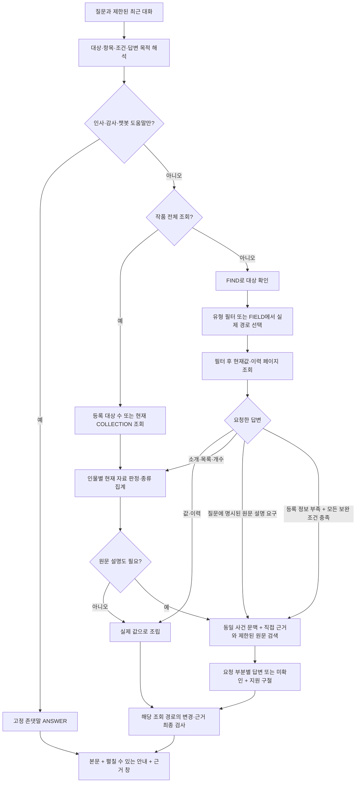

# 챗봇 조회·집계와 원문 답변 품질 보완 — 2026-10-15

관련: [GH241](https://github.com/catchhole-soma/catchhole-backend-java/issues/241), [누적 한계 GH247](https://github.com/catchhole-soma/catchhole-backend-java/issues/247). Java/Python에 같은 내용으로 보관한다. 이 문서의 현재 동작은 이번 수정 코드 기준이며, 아래 과거 검증 수치는 새 구현의 통과 기록으로 재사용하지 않는다.

## 추가 진단에 따른 대화·조회 보완 — OPT-31

[#247 OPT-31](https://github.com/catchhole-soma/catchhole-backend-java/issues/247)의 후속 개선이다. 현재 코드 계약은 아래 네 가지이며, 후속 실제 모델 6건의 실행·미확인 결과는 아래 검증 기록에 구분한다. 아래 과거 실행·정확도 해석을 이번 변경의 검증으로 재사용하지 않으며, 진단 당시 기록되지 않은 모델 출력의 정확한 오류 필드나 분류 원인을 사후 추정해 확정하지 않는다.

1. 인사·감사·이 챗봇의 사용법만 있는 입력은 planner의 `GREETING`·`THANKS`·`HELP`로 구분한다. 조회 필드를 비운 계획만 허용하고 서버의 고정 존댓말을 기존 `ANSWER` 결과로 반환한다. 문자열 인사 감지나 자유로운 사실 답변 경로를 추가하지 않는다. 인사와 작품 질문이 함께 있거나 작중 인사·능력 사용법을 묻는 경우는 일반 조회로 분류하도록 지시한다. 해석 호출은 기존 예약·정산을 거치고 후속 조회·답변 모델 호출은 없다. `CONVERSATION_LIMIT`는 내부 모델 문맥에 유지하되 공개 결과에는 추가 확인이 필요한 `CLARIFICATION`에서만 표시한다. 실제 자료·원문 오류나 부분 조회 안내는 유지한다.
2. 일반 작품 사실을 RDB에서 찾지 못하면 `sourceFallback`과 실제 조회 상태를 재검사한다. 아래 조건을 모두 만족할 때만 기존 원문 검색으로 보완한다. 등록 자료에 없다는 것은 작품에 없다는 뜻이 아니며, 이미 확인된 현재값이나 명시적 부정 답변을 빈 결과로 취급하지 않는다. 이전 답변의 부재·확실성을 되묻는 후속 질문은 원래 대상과 요구를 연결하고 필요하면 처음부터 원문 경로를 계획하도록 지시한다. 이전 답변이나 질문의 부정 표현은 사실 근거가 아니다.
3. 세계관 이름 조회는 모델에 고유 이름과 분류어를 분리하도록 지시한다. 공통 resolver는 먼저 전체 이름과 같은 `worldCategory`로 조회한다. 결과가 완전한 빈 목록일 때만 이름 끝에서 공백으로 분리된 해당 분류의 고정 표시어를 한 번 제거해 같은 분류로 재조회한다. 전체 이름의 기존 후보, 복수 후보, 불완전한 목록, 조회 오류를 짧은 이름으로 우회하지 않는다. 인물·붙어 있는 단어·임의 별칭에는 적용하지 않는다.
4. 계획의 `requestedParts`는 원래 질문의 주체·대상·전후·인과 범위를 보존한다. 유형 전체의 최초 획득 요청은 존재하지 않는 attribute를 만들지 않고 원문 경로와 사건 조건으로 표현한다. 새 검증 피드백은 schema에서 확인한 필드 경로와 고정 규칙만 사용해 형식 오류·계약 오류·JSON 오류·provider 출력 절단을 구분한다. 요청 부분을 삭제하거나 검증을 완화해 복구하지 않으며, 최초 호출 포함 최대 두 번과 기존 실행 예산을 유지한다. 초기 보완의 답변 v8은 내면·행동·자기진술과 사건 전후, 후속 행동과 실제 인과 근거를 구분하도록 지시했다. 현재 v9은 이 지침을 유지하면서 아래 관련 맥락·검증 실패 복구를 추가하며, 의미적 지지를 결정적으로 인증하는 장치는 아니다.

현재 hybrid 계획 v8은 처음 습득한 항목을 찾는 질문에서 HISTORY로 초기 등록 기록을 확인하고 원문 PROCESS로 실제 획득을 확인하도록 지시한다. 현재 보유 목록을 명시적으로 물었을 때의 CURRENT와 구분하며, 가장 이른 등록 기록·사용 장면을 실제 최초 획득이라고 단정하지 않는다. 일반 원문 경로의 직접 근거 조회는 `3 * max_rounds + 2`에 collection 검사 수를 더한 도구 여유를 남긴다. 기본 두 라운드에서는 collection 검사 외 8회분이며 키워드·벡터 검색과 최종 검증의 여유다. 기존 실행 상한을 늘리거나 두 검색 라운드의 실행을 보장하지는 않는다. 후속 실제 검증에서 두 검색 라운드까지 진행했으며 실제 최초의 입증은 미확인으로 남았다. 아래 검증 기록과 구분해 읽는다.

### 관련 원문 맥락과 답변 검증 실패 복구 — 답변 v9

일반 원문 답변의 `GroundedClaim.relatedFacets`는 질문에 직접 관련된 원문 맥락을 확인했지만 해당 요구를 확정하지 못했음을 뜻한다. 직접 답한 부분은 `answeredFacets`, 아직 답하지 못한 요구는 `missingFacets`로 유지한다. 같은 claim의 answered/related는 겹칠 수 없고 모두 실제 요청 참조여야 한다. 관련 맥락만 있으면 요구를 답한 것으로 세지 않고 PARTIAL로 표시하며 남은 예산 안에서 검색을 계속한다. 다른 claim이 같은 요구를 실제로 답했다면 그 주장에 따른 충족 여부를 판단한다. 항목별 itemAnswers의 기존 답변/미확인 계약을 일반 claim의 새 필드로 대체하지 않는다.

related claim도 정확한 `supports.quote`, 제공된 passage/참조·위치 검사와 최종 원문 재검증을 그대로 통과해야 한다. 무관한 맥락을 남기거나 과거 사실로 현재값을 단정하도록 허용하는 필드가 아니다. 관련성·전후·인과의 의미 해석 자체는 여전히 모델 평가 대상이다.

`hybrid.answer()`는 완성된 모델 응답의 schema/계약 복구가 소진되어 발생한 `ResponseValidationFailure`만 분리해 처리한다. 거절한 문장과 참조를 전부 버리고 해당 라운드는 NONE으로 돌려 남은 검색 경로 또는 이미 검증된 PARTIAL snapshot을 사용한다. 부분 답변은 최종 근거 검사를 통과해야 게시한다. 모델 호출 여유가 없으면 새 호출을 하지 않으며 같은 실행의 검색·시간·토큰·도구 상한을 늘리지 않는다. 전송·provider 실패, 출력 절단 복구 실패, 권한/조회 오류를 정상 미확인으로 삼키지 않는다. 계획·등록 답변 등 이 예외를 따로 복구하지 않는 호출부는 기존 실패 경계를 유지한다.

현재 버전은 `chat-hybrid-answer-v10`이다. v9의 관련 맥락·검증 복구는 유지하며 아래 자연어 미확인 설명을 추가했다. 아래 실제 모델 검증은 v9 실행 기록이며 v10의 품질 측정으로 재사용하지 않는다.

### 구체적인 미확인 설명 — 답변 v10

부분 원문 답변은 기존 답변 호출에서 `missingExplanations: [{facet, text}]`를 함께 받는다. 일반 답변과 항목별 답변 모두 해당 `missingFacets` 안의 서로 다른 참조만 허용한다. 질문의 요구 제목을 고정 문구 뒤에 붙이는 대신, 확인한 내용과 구분해 아직 확인하지 못한 점을 짧은 존댓말로 설명한다. 설명에는 새 사실·회차·인용·작품 전체의 부재를 만들지 않도록 지시한다. 의미적 적절성은 모델 품질 검증 대상이며 schema 통과가 이를 보증하지 않는다.

미확인 설명은 coverage를 올리거나 근거를 대신하지 않는다. 부분 답변 병합에서 해결된 요구의 설명은 제거하고 남은 요구의 최신 설명을 보존한다. 사건·현재 조건 검사로 제거된 주장에 연결된 설명도 제외한다. 항목 충돌로 답변을 철회하면 해당 설명을 함께 버린다. 구형 응답이나 서버 검사로 새로 생긴 미확인 사항은 기존 기본 안내를 유지해 누락하지 않는다. 모든 검색이 NONE인 최종 근거 부족 응답은 기존 경로를 유지한다.

성공/부분 원문 답변에는 검색 후보·문맥 상한만으로 포괄적인 미검토 안내를 붙이지 않는다. 실제 미확인 요구는 위 설명으로 남기며, 색인 미완성·등록 자료 부분 조회·원문 변경·저장소 오류 안내는 유지한다. 검색/제외 진단, 검색량·문맥 한도·실행 예산과 LLM 호출 구조는 변경하지 않는다. 이전에 저장한 답변 본문을 다시 쓰지 않는다.

검증: API key·실제 모델 호출 없는 합성 회귀로 챗봇 테스트 627개 통과(미확인 설명 신규 20개 포함), Ruff 통과. 자연어 설명 1회 표시, 인용/호출 수 보존, 잘못된 참조 거절, 부분 답변 병합 및 사건·충돌 검사 후 설명 제거를 확인했다. 실제 Luna의 새 문장 품질은 미측정이며 다음 사용자 질문에서 확인한다.

### 등록 정보 부족에서 원문으로 넘어가는 조건

`sourceFallback=false`가 기록 호환 기본값이며 새 strict 계획에는 필드를 명시한다. `sourceNeed=NONE`이라도 보완을 허용하면 원래 요구를 `requestedParts`에 남겨야 한다. 등록 정보만·확정 이력만 요청한 질문, collection·집계·지원 밖 요청에는 보완을 허용하지 않도록 계획한다.

| 확인 단계 | 전환 조건 또는 유지할 결과 |
| --- | --- |
| 계획 | `PROCEED`, `sourceNeed=NONE`, `sourceFallback=true`, 명시한 subjects가 있고 collection/characterFilter가 없음; COUNT/DISTINCT 제외 |
| 등록 응답 | 정상 조회 결과가 `INSUFFICIENT_EVIDENCE`이고 조회 지점의 typed gap이 있음. `ANSWER`·`CLARIFICATION`·실행 실패는 자동 전환하지 않음 |
| gap | 대상 미등록, FIELD 없음/관련 FIELD 없음, 완전한 값 조회의 빈 결과, 행 없음/관련 행 없음. 사용자 문장이나 공개 warning을 파싱해 추정하지 않음 |
| 제외 상태 | 부분 페이지·입력 문맥·값/선택/답변 절단, 현재값 변경, 출처 범위 위반, 원문 변경·누락·파기·인용 불일치·저장소 오류가 있으면 전환하지 않음 |
| 실행 여유 | 모델 호출 여유와 검색·최종 검사에 필요한 최소 도구 여유가 있어야 함. 부족하면 등록 조회 결과를 유지하며 상한을 늘리지 않음 |

통과하면 같은 실행·권한·회차 범위·남은 예산과 이미 선택한 등록 행을 유지한 채 `run_source(collect=false)`로 연결한다. 등록 조회를 처음부터 반복하지 않고 기존 직접 근거 확인 → 키워드·인접 → 부족하면 벡터·인접 흐름을 재사용한다. 준비된 원문이나 충분한 근거가 없으면 미확인으로 남기며, 검색 후에도 작품 전체 부재나 최초를 단정하지 않는다. 현재값의 명시적 부정으로 정상 답변한 경우와 모집단 전체를 읽어야 하는 collection은 이 자동 보완 경로의 대상이 아니다.

## 책임과 전체 흐름

질문에 필요한 항목을 찾기 전에 전체 설정의 앞부분을 자르면 뒤쪽 값과 이력을 놓친다. 한 인물의 설정 행 수, 조건을 만족하는 인물 수, 실제 보유 능력 수도 서로 다르다. 원문에 사용 장면이 있다는 사실만으로 획득 시점·과정까지 확인됐다고 답해서도 안 된다.

Spring은 작품 권한, 실제 현재 snapshot/확정 이력, 저장 경로, 모집단과 변경 검사를 소유한다. Python은 질문에서 대상·항목·조건·답변 목적을 해석한 뒤 제한된 조회 도구를 호출한다. `qa_lookup.py`는 대상/필드 탐색, `qa_collection.py`는 작품 전체 조회와 최종 token 확인, `qa_synthesis.py`는 등록 자료의 의미 판정·소개·집계, `hybrid.py`/`hybrid_items.py`는 원문 검색과 요청 정보별 답변을 맡는다. LLM은 SQL·회원/작품 ID·저장 key/scope를 생성하지 않는다.

원문 보완 화살표는 위 sourceFallback 조건을 모두 통과한 경우에만 사용한다. 대상 자체가 미등록인 경우도 같은 조건을 확인하며, 그 외 빈 결과·명확화·부분 조회·오류는 각 상태를 유지한다.

## 계획과 실제 조회

다음 표는 합성 질문의 의도별 경로이며 실제 배포 모델의 예측 결과가 아니다.

| 질문 목적 | 계획 | 실제 처리 |
| --- | --- | --- |
| 한 인물의 현재 레벨 | CURRENT, focus=LEVEL/null, FACTS | 이름 FIND → CHARACTER_CURRENT(factType=LEVEL) → 실제 값 표시 |
| 특정 스탯 변화 | HISTORY, focus=STAT/질문의 항목 표현 | FIND → CHARACTER_FIELDS → 관측한 F 참조 선택 → 실제 key로 HISTORY 페이지 조회 |
| 특정 세계관 속성 | WORLD, worldCategory=질문에 명시된 분류/null, focus=null/질문의 항목 표현 | 공통 대상 resolver의 분류별 FIND → WORLD_FIELDS의 category/scope/key를 구분해 선택 → WORLD_CURRENT/HISTORY |
| 등록 인물 수 | CURRENT, collection=CHARACTER, 조건 없음, COUNT | FIND_CHARACTERS(size=1)의 서버 totalElements 사용 |
| 세계관에 등록된 종족 목록 | collection=WORLD, worldCategory=RACE | 해당 분류의 등록 주체 목록 조회; 인물의 종족 속성과 구분 |
| 현재 전투 불능인 인물 | collection=CHARACTER, factType=STATUS, predicate=질문의 조건 구절 | CHARACTER_CURRENT_COLLECTION → 인물별 상태를 함께 읽어 MATCH/NO_MATCH/UNKNOWN |
| 레벨 10 이상인 인물 | collection=CHARACTER, factType=LEVEL, predicate=질문의 조건 구절 | 현재 LEVEL 자료를 의미 판정; 서버 valueEquals로 대소 조건을 바꾸지 않음 |
| 한 인물의 소개 | SUMMARY | 이번 등록 자료를 R 참조로 뒷받침하는 자연어 설명 |
| 보유 능력 목록·개수 | LIST/COUNT | 논리 설정 항목별 판정 → 코드가 확인 목록/개수와 보류 항목 표시 |
| 각 능력을 언제 어떻게 얻었는지 | CURRENT + PROCESS, perItem=true, requestedParts=P1(시점)/P2(경위) | 현재 논리 항목별 검색 → 시점·경위 각각 답변 또는 미확인 |
| 앞서 물은 사건 뒤의 감정과 행동 영향 | 원문 경로 + eventContext + requestedParts=P1(감정)/P2(행동 영향) | 같은 사건인지 다시 확인 → 요청 부분별 설명과 실제 지원 구절 연결 |

새 strict 모델 schema는 `focus`, `collection`, `answerShape`, `requestedParts`, `requestedFacets`, `eventContext`, `eventScope`, `includeRegisteredValues`, `sourceFallback` 등 해당 계획의 필드를 명시하게 한다. 이름을 지정한 대상에도 `worldCategory`를 명시하며 해당하지 않으면 null을 사용한다. 현재 prompt 버전은 QA plan v7, FIELD select v1, 구형 행 select v3, hybrid plan v8/answer v9이다. 등록 설명과 현재 조건 판정은 각각 `chat-registered-answer-v2`, `chat-current-condition-v2`를 사용한다. 이력 사건의 판정은 `chat-history-condition-v2`로 구분한다.

- `focus`의 FactType은 정해진 유형이고 attribute는 현재 질문 또는 제한된 대화에 실제 나온 항목 표현이다. 동적 경로는 값 없는 FIELD 목록을 끝까지 확인한 뒤 관측된 F 참조로 고른다. 불완전한 FIELD 목록을 유일한 경로라고 확정하지 않는다.
- 이름을 지정한 세계관 대상과 collection의 `worldCategory`는 같은 분류를 뜻한다. RDB·hybrid 공통 `resolve_subject`가 FIND 필터를 적용하며 동명 대상의 다른 분류를 합치지 않는다. CHARACTER에는 category를 넣지 않는다. 복수 후보·불완전한 탐색은 명확화를 요청하고, 분류와 다른 응답은 계약 오류로 처리한다. 분류 조회 실패를 무필터 조회로 자동 우회하지 않는다.
- 인물 FIELD는 대상이 있으면 현재와 허용 이력의 경로, 대상이 없으면 작품 활성 인물의 현재 경로다. 세계관의 작품 FIELD는 category/scope/key별 현재 경로다. 동일 표시명이라도 다른 scope나 의미를 임의로 합치지 않는다.
- 출처 회차를 지정한 CURRENT_AND_HISTORY의 동적 항목 선택은 현재 설정 경로와 범위 안 이력 경로를 합쳐 수행한다. 범위 밖 과거 경로는 후보에 넣지 않으며, 이력이 없는 현재 전용 항목은 보존한다. 현재값은 회차 당시 상태로 바꾸지 않는다. 선조회한 현재값을 재사용할 때는 같은 도구 예산 안에서 FIELD 선택 후 현재 상태를 1회 추가 확인하며, 현재 경로나 범위 내 이력 경로를 끝까지 확인하지 못하면 유일한 경로로 확정하지 않는다.
- `collection`은 개별 이름 없이 작품 전체 현재 자료를 조회한다. 인물 FactType과 세계관 worldCategory는 다른 분류다. 복수 유형이 필요한 조건은 FactType을 고정하지 않고 관련 현재 자료를 함께 읽어야 한다.
- 과거 대화는 지칭·보충 답변·동일 사건 해석을 돕는다. 명확화 답변은 직전 요청의 대상과 사용자의 최신 수정을 함께 읽어 다시 계획한다. 현재 질문의 사실 근거는 다시 읽은 RDB와 검증된 원문이며 이전 답변을 사실로 재사용하지 않는다. 현재 질문이 새 주제나 사건을 명시하면 최신 요청을 우선한다.
- 회차 범위는 출처의 허용 범위다. 현재 snapshot을 그 회차 당시 상태로 바꾸지 않는다. 이번 서버 범위 또는 현재 질문에 명시된 숫자 회차만 사용하며 예전 대화의 범위를 자동 계승하지 않는다.

## 모집단·페이지·변경 검사

등록 인물 수는 활성 등록 인물, 세계관 목록/개수는 선택한 분류의 등록 주체가 모집단이다. 소설에 실제로 등장하는 모든 존재나 설정 행 수를 뜻하지 않는다. 원문 전체에서 존재 여부를 검색한 결과와도 구분한다.

`CHARACTER_CURRENT_COLLECTION`/`WORLD_CURRENT_COLLECTION` 응답의 `collection`은 `subjectCount`(등록 대상 수), `subjectsWithValues`(선택 필터의 현재 행이 있는 대상 수), `recordCount`(설정 행 수)를 구분한다. 조건 목록은 인물/세계관 주체 단위로 묶고 MATCH 대상만 센다. 이름을 지정한 능력 목록·개수는 이번에 읽은 관련 논리 설정 항목을 묶어 판정하므로 같은 항목의 여러 행을 그대로 더하지 않는다. 조건 결과는 MATCH를 먼저 표시하고 UNKNOWN의 개별 이름·설명·인용을 나열하지 않고 미확인 수로 요약한다. 자료가 없는 대상과 미검토 대상도 확인한 수에 넣지 않는다. 일치 대상을 못 찾았어도 이런 미확인 또는 부분 조회가 남으면 '없음'이 아니라 '아직 확인하지 못함'으로 표현한다. 완전히 확인한 등록 모집단의 부재와 작품 전체의 부재는 구분한다. 세계관의 실제 FIELD를 선택하면 그 category도 조회에 고정한다. 여러 분류를 선택한 경우 분류별 모집단을 중복 없이 더하고 선택한 분류의 범위임을 표시한다.

20은 기본 페이지 크기다. 새 focus/collection은 필터 후 `hasNext=false`까지 전역 도구 예산 안에서 순회하며 옛 2페이지/10행 제한을 적용하지 않는다. 페이지 조회가 끝났는지, 의미 판정을 모두 했는지, 답변에 모두 표시했는지는 별도 상태다. 부족한 경우 부분 조회·문맥·답변 길이 안내를 유지한다.

조건 판정의 묶음은 실제 CHAT_ANSWER 출력 상한과 입력 적합성을 함께 사용한다. 기본 출력 3,000토큰에서는 항목당 100토큰의 기존 추정 기준으로 최대 30항목이며, 입력이 크면 더 작게 나눈다. 이 수는 실제 출력 길이나 정답을 보장하지 않는다. 모델/실행 상한과 미검토 대상 표시는 유지한다. 질문 계획과 FIELD 선택의 호출·지연 지표는 모두 CHAT_INTERPRETATION으로 기록하며, 실제 예약·정산 목적과 일치시킨다.

COLLECTION의 두 번째 페이지부터 최초 `readToken`을 전달하고 답변 생성 후 같은 필터의 page 0을 재검사한다. token은 작품·도구·필터·대상 집합/이름/version·표시 schema의 변경 확인용이며 권한이나 과거 snapshot 저장소가 아니다. 생성 중 변경이 확인되면 결과를 확정하지 않고 최신 상태로 다시 질문하도록 안내한다. 조건 없는 전체 대상 목록도 COLLECTION으로 조회 전후를 감싸고 중복 대상/완료 목록 수를 확인한다. 단일 COUNT는 한 FIND 응답의 서버 totalElements를 사용한다. FIND API 자체에 snapshot token이 추가된 것은 아니다.

원문을 결합한 답변도 이름을 지정한 CURRENT/CURRENT_AND_HISTORY의 선택된 현재 대상별 version·이름·존재를 최종 재확인한다. 일반·항목별 답변과 등록 항목명을 남기는 항목별 근거 부족 응답에 같은 검사를 적용한다. 조회·직접 근거·검색 예산에서 대상별 마지막 조회 비용을 남기며, COLLECTION은 전체 readToken 검사로 대신한다. HTTP 409 또는 내부 CONCURRENT_UPDATE는 통신 장애로 표시하지 않고 CURRENT_CHANGED와 최신 설정으로 다시 확인하라는 안내로 반환한다. 실제 500/전송 실패·실행 한도는 기존 실패로 유지한다. 이 재확인은 결과 저장과 설정 수정을 하나의 트랜잭션으로 잠그는 기능은 아니다.

정렬된 COLLECTION을 도중에 멈추면 마지막 인물의 뒤쪽 설정이 남아 있을 수 있다. 이 인물과 잘린 값이 있는 인물은 UNKNOWN으로 보류한다. 여러 경로 중 일부 조회가 중단되면 다른 경로가 판정을 바꿀 수 있어 읽은 대상 전체를 보수적으로 보류한다. 각 필터의 첫 조회와 최종 token 검사에 쓸 도구 예산을 남긴다. 선택한 경로가 너무 많아 최소 조회·검사조차 불가능하면 설정 없음으로 오답을 만들지 않고 범위 구체화를 요청한다. 대량 작품의 전수 현재값/경로 scan은 대상·설정 수에 비례하는 DB/메모리 비용을 가지며 운영 규모 처리량은 아직 측정하지 않았다.

## 등록 자료의 판정·설명·종류

새 조건 조회는 scalar 정확 일치 외에도 서술형 상태, 부정, 숫자 비교, 복수 조건을 관련 현재 자료에 대해 LLM이 판정하는 경로를 제공한다. Java가 의미 SQL을 생성하거나 사망·회복·보유 상태를 추정하지 않는다. 조건 판정은 현재 자료 전체를 인물 단위로 묶고, 같은 batch의 모든 itemRef가 정확히 한 번 등장하는지와 인용 R 참조의 소속을 검사한다. MATCH/NO_MATCH에는 실제 해당 항목의 참조가 필요하다. 판정용 입력은 한 인물/항목을 중간에 자르지 않고 batch로 나누며 문맥/호출 한도를 넘는 대상은 미검토로 남긴다.

LIST와 COUNT는 선택적 소개와 다르게 모든 읽은 논리 항목을 판정 대상으로 삼는다. 희망·예정·학습 중인 능력을 보유로 세거나 과거 사망/제거를 현재 상태로 읽지 않도록 지시한다. 목록·숫자는 모델이 임의로 집계한 문장을 그대로 쓰지 않고 검증된 판정에서 코드가 만든다. 이 구조 검증은 판정 내용의 의미적 정확성을 증명하지 않는다. HISTORY의 LIST/COUNT는 같은 저장 key라도 실제 사건 ID별로 구분하고 과거 사건용 판정을 사용한다. CURRENT_AND_HISTORY의 LIST는 현재값과 이력을 나누어 표시하고 COUNT는 무엇의 개수인지 구체화를 요청한다. 잘린 값은 이름을 지정한 조회에서도 자동으로 판단 보류한다.

SUMMARY 등 등록 자료 설명은 이번 R 참조를 가진 자연어 주장으로 작성한다. 일부만 읽거나 입력에서 일부 행을 제외했다면 모델에 partial을 전달하고 답변에도 확인한 범위임을 붙인다. 소개는 관련 특징을 요약할 수 있으므로 전체 항목 열거와 동일한 coverage 계약이 아니다. 원문을 요청한 조건 목록에서는 MATCH 판단에 사용한 행의 직접 근거를 예산 안에서 확인하며, 확인 실패와 근거 상한을 안내한다. 실제 표시한 설명에 연결된 sources만 결과에 남긴다. 이름을 지정한 CURRENT 소개·목록·개수도 모델 생성 뒤 대상의 현재 version·이름·존재를 다시 확인하며, 변경되면 구값 설명을 보류한다. 이 검사는 미래 변경을 잠그거나 과거 snapshot을 저장하는 기능은 아니다.

DISTINCT는 domain/category/scope/key가 같은 경로별로 독립 집계한다. 조건이 있으면 MATCH 판단이 실제 인용한 행에서만 종류를 세고, 요청한 직접 근거도 그 행에만 연결한다. 인물은 structured JSON의 scalar 또는 value/name을 사용하고 표시 설명문을 대체 값으로 쓰지 않는다. 세계관 속성은 서버의 실제 문자열 value를 사용한다. 없거나 복합형이거나 잘린 값은 집계에서 제외하고 scalar 확인 불가를 안내하며, 확인할 값이 없으면 0종류라고 단정하지 않는다. 같은 의미의 다른 표기를 자동으로 정규화·통합하는 기능은 없다. 긴 목록은 항목 경계에서 줄이고 답변 길이 안내를 남긴다.

기존 저장 계획의 `CHARACTER_LIST`/`characterFilter`는 호환 경로로 남는다. 이 경로만 Spring의 단일 현재 scalar 정확 일치(valueEquals)를 사용한다. strip/NFC/소문자 비교와 기존 snapshot 해석을 유지하며, 부정·대소·복수 조건을 이 연산으로 임의 변환하지 않는다. 새 모델 계획은 collection을 사용한다. focus/새 답변 필드가 없던 기록도 허용하되, 필드 생략에 따른 구형 행 선택·표시 계약을 유지하며 저장 답변을 소급 재작성하지 않는다.

## 원문 답변의 공통 요청 정보와 검색

값·변경 이력에 연결된 인용을 함께 보여달라는 요청은 기존 등록 조회와 직접 근거를 사용한다.
HISTORY + sourceNeed NONE + includeEvidence true + FACTS이며, '전부'나 '어떻게 바뀌었는지'만으로
원인·과정 추론으로 바꾸지 않는다. 이유·사건 경위를 명시적으로 요청하면 원문 해석 경로를 사용한다.
직접 근거 요청에서 확인하지 못한 행도 값을 유지하고 `원문 미확인`을 표시한다. 원문을 요청하지
않은 답변에는 이 표시를 붙이지 않는다. 실제 인용문은 기존 Spring source 참조 계약으로 연결한다.

원문 필요와 RDB 조회는 독립적이다. 새 원문 계획의 `requestedParts`는 질문에 실제 요구된 내용을 P1~P4 순서와 짧은 설명으로 보존한다. 감정과 이후 행동의 영향처럼 다른 요구를 고정 TIME/HOW/WHY/SCENE 중 하나로 바꾸어 버리지 않는다. `sourceNeed`는 큰 검색 경로를 고르는 용도로 유지한다. 새 계획의 `requestedFacets`는 빈 목록이며 즉시 원문 조회와 sourceFallback이 모두 필요 없는 계획만 requestedParts도 비운다. 구형 저장 계획에는 TIME/HOW/WHY/SCENE 호환 경로가 남는다. 답변의 기존 `answeredFacets`·`missingFacets`와 항목별 `facet` 필드는 새 계획에서 P 참조를 사용한다. 일반 답변도 확인한 부분과 미확인 부분이 요청을 빠짐없이 나누는지 검사한다. 이 coverage 검사는 사용 장면을 획득 과정으로 해석한 오류까지 검출한다는 뜻이 아니다.

`eventContext`는 '처음', '그 전투' 등 현재 질문과 허용 대화가 가리키는 사건 제약을 보존한다. 앞 답변의 값·회차는 재검증이 필요한 힌트이며 원문 근거 또는 강제 회차 필터로 쓰지 않는다. 사건 문맥이 있으면 claim/항목별 답변의 `eventMatch`도 요구하며 OTHER/UNCERTAIN은 그 사건의 확정 답으로 게시하지 않는다. 같은 사건을 제대로 해석했는지는 여전히 실제 모델 평가 대상이다.

새 답변의 `supports`는 각 주장에 실제 passage에서 복사한 지원 구절과 E 참조를 연결한다. 서버는 지정 passage 안에서 유일한 정확 문자열과 원래 청크 offset을 대조해 실제 지원 청크로 참조를 연결한다. 잘못된 인접 청크 참조, 없는 구절, 반복 구절의 모호한 위치, 청크 사이의 공백 구간은 구분한다. 최종 공개 인용은 원래 청크이고 Spring의 원문·receipt 재검증 계약을 유지한다. 이 검사는 위치와 원문 존재를 확인하며 의미적 인과를 자동 증명하지 않는다. 출처 회차와 사건 발생 시점, 검색에서 관측한 이른 장면과 작품 전체의 최초도 구분해 설명하도록 지시한다.

일반 답변의 미확인 정보 종류와 미답변 기록은 독립적이다. 일부 행에서 모든 facet 종류가
등장해도 unansweredRowRefs가 남으면 COMPLETE가 될 수 없다. 부분 답변 병합·조건 후처리도
미답변 행을 보존한다. 모델이 일반 답변에서 행을 아예 누락하고 미답변으로도 선언하지 않는
경우까지 모든 선택 행의 coverage를 강제하는 계약은 아직 없으며, '전체 원문 설명'의 별도 평가 대상이다.

모델 응답 검증 실패에는 목적·schema·시도·JSON/schema/후속 계약 구분과 고정 코드 위치만
진단 로그에 남긴다. 이 오류 로그에는 원시 응답·질문·인용·ID·예외 메시지를 기록하지 않는다.
별도 검색 추적 로그는 실행 attempt ID와 후보/선택/최종 입력의 E 참조·청크 ID, 검색 방식·순위·점수,
제외 사유와 coverage를 기록한다. 입력 예산으로 줄인 뒤 실제 모델에 보낸 참조도 구분하므로
조회 성공과 입력 포함 여부를 혼동하지 않는다. 원시 질문·원문·답변·eventContext 문자열·회원/작품 ID·
인증값은 기록하지 않고, 실행/청크 ID를 metric label로 넣지 않는다. 원장은 attempt ID로 연결해 실제
input/cached/output과 실패 사용량을 따로 확인한다.

시점·과정 질문은 `eventScope=ACTUAL/PLANNED/null`로 실제 사건과 계획을 구분하고, 원문 답변의 `eventStatus=OCCURRED/PLANNED/UNCERTAIN/null`을 함께 받는다. 실제 사건 질문에 계획·불확실 상태만 있으면 서버가 완료로 집계하지 않고 확인한 계획과 미확인인 실제 시점·과정을 구분한다. 필요한 상태를 누락한 설명은 사실 답변으로 게시하지 않는다. 모델이 사건 상태 자체를 오독하는 경우까지 이 계약이 의미적으로 검증하는 것은 아니다.

`perItem=true`는 현재값·이력을 domain/subject/category/scope/key가 같은 논리 항목으로 묶는다. CURRENT_AND_HISTORY에서는 현재 항목이 응답 대상이고 이력만 있는 항목을 새 현재 보유 항목으로 늘리지 않는다. 모든 논리 항목의 itemAnswers에 동일한 요청 부분별 답변 또는 미확인이 있어야 한다. 새 항목별 답변은 claim/행 단위 fallback과 섞지 않으며, 일부 요청만 확인한 부분 답변은 다음 검색에서도 보존한다. 새 근거가 기존 답변과 충돌하면 관련 항목을 보류하고 충돌을 지운 것처럼 처리하지 않는다.

현재 조건이 UNKNOWN인 대상은 검색 후보에 남을 수 있지만 원문 설명 모델이 이를 현재 조건 충족자로 승격할 수 없다. 코드가 그 대상의 답변을 보류하고, 관련 facet을 미확인으로 유지한다. 과거 사건이 검색됐다는 이유로 현재 사망·현재 보유 등이 확정되지는 않는다. 원문을 이용해 UNKNOWN 현재 조건을 새로 증명하는 별도 계약은 아직 없다.

직접 근거 뒤 부족한 정보를 검색한다. 각 항목은 실제 표시명과 scope로 키워드를 구성하고, 연결 출처는 검색 힌트로만 사용한다. 키워드는 일치 점수를 먼저 정렬하고 동점에서 연결 회차를 우선한다. 항목별 검색 결과를 함께 모아 여러 항목을 뒷받침할 수 있는 공통 청크를 우선 선택하고 인접 문맥을 한 번에 조회한다. 앞 항목의 이웃 청크가 문맥을 먼저 채워 뒤 항목의 실제 획득 장면을 밀어내지 않도록 근거 공간을 함께 배분한다. 다음 검색은 미확인 항목을 우선하며 벡터에는 이미 읽은 청크를 제외할 수 있다. 필터·정렬은 허용 코퍼스 전체에 적용한 뒤 LIMIT한다.

새 requestedParts 일반 원문 답변은 회차별 교대 선택 대신 검색 방식·score·회차·청크 순위를 보존한다. 같은 회차의 두 번째 높은 순위 후보를 단순한 회차 다양성 때문에 뒤로 보내지 않는다. 항목별 답변과 구형 경로는 기존 회차 분산을 유지하고 두 정책 모두 회차당 3개·전체 8개·문맥 상한을 지킨다. 인접 조회는 현재 유효한 seed의 입력 순위, 해당 seed와의 거리, 회차/청크 순으로 선택한다. 여러 seed의 공통 이웃은 앞선 seed 기준으로 한 번만 반환하고 무효/범위 밖 자료와 seed 자체는 한도 전에 제외한다. 이 정책도 검색 누락이나 의미적 정답을 자동 보장하지 않는다.

일반 requestedParts 경로에서 첫 검색 답변이 `NONE`이면 다음 벡터 라운드는 기존 키워드 후보 목록을 새 벡터 결과로 교체한 뒤 그 결과의 인접 문맥을 확장한다. 답을 하나도 만들지 못한 이전 자료의 키워드 점수가 새로운 cosine 점수보다 높다는 이유로 입력 공간을 계속 차지하지 않게 한다. 이전 후보 ID는 벡터 조회의 제외 조건에 유지한다. `PARTIAL`이면 이미 확인한 답변과 원래 근거의 snapshot을 보존하고 보완 답변과 병합한다. NONE 판정도 모델의 판단이므로 이전 후보가 의미적으로 무관함을 별도 증명하는 정책은 아니다. 초기 검색어가 달라져 필요한 장면을 후보로 회수하지 못하는 한계는 별도로 남는다.

기본 상한은 키워드/벡터 각각 Top K 12, 인접 반경 1·최대 6, 근거 항목 8, 검색 후보 구성 시 회차당 청크 3·직접 인용과 검색 문맥 합계 6,000 cl100k 토큰, 검색 2라운드, 질문 임베딩 1회, 텍스트 모델 6회(각 schema/참조 오류·출력 절단 복구 포함)다. 서버와 QA의 전체 도구 한도 중 작은 값도 적용한다. 조건 판정은 최종 설명 모델 1회와 COLLECTION/직접 근거/검색 receipt·원문 재검증에 필요한 호출을 남긴다. 답변 모델 예산이 없으면 추가 검색을 중단하며, 유효한 부분 답변은 최종 검사를 통과한 뒤 반환한다. 각 항목·요청 부분을 입력 예산 안에 표현할 수 없거나 항목 수가 상한을 넘으면 범위를 좁혀 달라고 요청한다.

해석 출력 1,500·답변 출력 3,000과 별도 절단 복구 상한 6,000을 사용한다. 최초 호출 포함 최대 2회가 형식/참조 오류와 provider 출력 절단 복구에 공통 적용되며, 절단 복구는 해당 목적 기본값의 두 배를 상한 안에서 사용한다. 따라서 기본 설정에서 해석 절단은 3,000, 답변 절단은 6,000이다. 각 재시도는 새 호출 예약·정산이며 총 텍스트 호출·시간·잔액 한도를 우회하지 않는다. Spring 누적 예약 기본값은 240,000이다. 입력 상한과 출력 확대를 모두 포함한 보수적 예약 설계와 실제 사용량은 [실행 계약](chat-execution-v1.md)에 구분한다.

이전 부분 답변의 E 참조를 함께 유지하고 최종 결과에서 사용한 근거의 합집합을 다시 검사한다. Python fingerprint, Spring의 실제 원문 hash/offset/인용 receipt, 직접 근거의 현재 응답과 COLLECTION token이 각 경계를 소유한다. 검증 실패한 설명을 그대로 게시하지 않는다. 현재 등록값은 명시적으로 함께 요청한 `includeRegisteredValues=true`일 때 본문에 덧붙이며, 이 필드가 없던 과거 기록만 예전 표시를 유지한다. 새 계획에 없는 요청 facet은 구형 기록의 sourceNeed를 기준으로 해석하는 호환 경로가 남는다.

## 화면과 남은 한계

본문은 plain text다. 설명·목록·미확인 안내를 질문 목적에 맞게 표시하고 내부 R/F/E 참조·처리 enum을 형식 문구로 노출하지 않는다. 실제 이름·값에 같은 문자열이 있다는 이유로 regex로 삭제하지 않는다. 긴 인용은 근거 창에 두며 번호는 sources 다음 retrievalSources의 원본 순서다. 일부 근거 실패로 번호를 당기거나 다른 유효한 근거를 버리지 않는다. 마지막 질문 재검증/실행 일치 검사가 실패하면 인용 전체를 표시하지 않는다.

새로 작성하는 설명 문장은 목록 안에서도 `~습니다`·`~요` 같은 존댓말을 사용하고 서술체 `~다`·`~했다`를 섞지 않는다. `qa_prompts.py`의 공통 `ANSWER_STYLE_INSTRUCTIONS`를 원문 답변, 등록 정보 설명, 현재 조건 판정, 이력 조건 판정의 네 자연어 프롬프트에 적용한다. 사용자 질문이나 이전 대화 등 자료가 반말이어도 이를 따라 쓰지 않는다. 조건 목록에 표시되는 `explanation`도 같은 규칙을 따른다.

이 규칙은 새 설명 문장의 말투에 적용한다. 고유명사·저장값·정확한 원문 인용과 `supports.quote`는 바꾸지 않으므로 원래 자료에 서술체가 포함될 수 있다. 명확화·실패·미확인 안내는 기존 코드의 고정 존댓말을 사용한다. 응답 전체의 정규식 어미 변환이나 말투 교정용 추가 모델 호출은 하지 않는다. 직전 말투 보완에서는 네 자연어 프롬프트의 `prompt_cache_key`만 변경했다. 현재 OPT-31 후속에서는 QA 계획 v7·hybrid 계획 v8·원문 답변 v9로 구분하며 필드/행 선택 버전과 기존 예약·정산·참조 검증 계약을 유지한다.

성공한 원문 답변의 검색·문맥 상한은 확인한 자료 범위라는 자연어 안내로 묶고, 미확인 요청 부분은 그 내용을 구체적으로 알린다. 등록값을 표시하지 않는 원문 답변에서 RDB 미등록 안내를 반복하지 않고, 대상과 근거를 새로 확인한 답변에는 과거 대화 생략 자체를 오류처럼 반복하지 않는다. 실제 원문 변경·접근/저장소 장애·등록값과 원문 충돌 안내는 유지한다. 남은 서로 다른 서버 안내는 화면에서 보존하고 여러 개면 기존 펼침 UI로 제공한다. 상세 후보 제외 사유는 내부 진단에서 확인한다.

현재 의미 판정, 소개 문장, 경로 선택과 인용의 의미적 지지는 실제 배포 모델로 평가해야 한다. 참조 존재·정확한 원문 인용·항목 coverage 통과가 진실성 점수는 아니다. #242의 품질/비용/지연 평가와 #247의 분석 추출 오류, 모호한 경로, 대량 scan 비용, 긴 대화 지칭, 원문 검증 I/O 한계를 유지한다. 설정집, 특정 회차 당시의 전체 상태, 과거 원문 버전, 작품 전체 모순 판정은 지원하지 않는다. 새 모델·운영 배포·기능 활성화·임베딩 백필은 이번 변경 범위에 포함하지 않는다.

## OPT-31 후속 구현 검증 — 2026-10-15

최종 제품 SHA는 AI `265fc683d0f6d026c5ce860c9bb90afe06d24d83`다. 실제 모델 검증은 직전 제품 `77dc74e1df125dfec34fe609481d5881fbe45b57`에서 실행했다. 최종 커밋은 모델을 추가 호출하지 않는 표시 보완으로, 미확인 요구를 나열할 때 문장과 조사를 분리하고 EVIDENCE_LIMIT를 본문의 확인 범위 안내에 합쳤다. 모델·프롬프트·검색·검증 경로는 같고 최종 렌더링은 전체 자동 테스트와 로컬 기동으로 확인했으며, 최종 표시 문구를 실제 모델로 다시 검증했다고 기록하지 않는다.

| 검증 단계 | 결과와 해석 |
| --- | --- |
| 최종 Python 전체 | 2,853 passed / 54 skipped / 기존 warning 1, 11.99초; 의미 변화 없는 포맷 정리 전 동일 제품 AST에서 실행. 최종 Ruff·기동 확인 통과 |
| 중간 제품 실제 모델 | `d1c8f6865e255a7a785c4020e3b0bfcede7b8a13`의 4건 중 실행 성공 3건·실패 1건; 후속 6건과 합산하지 않음 |
| 후속 실제 모델 | `77dc74e1df125dfec34fe609481d5881fbe45b57`, `gpt-6-luna` / medium, 새 대화에서 6건 모두 SUCCEEDED |
| 후속 결과 구분 | ANSWER 4건 / INSUFFICIENT_EVIDENCE 2건. ANSWER에는 인사·확인한 등록값뿐 아니라 관련 원문 맥락의 PARTIAL 답변도 포함 |
| 후속 6건의 실제 호출·사용량 | 총 19회 = 텍스트 16회 + 질문 임베딩 3회. 입력 78,765토큰(캐시 입력 34,210 포함), 출력 6,496토큰. 캐시 입력을 입력에 다시 더하지 않음 |

실제 후속 6건에서 관련 맥락 경로는 확인했지만 자연 발생한 모델 응답 검증 실패는 없었다. `ResponseValidationFailure`의 NONE 복구·기존 PARTIAL 보존은 합성 회귀로 검증했으며 이번 실제 6건이 그 예외 복구를 실증했다고 주장하지 않는다.

등록 정보가 비어 있는 일반 사실 요청은 키워드와 벡터 검색으로 이어졌고, 부재를 되묻는 후속 요청도 새 원문을 조회하여 현재와 과거 맥락을 구분했다. 인사와 사실 요청이 함께 있는 경우는 실제 등록값을 조회했다. 명시적으로 등록 정보만 요청한 빈 결과는 원문 검색으로 확대하지 않고 미확인으로 유지했다. 관련 맥락을 제시한 답변은 요청 전체를 확정한 결과가 아니며 PARTIAL의 의미를 유지한다.

최초 습득 항목의 경우 HISTORY+PROCESS 계획, 직접 근거와 키워드·벡터 두 라운드까지 진행했으나 실제 최초를 입증할 근거를 확정하지 못해 INSUFFICIENT_EVIDENCE로 남았다. 검색 전 계획 실패나 벡터 단계에 도달하지 못한 문제의 보완과 실제 최초 답변의 성공을 구분한다. 이 6건의 실행 성공이나 ANSWER 4건을 정답률로 환산하지 않는다. 고정 평가집·독립 judge에 의한 정확도·회수율·비용·지연 평가는 아니며 최초 사건 입증과 관련 맥락의 의미적 지지는 #247/#242 후속 확인 대상이다.

이번 수치로 새 Java/Front 전체 테스트나 운영 적용을 주장하지 않는다. 공개 문서에는 개인 질문·원문·개별 예측을 복사하지 않고 아래 이전 조회·말투 검증 기록을 보존한다.

## 존댓말 보완 검증 상태 — 2026-10-15

위 공통 말투 지침과 hybrid answer v7·등록 설명/현재 조건/이력 조건 v2는 아래 조회·검색 보완 검증 이후의 변경이다. AI `3f44fc822370e3958dfa80bf37d3f5e30cdf8155`에서 Python 전체 2,780 passed/54 skipped/기존 warning1(11.14초), Ruff check/format을 통과했다. 로컬 Luna/medium 원문·등록 설명 각1건은 SUCCEEDED/ANSWER였고 새 설명의 존댓말과 원문 인용 보존을 확인했다. 조건 판단 두 경로의 실제 말투는 별도 재검증하지 않았다. 아래 실제 Luna 13건을 이번 말투 변경의 검증 결과로 재사용하지 않는다. 프롬프트 지침만으로 모든 생성 문장의 준수를 결정적으로 보장한다고 주장하지 않는다.

## 이전 조회·검색 보완 검증 기록 — 2026-10-15

당시 조회·검색 보완의 최종 제품 코드는 AI `257dfe6cb56cf759047f5e62c0d079ff0d4a64e7`, Java `1166892aa300a8c27c46b40f227df6e69ec3ebcd`다. requestedParts·동일 사건 문맥·지원 구절 연결·공통 대상 조회·UNKNOWN 요약·출력 복구·추적과 후속 검색 후보 교체를 포함한다. 아래 자동 검증과 로컬 실제 모델 실행을 구분하며 과거 결과나 부분집합을 합산하지 않는다.

| 검증 | 결과와 범위 |
| --- | --- |
| Python 전체 | 2,780 passed / 54 skipped / 기존 경고 1개, 11.50초 |
| 별도 격리 PostgreSQL 검색 | 26 passed; 현재 corpus 필터·순위·seed 순서·유효성 검증 |
| Java ChatExecution 관련 테스트·패키징 | 21 passed, bootJar 성공; 이번 실행은 Java 전체 테스트 재실행이 아님 |
| 로컬 실제 모델 HTTP 흐름 | `gpt-6-luna`, reasoning `medium`, 질문 실행 13건에서 실행 오류 0건 |

실제 모델 13건은 개발 중 8건, AI `ce3f4b5218c705af3647a8e86ccd3ecf352c3e66`에서 2건, 최종 AI `257dfe6cb56cf759047f5e62c0d079ff0d4a64e7`에서 3건이다. 모든 질문을 최종 코드로 다시 검증한 것은 아니다. 정상 실행에는 부분 답변·미확인 안내도 포함하므로 실행 오류 0건을 13건 정답 또는 의미 정확도 100%로 해석하지 않는다. 고정 평가집·독립 judge를 사용한 정식 정확도/회수율·비용·지연 평가도 아니다.

최종 세 질문 중 동일 사건의 시점을 묻는 질문과 그 사건 이후의 감정·행동 영향을 묻는 후속 질문은 답변·인용을 원문과 대조해 확인했다. 다른 복합 최초 사건 질문에서는 한 요청 부분이 여전히 미답변이었다. 해당 부분과 관련된 장면은 이번에는 첫 검색 라운드의 모델 입력에 들어 있었으므로, 이 실행의 잔여 실패를 후보 제외로 설명하지 않는다. 관련 장면을 질문의 '최초' 조건에 연결하는 의미 해석의 한계가 남았으며, 검색어 선택에 따른 초기 회수율 변동과 함께 #247/#242의 후속 검증 대상으로 유지한다. 공개 기록에는 개인 질문·원문·개별 답변을 복사하지 않는다.

이하 기록은 이전 코드의 검증 결과다. 이번 변경의 운영 배포·활성화·임베딩 백필 또는 운영 부하 측정을 뜻하지 않는다.

## 이전 변경 검증 기록

**후속 이력·원문 보완:** AI `ce55d2620abd1f7be529841e08cded4f17c2699c`에서 정상 부분 답변 거절·행별 병합·직접 근거 미확인 표시와 안전한 진단을 보완했다. Python 전체 2,641 통과/51 skip/기존 경고1이며 신규40개를 포함한다. 외부 API 호출 없는 합성 회귀이고 최신 계획 프롬프트의 실제 분류·의미 품질은 미측정이다. 로컬 챗봇을 재시작했으며 코드·검증 질문안·미선언 행 누락의 남은 한계는 AI `docs/evaluations/chat-history-evidence-v1.md`와 v0012 상세에 기록했다. 이하 Java/Front/실제 모델 수치는 선행 실행으로 보존한다.

**최종 검증 완료 / 로컬 커밋·미push.** AI `a7e3b9a4059f74b1d0850eeb500411347f9c1cdc`, Java `738336ef01b4bcdc0fc3b21117f921d38d546cc0`, Front `160cc5511f8c22639441f8af45dc86b04c58e10f`. Python 전체 2,601 통과/51 skip/기존 경고1, 별도 검색 PostgreSQL23 통과, Java 관련111 통과/bootJar 성공, Front19·타입/lint/build/Knip 통과다. Java 전체는 1,841 통과/26 skip/기존 Redis 시계 차이 검사1 실패로 남았다. 실제 Terra·medium과 로컬 복사 DB/기존 색인으로 재시험 포함 질문10건을 확인했다. 실행 성공을 의미 정답률로 표시하지 않는다. 개발 중 원문 문맥 누락과 계획/실제 혼동을 확인해 보완한 뒤 재검증했고, 정식 품질·비용·지연 평가는 #242에 남긴다. 실행 단계별 코드 차이·비공개 snapshot 식별·명령은 AI 저장소 `docs/ai-logic-versions/details/v0012.md`에 기록했다. 아래 역사 기록을 이번 실행의 결과로 합산하지 않는다. 새 회귀 대상은 작품 모집단/빈 값/조건 의미 판정, COLLECTION 중간·최종 변경, 부분 인물·복수 경로의 예산 중단, LIST 항목 누락, DISTINCT 값/절단, 근거 요청, 논리 항목·공통 facet coverage, UNKNOWN의 원문 승격 차단, 검색·최종 확인 예산이다. 공개 fixture는 합성이며 고정 모델 응답은 연결·구조 검증용이다. 개인 원문·개별 예측을 이 문서에 복사하지 않는다.

## 역사 기록 — 2026-10-14 e9a 구현 검증

이하 표와 복원 SHA는 앞선 구현의 실행 기록으로 보존한다. 이번 collection/synthesis/facet 보완의 최종 검증 결과와 구분한다.

2026-10-14, API key/provider/embedding/judge 호출 없이 검증했다. 공개 회귀는 합성 데이터만 사용한다. 실제 로컬 복사 DB 연결 검증은 수동 계획으로 실행했으며 개인 질문·원문·예측을 이 문서에 복사하지 않는다.

| 검증 | 결과 |
| --- | --- |
| Java 전체 test + bootJar | 1,795 passed / 27 skipped |
| Java 실행별 API 경로 H2 / PG | 18 passed / 19 passed (전체 실행에 포함) |
| Java 설정 도구 H2 + scalar / 별도 격리 PG | 39 passed / 27 passed |
| Python 전체 | 2,520 passed / 50 skipped, 기존 Starlette 경고 1개 |
| 새 focused / hybrid 회귀 | 35 passed / 16 passed (전체 실행에 포함) |
| Front 챗봇 E2E | 16 passed, PC/모바일 확인 |
| Front 타입·lint·빌드 | 통과, 기존 lint 경고 2개와 bundle 크기 경고 유지 |
| 실제 Spring/Python/복사 DB 연결 | 현재값·필터 이력·스킬 목록·조건 인물 목록 6경로 통과, 모델 계획은 수동 지정 |
| 실제 모델의 분류·필드 의미 선택·답변 의미 품질 | 미측정, #242에서 평가 |

회귀는 관련 항목 앞의 무관한 설정 300개, 관련 이력 47개/3페이지, 여러 scope, 모호성/위조 참조, 조건 인물 23명, scalar 표시/실제 값 불일치, 사용·획득 구분과 항목 누락, 검색 후 최종 재검증 예산을 포함한다. 개별/부분집합 테스트 수를 전체 수에 합산하지 않는다. 구현 SHA와 상세 조건은 AI의 [v0012 상세](https://github.com/catchhole-soma/catchhole-backend-ai/blob/feat/gh-241-chat-context/docs/ai-logic-versions/details/v0012.md)에 기록한다.

#247의 의미적 인용 지지, 분석/추출 정확도, 모호한 경로, 대량 데이터 비용, 긴 대화 대상 기억 등은 계속 열어 둔다. 이번 개선은 운영 배포·기능 활성화·추가 임베딩 백필을 포함하지 않는다.

실행별 인증 어댑터는 factType/valueEquals를 보존한다. 대상 FIELD에 출처 회차가 하나라도 명시되면 실행 범위보다 넓힐 수 없고 생략한 반대쪽 경계는 실행 범위로 채운다. 회차 없는 FIELD는 현재 조회를 위한 catalog 의미를 유지하며 회차 필터를 자동 주입하지 않는다.

최종 제품 복원 SHA: AI `e9a11e0ff380fac8232f9a6a9789b702e242cd90`, Java `f5a99490edb2eaa7fabe60b3f3195e5c7ed19738`, Front `66bd6407f30cadbcf568799e1c29fad929fdf489`. Java 최종 전체는 1분 56초, 총 1,822개 중 1,795 통과/27 skip이며 신규 실행 경로 회귀 4개를 H2와 PostgreSQL에서 각각 실행했다. 뒤 문서 커밋은 제품 코드를 변경하지 않는다.
