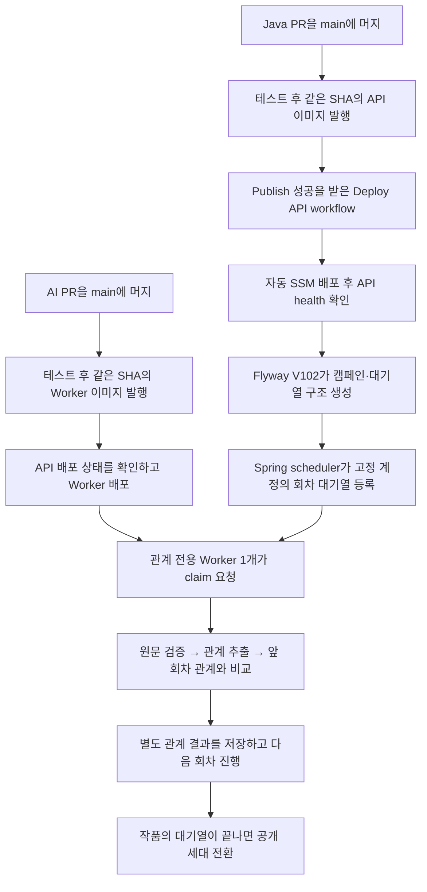

# 선정 계정 관계 자동 백필 — GH332

## 결과

고정된 선정 계정만 대상으로, 기존 회차 원문에서 인물 관계를 별도로 분석한다. 캐릭터·세계관
추출을 다시 실행하지 않으며 가족 가계도도 바꾸지 않는다. Java와 AI 변경을 순서대로 main에
머지하여 **각 배포가 성공하면** 운영자의 수동 백필 명령 없이 시작한다. PR 생성이나 merge
이벤트만으로 즉시 LLM을 호출하는 것은 아니다.

이번 캠페인은 `relationship-backfill-20261030-v1`이다. 2026-10-30 16:13:03 KST에 확정한
27계정(일반 회원26, 관리자1)이다. 선정 당시의 네 활동 조건 합집합에 피드백 작성자와
토큰 한도 추가 요청자를 합쳤다. 서버가 시작할 때 이 조건을 다시 계산하지 않는다.

- 최근14일 서로 다른 KST 날짜2일 이상 회차 업로드
- 전체 기간15화 이상 분석 성공(작품·회차 재분석 중복 제외)
- 전체 기간30화 이상 회차 업로드
- 보존된 로그인·자동 갱신 기록상3일 이상 연속 날짜
- 피드백 작성 또는 `QUOTA_EXHAUSTION` 한도 추가 요청

로그인 기록은 실제 방문일과 같은 의미가 아니다. 설정집 업로드는 회차 업로드 집계에서 제외했다.
개별 계정 ID·이메일·원고는 공개 저장소에 저장하지 않는다. 명단의 각 값은 캠페인 키,
회원 ID, 마이크로초 정밀도의 가입 시각을 함께 SHA-256한 fingerprint다. 다른 DB에서 우연히
같은 ID를 쓰는 계정을 편입하지 않으며, 해시는 로그인/인증 수단으로 쓰지 않는다.

## 배경과 책임

원문 저장, 사용자·작품 소유권, 분석 상태, 관계 이력, 과금 원장은 Java API/PostgreSQL이 소유한다.
Python Worker는 Java가 임대한 작업을 받아 원문을 읽고 모델을 호출한 뒤 결과를 돌려준다.
기존 일반 분석은 캐릭터·세계관과 관계를 함께 진행한다. 과거 관계만 채우려 일반 분석을
재실행하면 다른 설정까지 다시 비교하고 비용도 중복된다. 따라서 `RELATIONSHIP_EXTRACTION`
내부 작업과 전용 Worker를 추가한다.

일반 사용자 API로 이 내부 작업을 생성하거나 취소·조회할 수 없고, 회차의 최신 일반 분석
상태를 대신하지 않는다. 원문과 관계 결과를 다루는 기존 내부 API는 인증 키와 작업 lease를
그대로 요구한다. 일반 회차·설정집 분석 정책은 대상 작품의 관계 실행 경로 외에는 유지한다.

## 머지에서 실행까지

1. Java의 `.github/workflows/publish-image.yml`은 main push에서 검증과 이미지 발행을 수행한다.
   `.github/workflows/deploy-api-ec2.yml`은 성공한 발행 run의 SHA가 현재 main인지 확인한 뒤
   그 SHA의 Compose와 이미지를 배포한다. 배포 도구 내부에서 SSM을 쓰지만 사람이 SSM에
   접속해서 SQL/백필 명령을 입력할 필요는 없다.
2. `V102__add_relationship_cohort_backfill.sql`은 테이블·열·인덱스를 만든다.
   SQL migration 안에서 원문을 읽거나 모델을 호출하지 않는다. API는 migration 이후 기동한다.
3. 운영 `application-prod.yml`/`compose.api.prod.yml`은 기능을 기본 활성화한다. 기본
   10초 간격 scheduler가 `RelationshipBackfillCoordinator.bootstrap()`을 호출한다.
   캠페인 행 잠금과 `initialized` 기록으로 최초 등록을 한 번만 한다. active 회원·작품만
   고려하고, 선정 시각 이전에 저장된 보관 중 원문 key/hash가 있는 회차를 고정한다.
   대상 여부는 회차 생성 시각으로 정하고, 내용은 최초 bootstrap 시점의 현재 보존본으로 고정한다.
   이후 원문 변경은 차단 대상이다. API가 재배포되어도 완료한 작업을 새로 생성하지 않는다.
4. AI의 `.github/workflows/publish-image.yml`과 `deploy-worker-ec2.yml`은 같은 방식으로
   새 이미지를 발행하고 API 배포/health를 확인한 뒤 Worker를 배포한다.
   `deploy/compose.worker.prod.yml`에 포함된 `ai-relationship-worker`가 자동 기동한다.
   Java PR을 먼저, AI PR을 다음에 머지하는 순서다. CI나 배포 실패 시 그 단계에서 멈춘다.
5. Worker는 `/api/internal/v1/relationship-jobs/claim`을 반복 호출한다. 대상과 순서는
   Python에 복사한 명단이 아니라 Java DB 대기열이 결정한다. 한 캠페인에서 동시에 실행하는
   관계 Job은1개다. 행 잠금과 PostgreSQL 부분 unique index가 중복 실행을 제한한다.

## 왜 앞 회차부터 안전하게 채울 수 있는가

예를 들어 기존1~10화가 있고 백필이4화까지 진행한 사이11화의 일반 분석이 끝났다고 하자.
캐릭터·세계관은 기존대로 반영되고, 11화 관계만 같은 작품의 대기열에 추가된다.
Worker는5→6→…→10→11 순서로 이전 관계를 참고한다. 앞 회차의 일반 분석이 진행 중이면
그 결과와 충돌하지 않도록 기다린다. 배포 전후 사이 완료된 새 원문도 초기화 때 확인한다.

기존 공개 관계 결과는 `generation=0`, 백필 중 결과는 별도 세대에 저장한다.
`publishedGeneration`은 사용자가 읽는 세대이고 `buildingGeneration`은 Worker가 만드는
세대다. 작품의 대기열과 진행 중 핵심 분석이 끝난 뒤 같은 트랜잭션에서 공개 세대를 바꾼다.
따라서 백필 시작만으로 기존 관계도를 지우거나 아직 미완성인 중간 결과를 공개하지 않는다.
관계 node/edge의 ID는 공유하여 사용자의 설명 수정과 연결 삭제 억제를 유지한다.

진행 중1·3화 사이에2화가 추가되면3화 이후의 비교를 다시 대기시킨다. 원문이 같은 경우
이미 검증·저장한 관계 관측을 재사용하되, 앞 회차 관계가 달라졌으므로 비교 결정을 그대로
재사용하지 않는다. 전체 완료 후의 일반 재분석은 기존 관계 무효화 정책을 따른다.

## 코드 읽기

| 책임 | 파일 / 주요 지점 | 의미 |
|---|---|---|
| 고정 대상 | Java `relationship-backfill-20261030-v1.json`, `RelationshipBackfillManifest` | 명단과 선정시각을 검증하며 대상을 동적으로 늘리지 않음 |
| 실행 등록·순서 | Java `RelationshipBackfillScheduler`, `RelationshipBackfillCoordinator` | 초기화, 순서, 임대, 완료, 차단, 공개 전환 |
| 저장 구조 | Java `V102__add_relationship_cohort_backfill.sql` | 캠페인/작품/회차 상태와 관계 세대 |
| 기존 분석 연결 | Java `AnalysisJobWorkerServiceImpl` | 관리 중 작품의 inline 관계를 미루고 핵심 분석 완료 후 관계만 enqueue |
| 관계 문맥·공개 | Java `RelationshipGraphServiceImpl` | Worker는 만드는 세대, 화면은 공개된 세대를 읽음 |
| 토큰 경계 | Java `AiTokenServiceImpl` | 서비스 부담 여부, 목적, lease, 누적 예약 상한 검사 |
| 전용 Worker | AI `app/worker/relationship_worker.py` | 고정 S3 원문과 순수 청킹, 기존 관계 pipeline만 실행 |
| 배포 진입점 | 양쪽 `deploy/compose*.prod.yml`, `.github/workflows/` | 성공한 같은 SHA의 이미지/설정으로 자동 시작 |

Worker 입력은 `jobType=RELATIONSHIP_EXTRACTION`, `sourceKind=EPISODE`,
`analysisMode=CONFIRMED_ONLY`, 정수 `relationshipAnalysisContract.formatVersion=1`이다.
전용 claim/heartbeat/complete/fail을 사용하며, prepare/관계 결정 저장과 토큰 원장은 기존
`/api/internal/v1/analysis-jobs/{id}/relationship-analysis` 계열을 재사용한다.

원문의 key·version·SHA-256·회차 번호와 보관/파기 상태를 고정/검증한다. 관계 관측의
인용 위치도 기존 규칙대로 검증한다. 프로필 연결은 회차 cutoff 이전의 확인된 후보 출처만
사용하며, 현재 최신 프로필 전체를 가져와 과거 회차에 미래 이름을 노출하지 않는다.

## 비용, 중단과 남은 한계

- 최초 고정 과거 회차는 서버가 `relationshipServicePaid=true`로 지정한다. 실제 모델 사용량은
  원장에 기록하지만 사용자 잔액은 예약·차감하지 않고 토큰 계정도 새로 만들지 않는다.
  따라서 **사용자 차감0과 실제 제공자 비용0은 다르다**. 진행 중 합류한 새 일반 분석 회차는
  기존 사용자 과금 기준을 유지한다.
- 관계 전용 Job은 `RELATIONSHIP_EXTRACTION`/`RELATIONSHIP_COMPARISON` 목적만 허용한다.
  동일 예약 ID를 다른 작업/목적/모델/순번/예약량에 재사용하면 거절한다.
- 기본 상한은 **Job당 누적 raw 예약2,000,000**이다. 실패·반환·사용량 미확인 예약도 보수적으로
  포함하고 실제 사용량이 더 크면 큰 값을 사용한다. 캠페인 전체의 원화/달러 예산은 아니다.
- Worker는1프로세스·동시Job1·동시모델호출1이다. 기존 관계 Terra 모델/프롬프트를 재사용한다.
  원문 최대2MB·12청크를 넘으면 자르지 않고 실패한다. 캐릭터·세계관·임베딩 호출은 없다.
- lease는60초, 전용 Worker heartbeat는20초다. 프로세스가 죽으면 만료 작업을 회수하여
  최대3회 claim하며, PREPARED/COMPLETED 재개는 저장 관측/결정을 사용한다.
  준비 결과 저장 전 중단된 추출 호출은 재호출될 수 있어 모든 경우의 중복 비용0을 보장하지 않는다.
- 특정 회차가 실패하거나 원문이 교체되면 해당 작품을 `BLOCKED`로 남긴다. 다른 작품은 계속
  처리하지만 차단된 작품의 후행 관계를 자동으로 건너뛰지 않는다. 기존 공개 세대를 유지한다.
  시작 전 삭제된 회차만 건너뛰며, 이미 분석을 시작한 회차의 삭제는 차단한다.
  원인이 바뀐 작업을 무한 유료 재시도하거나 자동 해제하는 관리 API는 이번 범위에 없다.
- `RELATIONSHIP_BACKFILL_ENABLED=false`로 배포하면 새 초기화/claim을 멈춘다.
  이미 실행 중인1건은 완료 가능하고 관리 작품의 순서 보존·새 회차 대기 등록은 계속된다.
  다시 true로 배포하면 DB 상태에서 이어간다. flag만 바꾸면 이미 호출한 모델이 취소되지는 않는다.
- 새 세대가 생긴 뒤에는 세대 선택을 모르는 이전 Java 이미지로 단순 롤백하지 않는다.
  실행 일시 중지는 flag를 쓰고, 코드 복구는 세대 읽기 호환성을 유지하는 수정으로 배포한다.
- 일반 로컬 기본값은false이며 테스트는 scheduler도 끈다. 운영 데이터/LLM을 테스트에 쓰지 않는다.
- 초기 조회의 보관 중 원문은649회차였지만 실제 등록 건수는 배포 시점의 삭제·파기·상태와
  신규 회차 합류에 따라 달라진다.27계정 모두 원문을 가진 것은 아니다.

## 검증과 읽는 순서

합성 fixture로 선정 밖 계정 제외, 중복 초기화, 앞 회차 순서, 실행 중 새 회차, 원문 변경,
lease 회수, 공개 세대 보존, 사용자 토큰0과 raw 원장, 공개 API 경계를 검증한다.
실제 Spring HTTP·PostgreSQL/Flyway와 Python Worker를 잇는 테스트도 별도로 실행한다.
정확한 실행 결과는 각 PR의 확인 사항과 AI 로직 버전 상세에 기록한다. 테스트 통과를
운영 백필 완료나 실제 모델 정확도 평가로 해석하지 않는다.

최소 읽기 순서는 manifest → coordinator → graph service → Python worker →
Compose/배포 workflow다. 이 순서로 대상, 실행 권한, 공개 시점, 모델 호출, 자동 배포를
각각 분리해서 이해할 수 있다.

## 이해 확인

1. Java PR을 머지했는데 이미지 발행에 실패하면 백필은 어디까지 진행하며, 그 이유는 무엇인가?
2. 4화 백필 중11화 일반 분석이 끝났을 때 캐릭터·세계관과 관계의 반영 순서는 어떻게 다른가?
3. 공개 세대와 만드는 세대를 분리하면서 node/edge ID를 유지하는 이유는 무엇인가?
4. PREPARED 이후 Worker가 재시작한 경우와 원문 hash가 변경된 경우의 처리 차이는 무엇인가?
5. 사용자 토큰 차감0, raw 사용량 기록, Job당 예약 상한은 각각 무엇을 보장하고 무엇을 보장하지 않는가?
