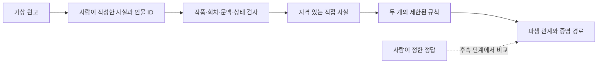

# 관계 온톨로지 실험: 1·2단계 설계

상태: **후속 Python 실험을 위한 설계·합성 정답 준비**. 제품 정책이나 구현 완료를 의미하지 않는다.

- 추적: [Java #438](https://github.com/catchhole-soma/catchhole-backend-java/issues/438)
- 조사일: 2026-11-17
- 조사 기준: AI `2224096347a5a4981fa369313afaa3c516ae95ee`, Java `3896bafa26ed6d5c1d75a28b7cbdc8caef882adb`의 `main` 코드. 작업 중인 다른 브랜치의 변경은 포함하지 않았다.
- 함께 읽을 자료: [합성 데이터·정답 계약](relationship-ontology-fixtures.md), [JSON 사례](../tests/fixtures/relationship_ontology_cases.json), [자료 무결성 검사](../tests/test_relationship_ontology_fixture.py)

## 1. 이번 작업을 쉬운 말로 설명하면

관계도에 선을 그리려면 먼저 “이 선은 무슨 뜻인지, 언제 연결해도 되는지”를 정해야 한다. 온톨로지는 이처럼 대상의 종류와 관계의 의미를 명시하는 모델이다. 추론 도구는 그 모델과 확인된 사실을 이용해 규칙에 맞는 결론을 계산한다. **관계도가 있거나 LLM이 관계를 찾아준다는 사실만으로 온톨로지 추론을 적용한 것은 아니다.**

이번에는 도구를 설치하기 전에 작은 시험의 문제와 정답을 만든다. 예를 들어 다음 가상 원고가 있다.

| 공개 회차 | 사람이 읽은 문장 | 입력으로 옮길 의미 |
| --- | --- | --- |
| 1화 | 도윤은 서연의 친아버지다. | 도윤 → 서연: 친부모, 확정 |
| 2화 | 서연이 하린의 친어머니라는 소문이 돌았다. | 서연 → 하린: 친부모, 추측 |
| 3화 | 서연은 하린의 친어머니임이 확인되었다. | 서연 → 하린: 친부모, 확정 |

1화까지 읽었다면 서연이 도윤의 자녀라는 역방향 표현은 가능하다. 2화까지 읽어도 도윤과 하린을 혈연 조부모 관계로 연결하면 안 된다. 3화까지 공개된 두 확정 사실이 **같은 인물·작품·서사 문맥**을 가리키면 도윤이 하린의 혈연 조부모라는 파생 관계를 제안할 수 있다. 결론에는 사용한 두 사실과 원문 출처가 따라야 한다.

이 예제의 인물 해소와 확정/추측 판정은 사람이 작성한다. 원고를 실제 LLM이 정확하게 읽는지는 이번에 평가하지 않는다. “혈연 조부모”는 성별을 추가로 추론하지 않는 `GRANDPARENT_OF + BIOLOGICAL` 의미이며, 부모 2단계의 방향을 표현한다.

## 2. 기존 코드에서 이미 하는 일

제품의 원본 계약은 Java 문서이며, 아래는 실험과 비교하기 위한 조사 결과다. 이 문서가 제품 계약을 대체하지 않는다. 링크는 조사한 커밋에 고정했다.

| 현재 기능 | 근거 | 실험에서의 판단 |
| --- | --- | --- |
| 가족 관계의 유형·세부유형·자기 관계 검사 | [RelationshipRules.java](https://github.com/catchhole-soma/catchhole-backend-java/blob/3896bafa26ed6d5c1d75a28b7cbdc8caef882adb/src/main/java/org/monitoring/catchholebackend/domain/relationship/processor/RelationshipRules.java#L25) | 이미 있는 의미 규칙이다. |
| 자녀→부모 역방향 정규화, 배우자·형제의 대칭 중복 정리 | [동일 소스](https://github.com/catchhole-soma/catchhole-backend-java/blob/3896bafa26ed6d5c1d75a28b7cbdc8caef882adb/src/main/java/org/monitoring/catchholebackend/domain/relationship/processor/RelationshipRules.java#L54) | 온톨로지의 새로운 효용으로 세지 않는다. |
| 명시된 조상 세대 차이의 충돌 검사 | [RelationshipGenerationRules.java](https://github.com/catchhole-soma/catchhole-backend-java/blob/3896bafa26ed6d5c1d75a28b7cbdc8caef882adb/src/main/java/org/monitoring/catchholebackend/domain/relationship/processor/RelationshipGenerationRules.java#L17) | 모르는 세대·중간 인물·새 관계를 채우는 추론기는 아니다. |
| 현재 프로필과 현재 출처가 지지하는 가족 명제만 사용 | [가족 계약](https://github.com/catchhole-soma/catchhole-backend-java/blob/3896bafa26ed6d5c1d75a28b7cbdc8caef882adb/docs/family-relationships-v1.md#L9) | 여러 명제를 합성한 새 결론은 기존 자동 확정 정책 밖이다. |
| 근거 유효성·검토 상태·서사 시점 구분 | [가족 계약의 상태·근거 수명](https://github.com/catchhole-soma/catchhole-backend-java/blob/3896bafa26ed6d5c1d75a28b7cbdc8caef882adb/docs/family-relationships-v1.md#L67) | 파생 결과도 이 구분을 잃으면 안 된다. |
| 일반 관계의 회차별 지식, 방향·감정·행동 구분, 모호한 인물 보류 | [관계 비교 프롬프트](https://github.com/catchhole-soma/catchhole-backend-ai/blob/2224096347a5a4981fa369313afaa3c516ae95ee/app/llm/prompts/relationship_comparison.md#L5) | 의미 분류 정책은 이미 있다. |
| 가족 그래프와 일반 관계도의 독립 운영 | [일반 관계 계약](https://github.com/catchhole-soma/catchhole-backend-java/blob/3896bafa26ed6d5c1d75a28b7cbdc8caef882adb/docs/episode-relationships.md#L3) | 실험용 공통 표현을 만든다고 두 제품 저장소·API를 합치지 않는다. |

양쪽 기준 코드·의존성에서 RDF/OWL/SHACL 도구, 전용 온톨로지 파일, 일반적인 관계 추론 엔진은 확인되지 않았다. 따라서 “관계 의미 모델은 이미 있으나 표준 온톨로지 도구를 적용한 추론 실험은 아직 없다”가 현재 상태다.

## 3. 먼저 답해야 할 질문과 최소 규칙

온톨로지 설계에서는 모델로 답하려는 질문을 먼저 적는다. 이를 competency question이라고 부른다. 이번 질문은 다음과 같다.

| 질문 | 정답의 기준 |
| --- | --- |
| Q1. A가 B의 부모라면 반대 방향으로 무엇을 표시하는가? | B가 A의 자녀. 부모의 세부유형과 문맥을 보존한다. 기존 의미의 재표현이다. |
| Q2. A→B, B→C가 모두 확정된 친부모면 무엇을 알 수 있는가? | 동일한 인물 ID와 문맥을 확인한 뒤 A→C 혈연 조부모. 두 전제의 근거를 함께 제시한다. |
| Q3. A가 B를, B가 C를 신뢰하면 A가 C를 신뢰하는가? | 도출하지 않는다. 신뢰는 전이 관계로 정의하지 않는다. B가 A를 신뢰한다고 뒤집지도 않는다. |
| Q4. 추측·부정·가정만 있다면 혈연 조부모를 만들 수 있는가? | 확정 사실로 승격하지 않는다. 긍정 결론을 만들지 않은 이유를 보존한다. |
| Q5. 2화 조회에 3화의 확인 문장을 쓸 수 있는가? | 사용할 수 없다. 추론 입력을 구성하기 전에 공개 회차로 제한한다. |
| Q6. 같은 이름이거나 다른 작품의 인물이어도 연결하는가? | 이름으로 합치지 않는다. 작품과 안정적인 인물 ID가 기준이다. |
| Q7. 근거 하나가 철회되면 결론도 사라지는가? | 모든 증명 경로가 끊기면 제거한다. 독립적인 유효 경로가 남으면 그 근거로 유지한다. |
| Q8. 원문 인용이 삭제되면 사실도 거짓인가? | 아니다. 현재 Fact의 유효성과 인용 조회 가능성을 별도로 판단한다. |
| Q9. 현재 가족 프로필만으로 1화 당시 가족관계를 복원할 수 있는가? | 지식 공개 이력이 없으면 지원 불가다. 빈 그래프를 성공한 과거 조회처럼 돌려주지 않는다. |

두 규칙만 후속 구현 대상으로 고정한다.

```text
R_PARENT_INVERSE
  PARENT_OF(A, B, subtype, context)
  ⇒ CHILD_OF(B, A, 같은 subtype, 같은 context)
  성격: 같은 사실의 역방향 표현, 신규 지식 효과로 평가하지 않음

R_BIOLOGICAL_GRANDPARENT
  PARENT_OF(A, B, BIOLOGICAL, context)
  + PARENT_OF(B, C, BIOLOGICAL, 같은 context)
  ⇒ GRANDPARENT_OF(A, C, BIOLOGICAL, 같은 context)
  성격: 두 사실을 연결한 실험용 파생 관계
```

두 규칙은 아무 입력에나 적용하는 전역 규칙이 아니다. 아래 입력 자격 검사를 통과한 직접 사실에만 적용한다. 혈연 조부모를 다시 부모 전제로 쓰거나 무제한 조상 폐쇄를 계산하지 않는다. 양부모·의붓부모·미상 부모 연쇄는 이번 혈연 조부모 규칙의 범위 밖이다. 양부모의 역방향 자녀 표현 자체는 허용한다.

## 4. 사실이 추론에 들어가기까지

다음은 **후속 구현의 설계**이며 이번 PR에서 실행되는 파이프라인이 아니다.



1. **입력 능력을 확인한다.** 현재 snapshot밖에 없는 데이터에 과거 지식 조회를 요구하면 `UNSUPPORTED`다. 실제 데이터에 없는 회차 정보를 발명하지 않는다.
2. **작품과 인물을 확인한다.** 같은 작품의 고유 ID로 연결한다. 인물이 미해결이면 해당 명제를 보류하고, 다른 작품의 인물을 끌어온 입력은 거절한다. `owl:sameAs`를 이름 유사성 처리에 쓰지 않는다.
3. **시간을 분리한다.** `cutoffEpisode`는 독자에게 공개된 범위이고 `temporalContextId`는 관계가 성립하는 같은 서사 문맥이다. `snapshotRevision`은 데이터 정정 상태다. 시스템 등록시각과도 다르다.
4. **주장의 성격을 확인한다.** 확정 주장과 추측·부정·가정을 구분한다. 원문에 문장이 있다는 사실만으로 문장의 내용이 참인 것은 아니다.
5. **현재 사용 자격을 확인한다.** 유효한 지원 사실만 남긴다. 검토 보류·철회·사용자 삭제 억제 등을 자동 승인하거나 되살리지 않는다. 원문 파기 여부만으로 현재 Fact를 무효화하지 않는다.
6. **의미 충돌을 분리한다.** 자기 관계·순환처럼 실험 전제에 어긋나는 입력은 거절 사례로, 명시된 세대 차이 충돌은 보류 사례로 다룬다. 제품의 기존 검증기와 실험의 엄격한 입력 범위를 같은 것으로 주장하지 않는다.
7. **규칙과 출처를 함께 적용한다.** 도출된 한 관계에 증명 경로가 둘이면 둘 다 남긴다. 철회 후에는 해당 snapshot의 자격 있는 사실에서 다시 계산하는 방식부터 시작한다. 증분 삭제 최적화는 후속이다.

가족의 `CURRENT/HISTORICAL/UNKNOWN`과 일반 관계의 `PRESENT/PAST/HYPOTHETICAL/UNKNOWN`은 이름을 바꿔 한 상태로 합치지 않는다. 합성 데이터는 실험 문맥을 명시하며, 실제 데이터 변환 규칙은 5단계에서 별도로 설계한다. 모르는 시점을 현재라고 간주하지 않는다.

## 5. 데이터와 결과의 의미

정확한 필드·열거값·사례 목록은 [fixture 계약](relationship-ontology-fixtures.md)을 기준으로 한다. 핵심 객체는 다음과 같다.

| 객체 | 쉬운 설명 | 필요한 구분 |
| --- | --- | --- |
| Entity | 작품에 속한 인물 | 표시 이름과 인물 ID는 다름 |
| Source | 어느 회차의 어떤 문장인가 | 원문 이용 가능성과 사실 유효성은 다름 |
| Assertion | 누가 누구와 어떤 관계라는 주장 | 확정·추측·부정·가정, 문맥, 현재 사용 자격 |
| Direct relation | 자격을 통과한 직접 사실 | 원고의 모든 주장을 그대로 복사하지 않음 |
| Derived relation | 정해진 규칙으로 얻은 표현/결론 | 역관계 재표현과 새로운 2단계 결론을 구분 |
| Proof | 결론을 지지하는 전제와 출처 묶음 | 한 묶음 안의 전제는 모두 필요, 대체 묶음은 독립 경로 |
| Withheld / forbidden | 보류 사유 / 이번 입력으로 내면 안 되는 결과 | “모르므로 미도출”을 “현실에서 거짓”과 혼동하지 않음 |

예를 들어 도윤→하린의 혈연 조부모 결론에는 `R_BIOLOGICAL_GRANDPARENT`, 도윤→서연과 서연→하린의 assertion ID, 두 출처 ID가 함께 필요하다. 두 전제를 각각 다른 독립 원문으로도 확인했다면 가능한 대체 증명을 보존한다. 한 증명 경로의 지지 사실이 철회되더라도 다른 유효 경로를 보존해야 한다. 원문 인용만 파기된 경우에는 지지 사실의 철회로 간주하지 않는다.

후속 실행 결과는 기존 제품의 `CONFIRMED` 관계와 분리한 읽기 전용 결과다. 제품 Fact, 가족 관계 row, 일반 관계 이력에 자동 저장하지 않는다. “보류/거절/지원 불가”도 성공한 빈 결과와 구분한다. 기대 관계 목록은 정확한 집합으로 비교하여 불필요한 추가 관계도 실패로 발견할 수 있어야 한다.

철회 사례는 개별 주장·지지 사실이 더 이상 유효하지 않은 경우다. 사용자가 관계 전체를 철회하거나 삭제 억제한 경우는 별개이며, 다른 근거가 있다고 자동 부활시키면 안 된다. 현재 합성 사례는 이 제품 억제 상태까지 모델링하거나 검증하지 않는다. 실제 adapter를 만드는 단계에서 별도 입력·회귀 사례가 필요하다. 신뢰 사례는 제품의 `ATTITUDE + TRUST + DIRECTED`만 축약한 것으로, 모든 관계 축·방향 조합을 포괄하지 않는다.

## 6. 직접 만드는 부분과 가져다 쓸 부분

우리가 만들어야 하는 것은 **CatchHole에서 관계가 의미하는 바, 자격 조건, 인물·시간·근거의 연결 규칙**이다. 일반 라이브러리가 작품의 추측 표현이나 독자 지식 시점을 대신 정해주지는 않는다.

| 후속 역할 | 사용할 표준/도구 후보 | 우리가 정할 부분 |
| --- | --- | --- |
| 의미와 데이터 표현 | RDF/RDFS/OWL, RDFLib | 클래스·관계 ID·문맥과 근거를 가진 주장 모델 |
| 입력 구조 검사 | SHACL, pySHACL | 필수 ID/유형/참조와 허용 구조. 문장이 참인지 판정하는 기능은 아님 |
| 허용된 관계 계산 | 제한된 규칙 실행, 필요시 OWL 2 RL 도구 비교 | 자격 있는 문맥별 그래프와 두 규칙, 증명 추적·재계산 |
| 출처 표현 | PROV-O 등 기존 어휘 검토 | assertion·원문·도출 활동의 대응, 파기 후 공개 범위 |
| 설계 검토 | 필요시 Protégé | 편집·확인 도구일 뿐 런타임 서버나 추출기를 대신하지 않음 |

3단계에서 RDFLib·pySHACL을 작은 로컬 실험 의존성으로 검토한다. 전체 triple store, Neo4j, Kafka, 외부 서비스 도입은 이 실험의 전제 조건이 아니다. 현재 DB 큐와 Worker 확장 논의는 별개 작업이다.

OWL의 클래스/관계 의미와 SHACL의 입력 제약을 구별한다. 예를 들어 OWL의 domain/range 선언은 자료의 타입을 추론하는 의미이지, 잘못된 타입 입력을 자동 거절하는 폼 검사가 아니다. 추측·시간·철회 상태를 전역 부모 triple로 모두 펼쳐놓고 OWL 도구를 돌리는 방식은 피한다. 일반적인 OWL 추론만으로 현재성 선택·철회·근거별 삭제·사용자 억제 정책이 해결되는 것도 아니다.

외부 표준의 개념을 재사용하되, 이번 JSON은 표준 RDF/OWL 문서가 아니다. `owlrl` 같은 도구를 쓰더라도 지원 프로파일은 OWL 2 RL이며 전체 OWL 기능을 지원한다고 표현하지 않는다. 4단계 구현 시 두 규칙에 필요한 기능과 증명 추적 가능성을 확인하여 도구를 결정한다.

## 7. 이번 완료 기준과 검증의 한계

1단계 완료 기준은 현재 기능과 신규 실험의 차이, 질문, 규칙, 자격 조건, 입력·결과 계약, 후속 작업 경계가 문서에 있는 것이다. 2단계 완료 기준은 이 계약을 보여주는 합성 원고·사람이 작성한 입력/정답과 재현 가능한 자료 무결성 검사가 있는 것이다.

자료 무결성 검사는 JSON 구조, 고유 ID, 참조 존재, 원문 인용 일치, 정답과 금지 결과의 충돌, 정답에 선언된 증명의 연결을 확인한다. 금지 입력 사례 자체를 없애지 않고 의도한 거절/보류 기대값과 함께 보존한다. **정답을 계산하는 추론기와 같은 구현을 만들어 정답 파일을 생성하지 않는다.**

검사 통과는 자료가 내부적으로 일관된다는 뜻이다. 다음은 아직 미구현·미측정이다.

- 실제 RDF/OWL 모델 로딩·SHACL 검증과 추론 실행.
- 원고에서 주장/인물/시점을 뽑는 LLM의 정확도.
- 운영 데이터에 대한 변환 가능성과 관계 품질 향상.
- 처리량, 지연, 비용, 서비스 장애/철회 반영 성능.
- 제품 API·UI·DB 반영과 배포.

현재 데이터를 기존 Java/Python 로직에 넣어 비교 실행한 것도 아니다. 규칙 감사는 코드 조사이며, 실행 baseline 측정과 다르다. 앞으로 비교할 때도 역방향 정규화 성공을 신규 효용으로 세지 않고, 새 혈연 조부모 결론과 근거 설명의 이득을 따로 측정해야 한다.

## 8. 다음에 한 번씩 지시할 작업

| 단계 | 할 일 | 끝났다고 판단할 결과 |
| --- | --- | --- |
| 1·2 — 이번 작업 | 현황·규칙 설계, 합성 입력과 수작업 정답, 무결성 검사 | 문서·fixture·검사 명령과 결과 |
| 3 | 최소 RDF 어휘와 SHACL 제약 작성, 합성 JSON을 RDF로 변환 | 원문·인물·주장·문맥을 손실 없이 읽고, 정상/의도적 오류를 구분하는 로컬 검사. 새 관계는 아직 계산하지 않음 |
| 4 | 두 규칙 실행과 증명 기록, 입력 자격·철회 후 재계산 연결 | 2단계의 정확한 정답 집합과 실제 결과 비교. 금지 결론·대체 근거 사례까지 통과 |
| 5 | 실제 계약을 읽는 adapter 설계·구현 | 지원 가능한 조회와 불가능한 조회를 명시. 실제 자료는 승인된 읽기 범위에서만 사용 |
| 6 | 기존 방식과 온톨로지 실험 비교 | 같은 입력의 누락·오추론·근거 설명·지연을 측정. 개선 없음도 결과로 기록 |
| 7 | 실제 실험 결과를 보여주는 로컬 화면 | 합성 예시를 연출한 화면과 실제 엔진 출력을 구분 |
| 8 | 제품 API 연결 설계·구현 | 권한·스냅샷·직접/파생 구분·철회 정책을 Java 계약에 반영 |
| 9 | 제품 관계도 연결 | 출처와 도출 이유를 사용자가 확인하고 직접 관계와 구분 가능 |

3단계를 시작할 때 먼저 이 문서와 fixture 계약을 읽고, `expected`를 변환기 입력으로 사용하지 않는 분리를 만든다. 기존 프롬프트나 제품 의미를 바꾸는 단계에 들어가면 해당 저장소의 버전 기록·공통 계약 갱신 절차를 따로 적용한다.

## 참고한 설계·표준 자료

- [Stanford Ontology Development 101](https://protege.stanford.edu/publications/ontology_development/ontology101-noy-mcguinness.html): 범위·질문·재사용 어휘를 먼저 정하는 설계 과정.
- [W3C RDF 1.1 Concepts](https://www.w3.org/TR/rdf11-concepts/), [OWL 2 Overview](https://www.w3.org/TR/owl2-overview/): 그래프 표현과 의미 모델.
- [W3C SHACL](https://www.w3.org/TR/shacl/): RDF 그래프 제약 검증.
- [W3C PROV-O](https://www.w3.org/TR/prov-o/): 출처·활동·도출 관계의 표현.
- [RDFLib](https://rdflib.readthedocs.io/en/stable/), [pySHACL](https://github.com/RDFLib/pySHACL), [OWL-RL](https://owl-rl.readthedocs.io/en/latest/): 후속 Python 실험 도구 후보. 이번 변경에는 설치하거나 의존성으로 추가하지 않았다.
