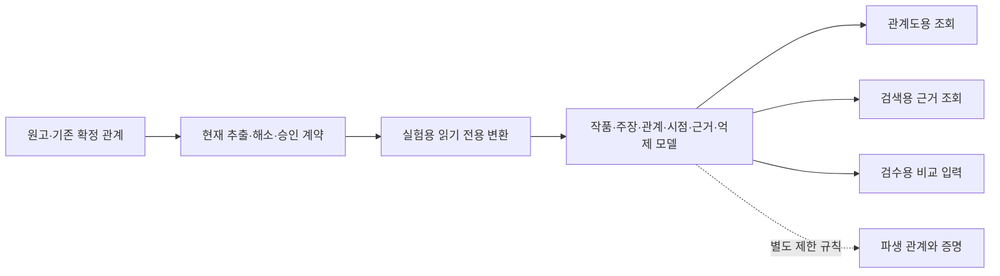

# 관계 의미 모델과 온톨로지 도입 검토: 1·2단계

상태: **제품 질문·공통 의미 계약·합성 정답을 준비한 설계 단계**. 실제 소비자 연동, RDF 모델, 추론 엔진, 도입 효과는 아직 구현·측정하지 않았다.

- 추적: [Java #438](https://github.com/catchhole-soma/catchhole-backend-java/issues/438), [AI PR #156](https://github.com/catchhole-soma/catchhole-backend-ai/pull/156)
- 조사 기준(2026-11-17 재확인): AI `2224096347a5a4981fa369313afaa3c516ae95ee`, Java `3896bafa26ed6d5c1d75a28b7cbdc8caef882adb`의 main. 기존 작업 브랜치의 미완료 변경은 포함하지 않았다.
- 읽는 순서: 이 문서 → [일반 관계의 제품 질문과 예제](relationship-semantics-fixtures.md) → [가족 규칙 회귀 자료](relationship-ontology-fixtures.md) → [다음 단계 실행 명세](relationship-ontology-next-step.md)
- 이 문서는 후속 Python 로컬 실험의 제안이다. 제품 정책의 원본은 Java이며, 공통 제품 계약을 이 문서로 대체하지 않는다.

## 1. 무엇을 개선하려는가

목표는 **관계도·검색·검수가 관계의 뜻을 공유하도록 만들 가치가 있는지 확인하는 것**이다. 가족 관계는 작은 규칙 시험 대상이며, 서비스 전체의 목표가 아니다. 조부모를 계산하는 것은 일반 코드로도 가능하므로 그 성공만으로 온톨로지의 필요성을 주장하지 않는다.

가상의 원고에 “서연은 도윤을 신뢰하지만 도윤은 서연을 의심한다. 두 사람은 함께 적과 싸웠다”가 있다고 하자. 이 내용을 사용하는 기능들은 적어도 다음 의미를 일관되게 보존해야 한다.

| 사용하는 기능 | 실험에서 확인하려는 동작 | 현재 상태 |
| --- | --- | --- |
| 관계도 | 서로 다른 방향의 신뢰·불신과 협력 행동을 구분해 표시 | 기존 관계도에도 축·방향·회차 계약이 있음 |
| 검색/답변용 조회 | “서연이 신뢰하는 사람”과 “서연을 신뢰하는 사람”의 근거를 다르게 반환 | 원문/설정 조회는 존재. 새 공통 관계 모델 소비는 미구현 |
| 검수용 비교 입력 | 협력 행동과 불신이 함께 있다는 이유만으로 모순이라고 단정하지 않음 | 기존 검수는 원문/설정을 판단. 관계 모델을 공통 입력으로 받는 연결은 미구현 |

현재 관계도에 틀이 없거나, 온톨로지가 없어서 검색·검수가 실제로 오답을 냈다고 확인한 것은 아니다. **여러 기능에 같은 관계 의미를 전달할 때 해석·구현의 중복을 줄일 수 있는가**가 검증할 가설이다. 자연어를 읽는 정확도, 실제 챗봇 답변 품질, 검수의 오탐 개선은 별도 평가가 필요하다.

도입 선택지는 세 가지다. 어느 것이든 제품 질문을 해결하면 후보가 된다.

| 선택지 | 하는 일 | 확인할 점 |
| --- | --- | --- |
| A. 현재 계약 재사용 | 기존 관계 DTO/API와 정책을 필요한 곳에서 읽음 | 새 모델 없이도 충분한가? 실제 소비자 연결 작업은 얼마나 필요한가? |
| B. 공통 typed 모델 | 관계와 주장의 의미를 공유 데이터 구조로 명시하고 일반 Python 코드로 조회·검사 | 공통화만으로 의미 손실과 중복 구현을 줄일 수 있는가? |
| C. RDF 기반 모델 | 같은 개념을 RDF로 표현하고 SHACL 검증·공통 질의 등으로 사용 | B에 비해 추가 재사용 이점이 있는가? 변환·도구 비용을 정당화하는가? |

A는 현재 코드 조사 기준이고, B/C는 후속 실험 구현이다. A가 이미 새 합성 파일을 읽어 실행했다고 기록하지 않는다. B만 유용하면 B에서 멈출 수 있다. C의 추가 이득이 없으면 표준 온톨로지 도구를 도입하지 않는다.

## 2. 온톨로지 설계와 if문의 역할

온톨로지 설계는 대상의 종류·관계·의미를 명시하는 일이다. 이를 실행하는 코드는 직접 작성할 수도, 그 의미를 지원하는 범용 도구를 사용할 수도 있다. `if`문 사용 여부가 온톨로지인지 아닌지를 결정하지 않는다. RDF/OWL 사용 자체도 도입의 효용을 증명하지 않는다.

| 구분 | 이번 범위에서의 예 | 구현 상태 |
| --- | --- | --- |
| 의미 모델 | 같은 인물 쌍에도 감정·사회·행동 관계가 공존하며 축과 방향은 별도 속성 | 기존 정책 조사와 실험 계약 작성 |
| 입력 검증 | 출처·인물 ID가 존재하고, 선언된 결과가 조회 범위에 속하는지 확인 | 합성 정답 자료 무결성 검사만 구현 |
| 조회 | 선택 회차의 특정 방향/축 관계와 근거를 읽음 | B/C 실행 비교는 3단계 |
| 추론 | 허용된 부모 두 단계에서 혈연 조부모를 계산 | 예제와 정답만 준비, 실행은 4단계 |
| 자연어 판정 | “의심했다”가 누구의 어떤 태도인지 해석 | 기존 LLM 경로의 별도 책임. 이번에는 수작업 입력으로 고정 |

현재 검사 코드의 조건문은 미리 적은 입력·정답·근거 연결을 확인한다. 그래프를 탐색해 새로운 정답을 만들어내는 엔진이 아니다. SHACL도 구조 제약을 검사하는 도구이며 자연어 진위를 판정하지 않는다. 시점 필터·사용자 삭제 억제·철회는 RDF 저장이나 OWL 추론만으로 자동 해결되지 않는다.

## 3. 이미 있는 기능과 보존해야 할 계약

아래는 조사한 커밋에 고정한 근거다. 기존 기능을 신규 온톨로지 성과로 중복 계산하지 않는다.

| 기존 능력 | 근거 | 새 실험의 경계 |
| --- | --- | --- |
| 일반 관계의 축·방향·상태·지식 회차, 관측과 확정 관계 구분 | [일반 관계 계약](https://github.com/catchhole-soma/catchhole-backend-java/blob/3896bafa26ed6d5c1d75a28b7cbdc8caef882adb/docs/episode-relationships.md) | 현재도 typed 모델이다. 원래 tuple을 보존해야 함 |
| 일방적 태도, 협력과 친구의 구별, 서로 다른 축 공존 | [비교 프롬프트](https://github.com/catchhole-soma/catchhole-backend-ai/blob/2224096347a5a4981fa369313afaa3c516ae95ee/app/llm/prompts/relationship_comparison.md) | 같은 정답을 내는 것만으로 품질 향상이라고 하지 않음 |
| 같은 slot 식별, 근거/회차/참조 검증 | [RelationshipGraphRules](https://github.com/catchhole-soma/catchhole-backend-java/blob/3896bafa26ed6d5c1d75a28b7cbdc8caef882adb/src/main/java/org/monitoring/catchholebackend/domain/relationship/processor/RelationshipGraphRules.java) | 축·방향·종류를 잃은 단순 연결로 축소하지 않음 |
| 가족의 역방향·대칭 정규화, 세부유형 | [RelationshipRules](https://github.com/catchhole-soma/catchhole-backend-java/blob/3896bafa26ed6d5c1d75a28b7cbdc8caef882adb/src/main/java/org/monitoring/catchholebackend/domain/relationship/processor/RelationshipRules.java) | 역관계는 이미 있는 의미의 재표현 |
| 명시 세대 차이 충돌 검사 | [RelationshipGenerationRules](https://github.com/catchhole-soma/catchhole-backend-java/blob/3896bafa26ed6d5c1d75a28b7cbdc8caef882adb/src/main/java/org/monitoring/catchholebackend/domain/relationship/processor/RelationshipGenerationRules.java) | 임의의 중간 인물·세대·새 관계를 생성하지 않음 |
| 현재 PROFILE와 현재 provenance 기반 가족 관계 | [가족 계약](https://github.com/catchhole-soma/catchhole-backend-java/blob/3896bafa26ed6d5c1d75a28b7cbdc8caef882adb/docs/family-relationships-v1.md) | 현재 가족 snapshot으로 과거 회차를 복원한다고 약속하지 않음 |
| 설정/원문 기반 검색·검수 | [설정 도구](setting-tools-v1.md), [챗봇 조회 계약](chat-query-quality-v1.md), [검수 계약](setting-validation-v1.md) | 공통 관계 모델을 소비하는 경로와 실제 품질 개선은 후속 범위 |

일반 관계의 slot은 **인물 쌍 + axis + kind + direction**이다. `DIRECTED`는 순서를 보존하고 `MUTUAL/UNDIRECTED`는 대칭으로 식별한다. `COOPERATION`이라는 kind만 보고 항상 `INTERACTION + MUTUAL`로 바꾸면 안 된다. 기존 코드에는 `SOCIAL + COOPERATION`, 방향이 DIRECTED인 협력 등도 존재한다. 현재 실험의 특정 조합은 예제일 뿐 전역 매핑 규칙이 아니다.

일반 관계의 선택 회차는 **독자가 알게 된 지식 범위**다. 서사 사건의 과거 상태 복원이 아니다. 공개 노드 이름이 현재 프로필 이름일 수도 있으므로, 모든 표시 정보가 당시 이름까지 재현한다고 말하지 않는다. 가족과 일반 관계의 시간 enum, 인물 해소 정책, 원문 파기·유효성 정책도 그대로 구분한다.

## 4. 제품 질문을 먼저 고정한다

아래 P1~P5는 [일반 관계 합성 사례](relationship-semantics-fixtures.md)의 기준이다. 기존 기능을 보존하면서 여러 소비자가 공유할 수 있는지를 시험한다.

| ID | 제품 질문 | 맞는 답의 조건 |
| --- | --- | --- |
| P1 | A가 B에게 갖는 감정과 B가 A에게 갖는 감정은? 동료 관계도 같이 존재하는가? | 방향·축·종류를 각각 유지하고 한 인물 쌍의 여러 slot을 하나로 합치지 않음 |
| P2 | 두 사람이 함께 싸웠다는 사실로 친구라고 표시해도 되는가? | 확인된 협력 tuple만 유지. 친구·동맹·상호 감정을 추가 생성하지 않음 |
| P3 | N화 독자가 아는 관계와 이야기 속 과거 관계는 같은가? | 공개 회차를 지키고, 과거 사건 시점 복원은 자료가 없으면 지원 불가 |
| P4 | 이 관계는 누구에 대한 어떤 근거로 확인됐는가? | 확정 사실·소문·가정·미해소 인물을 분리하고 근거를 연결함 |
| P5 | 관계 종료, 근거 정정, 사용자 관계 삭제는 어떻게 다른가? | ENDED 이력·잘못된 지지 사실·삭제 억제 상태를 구분. 대체 근거로 사용자 삭제를 부활시키지 않음 |

관계도·검색·검수의 표현 형식은 달라도, 같은 입력·질의 범위에서 참조하는 관계의 뜻은 같아야 한다. 2단계의 소비자 예시는 동일한 사실 ID 집합을 읽도록 명시한 **최소 계약**이다. 실제 검색 랭킹, 답변 생성, 검수 판정, 사용자 화면의 개선까지 증명하는 자료는 아니다. 향후 소비자가 서로 다른 조회 범위를 요구하면 그 차이를 명시해야 하며 항상 같은 결과 수를 강제하지 않는다.

## 5. 최소 공통 개념 모델

아래는 Python 실험에서 공유할 개념이며 아직 RDF 클래스·속성을 구현한 것은 아니다. 정확한 JSON 필드는 각 fixture 문서를 따른다.

| 개념 | 의미 | 반드시 보존할 구분 |
| --- | --- | --- |
| Work | 작품 범위 | 다른 작품의 인물·근거를 섞지 않음 |
| Person node / Mention | 해소된 인물 노드 / 원문 지칭 | 미등록 노드와 미해소 지칭은 다름. 이름으로 임의 병합하지 않음 |
| Source | 회차와 원문 근거 | 인용 가능성과 사실 유효성, 공개 회차와 작중 시점을 구분 |
| Claim | 원문이 제시한 주장·관측 | 명시·추측·가정과 인물 해소/보류 상태를 보존 |
| Relation fact | 현재 질의 입력이 확정 사실로 제공한 관계 slot | axis/kind/direction, ACTIVE/ENDED, 근거를 보존 |
| Query context | 작품·독자 지식 회차·지원하는 조회 종류 | 지원 불가를 빈 결과 성공으로 바꾸지 않음 |
| Suppression | 사용자가 관계 전체를 삭제해 재등장을 막는 상태 | 서사 속 종료나 근거 한 개의 철회와 다름 |
| Derivation / Proof | 허용 규칙으로 얻은 결과와 전제 묶음 | 직접 사실과 구분. 가족의 별도 회귀 자료에만 존재 |

예를 들어 “서연이 도윤을 신뢰한다는 소문”이라는 Claim을 저장하는 것과, “서연→도윤 신뢰”를 확정 Relation fact로 제공하는 것은 다른 일이다. 출처·회차·확실성이 붙는 관계를 단순한 `서연 —신뢰→ 도윤` 한 줄로만 펼치면 이 차이를 잃는다. RDF 후보도 주장/관계 기록을 노드로 표현하고, 사용할 수 있는 확정 사실의 투영을 구분해야 한다. 합성 claim의 subject/object는 의미 방향까지 수작업으로 해석한 것이며, 실제 Observation의 참여자 순서를 그대로 복사한 값이 아니다.



위 화살표는 **목표 구조**다. 현재 제품이 이 공통 모델로 연결됐다는 뜻이 아니다. LLM 추출·Java 승인/권한·회차 선택·사용자 정정의 책임은 유지한다. 조직·장소·사건 전체를 이번에 지식 그래프로 구축하거나 DB·가족/일반 관계 API를 합치지 않는다.

## 6. 예제 묶음의 역할

| 자료 | 역할 | 이 자료만으로 증명하지 못하는 것 |
| --- | --- | --- |
| [일반 관계 10개 사례](relationship-semantics-fixtures.md) | P1~P5의 의미·시점·상태와 소비자 공통 입력 계약 | 실서비스의 검색/검수 품질, 현재 코드의 실행 baseline, RDF 효용 |
| [가족 중심 24개 사례](relationship-ontology-fixtures.md) | 역표현·두 부모 연결·금지 추론·대체 근거·철회 회귀 | 제품 전체 온톨로지, 표준 도구의 우월성 |
| 두 fixture의 무결성 검사 | ID·인용·출처·정답의 참조/범위/선언 증명 연결 확인 | 추론 엔진의 실제 출력, 자연어 의미 판정, 전체 정답의 완전성 |

두 JSON은 각자의 `schemaVersion`과 필드 의미를 가진 독립 fixture다. 둘 다 버전 숫자가 1이어도 같은 계약이라는 뜻은 아니다. 일반 관계의 주장·slot 수명과 가족의 현재 provenance를 한 상태 enum으로 통합하지 않는다. 별도 loader를 두고 명시한 의미만 공통 모델에 매핑하는 것이 다음 단계의 과제다.

가족 회귀의 최소 규칙은 유지한다.

```text
R_PARENT_INVERSE
  PARENT_OF(A, B, subtype, context)
  ⇒ CHILD_OF(B, A, 같은 subtype, 같은 context)
  기존 의미의 역표현이며 신규 지식 효과로 세지 않음

R_BIOLOGICAL_GRANDPARENT
  PARENT_OF(A, B, BIOLOGICAL, context)
  + PARENT_OF(B, C, BIOLOGICAL, 같은 context)
  ⇒ GRANDPARENT_OF(A, C, BIOLOGICAL, 같은 context, gap=2)
  자격 있는 직접 사실에만 적용하는 읽기 전용 실험 결과
```

원문 파기와 사실 철회, 지지 사실 하나의 철회와 사용자 관계 전체 삭제를 구분한다. 가족 24개는 사용자 관계 전체 삭제 억제를 검증하지 않는다. 일반 관계의 삭제 예제로 그 일부를 추가하더라도 가족의 해당 정책까지 검증됐다고 합산하지 않는다. 무제한 조상 추론·미상 부모 생성·감정 전이·상호감정 추정은 범위 밖이다.

## 7. 개선 효과의 비교와 도입 판단

비교 시 입력 원고·수작업 해석·질의·정답·기준 커밋을 고정한다. LLM·프롬프트를 동시에 바꾸지 않는다. 공통 모델의 효과와 자연어 추출 효과를 섞지 않는다. 아래 수치는 **현재 모두 미측정**이며, 합성 자료 검사 통과를 채워 넣지 않는다.

| 항목 | 다음 실험에서 기록할 근거 | 통과/판정 기준 |
| --- | --- | --- |
| 의미 보존 | 각 query의 관계 tuple·상태·근거·지원 가능 여부의 실제 결과 | 기대 집합과 정확히 일치, 추가/누락을 모두 실패로 표시 |
| 경계 위반 | 미래 근거, 잘못된 방향, 삭제 관계 부활, 추측 승격 | 해당 예제에서 0건. 이를 실제 데이터 전체의 안전성으로 확대하지 않음 |
| 소비자 공통화 | 같은 범위의 세 소비자가 참조한 사실·출처와 변환 코드 | 차이가 있으면 사유/책임을 기록. fixture 배열 일치만으로 제품 통합 완료라 하지 않음 |
| 변경 비용 | 동일한 관계 유형 추가/조회 조건 수정에 바뀐 파일·규칙·매핑 지점 | A/B/C의 실제 diff 비교. 단순 줄 수만으로 유지보수 우열을 결론내리지 않음 |
| 실행·도구 비용 | 로딩·검증·조회 시간, 입력 크기, 의존성, 실패 진단 | 같은 환경·입력에서 측정. 운영 지연/비용을 대체하지 않음 |
| 표준의 추가 가치 | B로는 별도 코딩한 질의/제약을 C가 재사용한 구체적 사례 | B 대비 이득이 없으면 C 채택 근거 없음 |

의미 보존은 필수 조건이고, 같은 정답을 낸다는 것만으로 C를 선택하지 않는다. A로 충분하면 기존 계약을 재사용하고, 공통화의 효과만 보이면 B를 선택한다. C에서 재현 가능한 추가 이점이 확인되면 RDF 채택을 검토한다. 비용 허용 범위가 정해지지 않았거나 실제 adapter가 의미를 보존하지 못하면 운영 채택 판정은 보류한다.

## 8. 다음 단계와 현재 완료 범위

| 단계 | 결과물과 경계 |
| --- | --- |
| 1 — 목적/모델 준비 | 제품 질문, 기존 능력, 공통 개념, A/B/C 선택 기준을 문서화. 이번 범위 |
| 2 — 사례/정답 준비 | 일반 관계 10개 + 가족 중심 24개, 독립 정답 자료 검사. 이번 범위 |
| 3 — 조회·검증 비교 실험 | 같은 입력을 B의 Python 공통 모델과 C의 RDF/SHACL 모델로 읽어 검증·조회. 새로운 관계 추론은 아직 없음 |
| 4 — 제한된 추론 비교 | 필요성이 유지되면 가족의 두 규칙과 proof/철회 재계산을 실행해 일반 코드와 비교 |
| 5 — 실제 계약 adapter 검토 | 지원 가능한 필드/조회와 손실·미지원 목록 고정. 읽기 범위가 정해진 자료에만 적용 |
| 6 — 채택 판단 | 실제 계약 대응과 비교 결과를 함께 검토. A/B/C 중 선택하거나 중단 |
| 7 — 로컬 결과 화면 | 선택한 구현의 실제 출력·근거를 표시. 연출한 mock과 구분 |
| 8·9 — 제품 API/UI | 필요성이 검증된 기능만 Java 정책·권한·수명 계약과 함께 반영 |

3단계의 입력·파일 책임·실행 순서·완료 조건은 [다음 단계 실행 명세](relationship-ontology-next-step.md)에 고정했다. 지금은 그 단계를 시작할 준비까지이며, RDF 의존성 설치·실행, 제품 adapter, 운영 데이터 접근, 서비스 변경은 수행하지 않았다.

## 참고 자료

- [Stanford Ontology Development 101](https://protege.stanford.edu/publications/ontology_development/ontology101-noy-mcguinness.html): 범위·질문·어휘 재사용과 공통 의미 설계의 배경.
- [W3C OWL 2 Overview](https://www.w3.org/TR/owl2-overview/): 형식적 의미를 가진 개념·관계 모델. OWL 사용을 모든 온톨로지의 필수 조건으로 두지 않는다.
- [W3C SHACL](https://www.w3.org/TR/shacl/): RDF 그래프의 제약 검사. 자연어 사실 판정과 구분한다.
- [W3C n-ary relations 설계 Note](https://www.w3.org/TR/swbp-n-aryRelations/): 관계 자체에 추가 정보를 연결하는 모델링 참고. 규범적 표준이 아닌 Working Group Note다.
- [PROV-O](https://www.w3.org/TR/prov-o/), [RDFLib](https://rdflib.readthedocs.io/en/stable/), [pySHACL](https://github.com/RDFLib/pySHACL): 출처 어휘와 후속 실험 도구 후보. 이번에 의존성을 추가하지 않았다.
